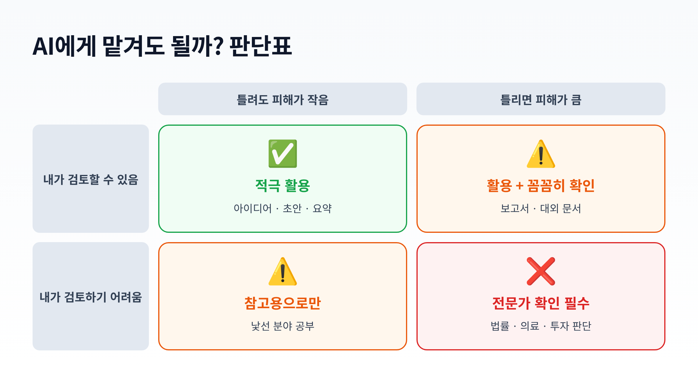

<!--
**상태**: 🔵 검토 중
**분류**: 01. AI 이해하기
**태그**: #기초
**작성일**: 2026-11-21
-->
> 📅 **최종 확인**: 2026-11-21

AI를 300% 활용하는 사람은 AI에게 **모든 일을 맡기는 사람이 아니라, 맡길 일을 잘 고르는 사람**입니다. 이 페이지에서는 AI가 강한 일과 약한 일을 나누고, 일을 맡길 때의 판단 기준을 정리합니다.

## 요약

- AI는 **글을 만들고, 바꾸고, 정리하는 일**에 매우 강합니다.
- AI는 **정확한 사실 확인, 최신 정보, 책임이 따르는 판단**에 약합니다.
- 기준: "초안과 아이디어는 AI에게, 확인과 결정은 사람에게."

## AI가 잘하는 일

| 유형 | 예시 | 왜 잘하나 |
|---|---|---|
| 초안 쓰기 | 이메일, 보고서, 기획안 첫 버전 | 수많은 글의 형식과 표현을 학습함 |
| 요약·정리 | 긴 문서 요약, 회의록 정리, 표로 바꾸기 | 주어진 글 안에서 작업하므로 정확도가 높음 |
| 다시 쓰기 | 어조 바꾸기, 쉽게 풀기, 분량 줄이기 | 같은 내용을 다른 표현으로 바꾸는 데 능숙함 |
| 아이디어 내기 | 제목 후보, 기획 아이디어, 질문 목록 | 다양한 조합을 빠르게 만들어 냄 |
| 번역·교정 | 외국어 번역, 맞춤법·문장 다듬기 | 언어 패턴에 강함 |
| 코드 작성 | 간단한 스크립트, 엑셀 수식, 오류 설명 | 코드도 학습한 "언어"의 하나 |
| 설명·학습 | 어려운 개념을 쉽게 설명, 예시 만들기 | 눈높이에 맞춰 설명을 바꿀 수 있음 |

## AI가 못하거나 조심해야 하는 일

| 유형 | 문제 | 대처 |
|---|---|---|
| 정확한 사실·수치 | 그럴듯하지만 틀린 내용을 만들 수 있음(환각) | 원문·공식 자료로 확인 |
| 최신 정보 | 학습 기준 시점 이후의 일은 모를 수 있음 | 검색 기능이 있는 도구 사용, 직접 확인 |
| 출처·인용 | 존재하지 않는 논문·기사·링크를 만들 수 있음 | 링크를 직접 열어 확인 |
| 복잡한 계산 | 긴 계산에서 실수할 수 있음 | 계산기·엑셀·코드 실행으로 확인 |
| 내 회사·내 상황 | 내가 알려 주지 않은 내부 사정은 모름 | 필요한 맥락을 직접 제공 |
| 책임이 따르는 판단 | 법률·의료·투자 판단의 최종 책임을 질 수 없음 | 참고 자료로만 쓰고 전문가 확인 |

[[TIP("주의")]]

AI는 모르는 것을 "모른다"고 말하지 않고 그럴듯하게 채워 넣는 경우가 있습니다. 자신 있는 말투는 정확하다는 뜻이 아닙니다.

[[/TIP]]

## 일을 맡길 때의 판단 기준



다음 두 가지 질문으로 일을 나누면 쉽습니다.

1. **틀렸을 때 피해가 큰가?** → 크면 AI 결과를 반드시 사람이 확인합니다.
2. **결과를 내가 검토할 수 있는가?** → 검토할 수 없는 분야라면 AI 결과를 그대로 쓰지 않습니다.

| | 틀려도 피해가 작음 | 틀리면 피해가 큼 |
|---|---|---|
| **내가 검토 가능** | ✅ 적극 활용 (아이디어, 초안, 요약) | ⚠️ 활용 + 꼼꼼히 확인 (보고서, 대외 문서) |
| **내가 검토 어려움** | ⚠️ 참고용으로만 (낯선 분야 공부) | ❌ 전문가 확인 필수 (법률, 의료, 투자) |

## 사람과 AI의 역할 나누기

```text
사람: 목표 정하기 → 맥락 알려 주기
AI:   초안 만들기 → 여러 안 제시하기
사람: 고르고 확인하기 → 최종 결정하기
```

AI는 "빠른 조수"로 쓸 때 가장 큰 효과를 냅니다. 처음부터 끝까지 맡기기보다, **시작(초안)과 중간(정리·변환)을 맡기고 끝(확인·결정)은 직접** 하는 방식이 가장 안전하고 효율적입니다.

## 실무 체크포인트

- [ ] 지금 맡기려는 일이 "만들기·바꾸기·정리하기" 유형인가
- [ ] 결과가 틀렸을 때의 피해를 생각해 봤는가
- [ ] 사실·수치·출처는 원문으로 확인할 계획이 있는가

## 관련 페이지

- 01-1. LLM은 어떻게 답을 만드는가
- 01-3. 환각과 검증하는 습관
- 📚 08-3. 결과 검증 체크리스트
