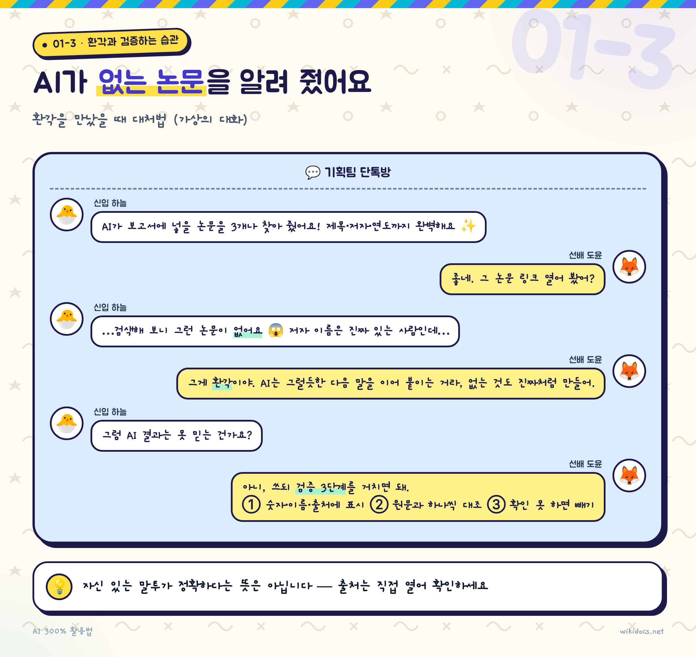
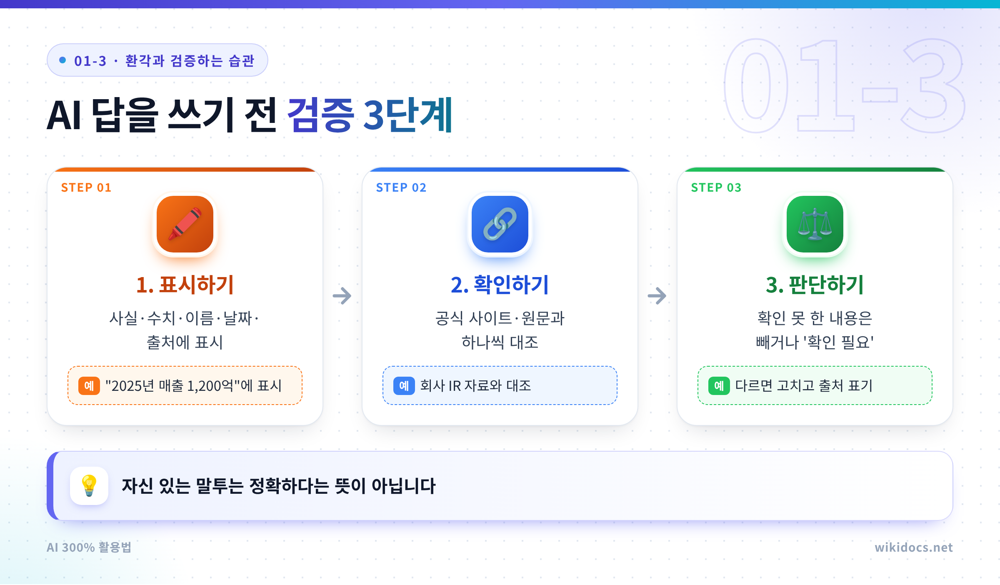

<!--
**상태**: 🔵 검토 중
**분류**: 01. AI 이해하기
**태그**: #기초 #검증
**작성일**: 2026-11-21
-->
> 📅 **최종 확인**: 2026-11-21

AI가 **사실이 아닌 내용을 사실처럼 말하는 현상**을 환각(Hallucination)이라고 합니다. 환각은 AI를 쓸 때 가장 흔하고 가장 위험한 문제입니다. 이 페이지에서는 환각이 왜 생기는지, 어떻게 줄이고 어떻게 잡아내는지 정리합니다.

## 요약

- 환각은 AI가 "그럴듯한 다음 말"을 만드는 방식에서 자연스럽게 생깁니다.
- 프롬프트로 **줄일 수는 있지만 완전히 없앨 수는 없습니다.**
- 그래서 **검증하는 습관**이 AI 활용의 기본기입니다.



## 환각은 왜 생기나

01-1에서 본 것처럼 AI는 정답을 찾아오는 것이 아니라 그럴듯한 말을 이어 붙입니다. 학습한 내용이 부족하거나 질문이 모호하면, AI는 빈자리를 **그럴듯한 내용으로 채웁니다.**

환각이 자주 나타나는 상황은 다음과 같습니다.

| 상황 | 예시 |
|---|---|
| 구체적인 수치·날짜 | 통계 수치, 법 시행일, 제품 가격 |
| 출처·인용 | 논문 제목, 기사 링크, 책의 문장 인용 |
| 잘 알려지지 않은 정보 | 작은 회사, 특정 인물, 지역 정보 |
| 최신 정보 | 학습 기준 시점 이후의 사건, 새 제도 |
| 전제가 틀린 질문 | "○○ 법 제99조 내용 알려 줘" (그런 조항이 없는데 만들어 냄) |

## 환각을 줄이는 프롬프트

**❌ 환각이 생기기 쉬운 요청**
```text
2025년 국내 생성형 AI 시장 규모를 알려 줘.
```

**✅ 환각을 줄이는 요청**
```text
아래 자료만 근거로 국내 생성형 AI 시장 규모를 정리해 줘.
자료에 없는 내용은 추측하지 말고 "자료에 없음"이라고 써 줘.
각 수치 옆에 자료의 어느 부분에서 가져왔는지 표시해 줘.

[자료]
(여기에 보고서 내용 붙여 넣기)
```

효과가 있는 방법을 정리하면 다음과 같습니다.

1. **자료를 직접 주기**: AI가 기억에 의존하지 않고 주어진 글 안에서 답하게 합니다.
2. **모르면 모른다고 하게 하기**: "확실하지 않으면 '모르겠다'고 답해 줘"를 덧붙입니다.
3. **근거를 표시하게 하기**: 어느 부분을 근거로 했는지 쓰게 하면 확인이 쉬워집니다.
4. **검색 기능이 있는 도구 쓰기**: 최신 정보는 웹 검색 결과를 근거로 답하는 도구가 유리합니다. 이때도 출처 링크를 직접 열어 확인합니다.

[[TIP("주의")]]

이 방법들은 환각을 **줄여 줄 뿐 없애지는 못합니다.** 자료를 줘도 잘못 읽거나 섞어서 답할 수 있으니, 중요한 내용은 항상 확인합니다.

[[/TIP]]

## 검증하는 습관: 3단계



AI의 답을 업무에 쓰기 전에 다음 순서로 확인합니다.

| 단계 | 확인할 것 | 방법 |
|---|---|---|
| 1. 표시하기 | 답에서 사실·수치·이름·날짜·출처에 표시 | 형광펜 치듯 확인할 대상을 먼저 고름 |
| 2. 확인하기 | 표시한 항목을 원문과 대조 | 공식 사이트, 원문 문서, 링크 직접 열기 |
| 3. 판단하기 | 확인 못 한 내용은 빼거나 "확인 필요"로 표시 | 확인 안 된 내용을 그대로 내보내지 않음 |

## AI에게 스스로 점검시키기

AI에게 자기 답을 다시 보게 하면 일부 오류를 잡을 수 있습니다.

```text
방금 답변에서 사실 확인이 필요한 문장을 모두 골라 목록으로 만들어 줘.
각 문장마다 확신 정도(높음/중간/낮음)와 확인 방법을 함께 적어 줘.
```

이 방법은 **확인할 대상을 찾는 데** 도움이 됩니다. 확인 자체는 사람이 원문으로 해야 합니다. 더 자세한 방법은 03-4에서 다룹니다.

## 직접 해 보기

1. 대화형 AI에 "**개인정보 보호법 제99조**의 내용을 알려 줘"라고 물어보세요. (실제로는 그런 조항 번호가 없을 수 있습니다) AI가 그럴듯하게 지어내는지, "확인할 수 없다"고 답하는지 확인합니다.
2. 같은 질문에 "확실하지 않으면 모른다고 답해 줘"를 덧붙여 다시 물어보고 답을 비교합니다.
3. AI가 알려 준 링크 하나를 직접 열어, 그 페이지에 정말 그 내용이 있는지 확인합니다.

## 실무 체크포인트

- [ ] 답에 수치·날짜·이름·출처가 있다면 원문으로 확인했는가
- [ ] AI가 제시한 링크를 직접 열어 봤는가
- [ ] 자료를 직접 주고 "자료에 없는 내용은 쓰지 말라"고 요청했는가
- [ ] 확인하지 못한 내용을 그대로 내보내지 않았는가

## 관련 페이지

- 01-1. LLM은 어떻게 답을 만드는가
- 01-2. AI가 잘하는 일과 못하는 일
- 📚 03-4. 스스로 검토하게 하기
- 📚 08-3. 결과 검증 체크리스트
