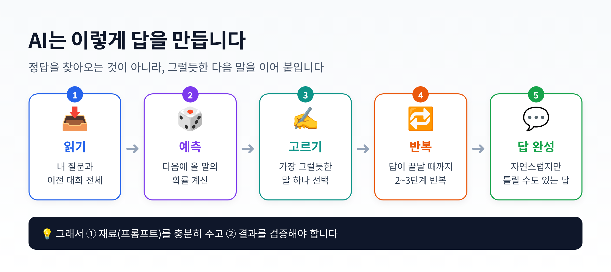

AI를 잘 쓰려면 먼저 AI가 **어떻게 답을 만드는지** 알아야 합니다. 원리를 알면 왜 어떤 요청에는 훌륭한 답이 나오고 어떤 요청에는 엉뚱한 답이 나오는지 이해할 수 있습니다.

이 장에서는 대화형 AI의 바탕인 대규모 언어 모델(LLM)의 동작 방식, AI가 잘하는 일과 못하는 일, 그리고 AI를 쓸 때 가장 조심해야 하는 환각(Hallucination)과 검증 습관을 다룹니다.

[[TIP("이 장을 읽고 나면")]]

- AI의 답이 "생각"이 아니라 "다음 단어 예측"에서 나온다는 것을 이해합니다.
- AI에게 맡길 일과 사람이 해야 할 일을 구분할 수 있습니다.
- AI의 답을 그대로 쓰기 전에 무엇을 확인해야 하는지 압니다.

[[/TIP]]

## 이 장의 구성

[[SubPages]]
