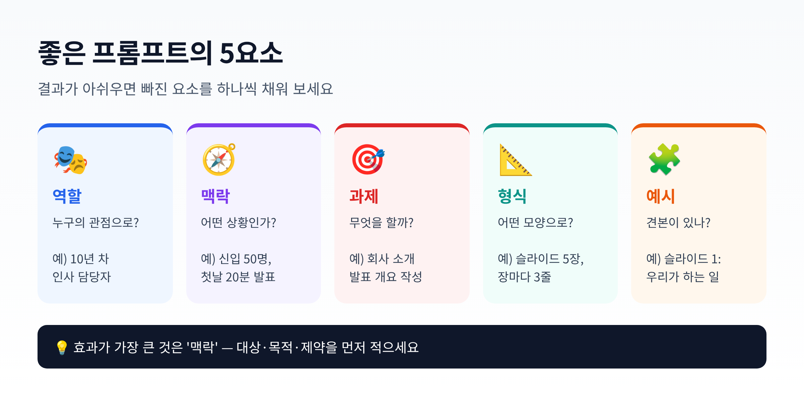

프롬프트(Prompt)는 AI에게 주는 요청문입니다. 같은 AI라도 **프롬프트를 어떻게 쓰느냐에 따라 결과의 품질이 크게 달라집니다.**

이 장에서는 누구나 바로 적용할 수 있는 프롬프트의 기본기를 다룹니다. 좋은 프롬프트의 구조인 5요소, 모호함을 없애는 구체적인 요청법, 그리고 한 번에 끝내지 않고 대화로 결과를 다듬는 방법입니다.

[[TIP("이 장을 읽고 나면")]]

- 5요소(역할·맥락·과제·형식·예시)로 프롬프트를 짤 수 있습니다.
- "알아서 잘" 대신 구체적인 조건으로 요청할 수 있습니다.
- 마음에 안 드는 결과를 처음부터 다시 쓰지 않고 대화로 고칠 수 있습니다.

[[/TIP]]

## 이 장의 구성

[[SubPages]]
