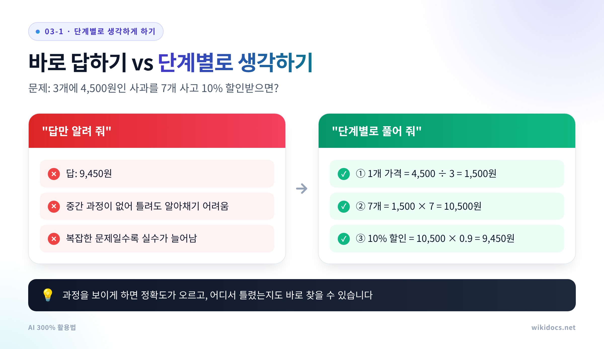

<!--
**상태**: 🔵 검토 중
**분류**: 03. 프롬프트 고급
**태그**: #프롬프트 #고급
**작성일**: 2026-11-22
-->
> 📅 **최종 확인**: 2026-11-22

계산, 비교, 판단처럼 여러 단계를 거쳐야 하는 문제는 AI에게 **바로 답하게 하는 것보다 단계별로 생각하게 할 때** 정확도가 올라갑니다. 사람도 암산보다 종이에 풀어 쓸 때 실수가 적은 것과 같습니다.

## 요약

- 여러 단계가 필요한 문제는 "**단계별로 풀어 줘**"라고 요청합니다.
- 단계를 **직접 정해 주면** 더 정확하고, 결과를 검토하기도 쉽습니다.
- 최근 많은 AI 도구에는 스스로 오래 생각하는 **추론 모드**가 있습니다. 복잡한 문제에는 이 모드를 켜는 것도 방법입니다.

## 바로 답하기 vs 단계별로 생각하기



## 세 가지 방법

| 방법 | 프롬프트 예 | 언제 |
|---|---|---|
| 단계별로 생각하라고 요청 | "답하기 전에 단계별로 생각해 줘" | 가볍게 정확도를 높이고 싶을 때 |
| 단계를 직접 지정 | "① 조건 정리 ② 계산 ③ 검산 순서로" | 절차가 정해진 업무 |
| 생각과 답을 분리 | "풀이는 [풀이]에, 최종 답은 [답]에" | 결과만 따로 쓰거나 자동화할 때 |

## 예시 1: 업무 판단

**❌ 바로 답하게 하면**
```text
A안과 B안 중 어느 쪽이 나아?
```

**✅ 단계를 지정하면**
```text
신규 협업 도구 도입안 A와 B를 비교해 결정을 도와줘. 아래 순서로 생각해 줘.

① 우리 상황 정리: 팀원 25명, 월 예산 50만 원, 기존 메신저와 연동 필수
② 평가 기준 정하기: 비용, 연동, 사용 난이도, 보안 (중요도 순서도 제안)
③ 기준별로 A와 B 비교 (표)
④ 결론과 그 이유 3가지
⑤ 결론이 바뀔 수 있는 조건 (예: 예산이 늘면)

[A안] 월 1인 18,000원, 메신저 연동 지원, 관리자 기능 강함
[B안] 월 1인 15,000원, 연동은 별도 개발 필요, 화면이 단순
```

⑤번처럼 **결론이 바뀌는 조건**을 묻는 것이 핵심입니다. AI의 결론을 그대로 따르지 않고, 내가 판단할 수 있는 재료를 얻게 됩니다.

## 예시 2: 생각과 답 분리

```text
아래 고객 문의가 환불 대상인지 판단해 줘.
<풀이> 안에 환불 규정의 어느 조항에 해당하는지 단계별로 쓰고,
<답> 안에는 "환불 가능", "환불 불가", "담당자 확인 필요" 중 하나만 써 줘.

[환불 규정]
1. 구매 후 7일 이내, 미개봉 상품은 전액 환불
2. 개봉 상품은 제품 불량일 때만 환불
3. 할인 행사 상품은 교환만 가능

[문의]
"5일 전에 행사 기간에 산 이어폰인데, 한쪽 소리가 안 나요."
```

예상되는 풀이 흐름: 구매 5일 차(1조 기간 내) → 개봉했지만 불량 주장(2조) → 행사 상품(3조와 충돌) → 규정 간 충돌이 있으므로 **"담당자 확인 필요"**. 이처럼 규정끼리 부딪히는 경우를 AI가 스스로 드러내게 할 수 있습니다.

[[TIP("요령")]]

단계별 풀이는 길어지므로, 결과만 필요한 자동화 업무에서는 **<답> 부분만 꺼내 쓰도록** 형식을 나눠 두세요. 사람이 검토할 때는 <풀이>를 보고 어디서 판단이 갈렸는지 확인합니다.

[[/TIP]]

## 자주 하는 실수

| 실수 | 바로잡기 |
|---|---|
| 단순한 질문에도 단계별 풀이를 요구 | 짧은 사실 질문은 그냥 묻기. 답이 길어지고 느려질 뿐 |
| 풀이가 그럴듯하니 답도 맞다고 믿음 | 풀이 속 숫자·조건을 직접 확인. 과정도 틀릴 수 있음 |
| 계산을 AI 머릿속에만 맡김 | 중요한 계산은 계산기·엑셀로 검산 |

## 실무 체크포인트

- [ ] 여러 단계가 필요한 문제에 단계별 풀이를 요청했는가
- [ ] 반복되는 업무는 단계를 직접 지정했는가
- [ ] 결론이 바뀌는 조건까지 물어봤는가
- [ ] 중요한 숫자는 따로 검산했는가

## 관련 페이지

- 03-4. 스스로 검토하게 하기
- 03-5. 단계를 나눠 연결하기
- 📚 01-3. 환각과 검증하는 습관
