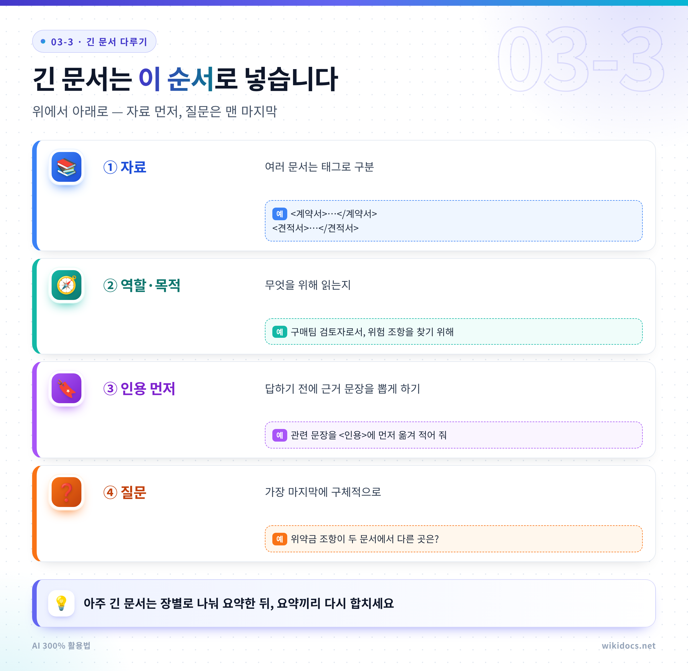

<!--
**상태**: 🔵 검토 중
**분류**: 03. 프롬프트 고급
**태그**: #프롬프트 #고급
**작성일**: 2026-11-22
-->
> 📅 **최종 확인**: 2026-11-24

보고서, 계약서, 회의록처럼 긴 문서를 AI에 넣을 때는 짧은 질문과 다른 요령이 필요합니다. 문서가 길수록 AI가 **중요한 부분을 놓치거나, 문서에 없는 내용을 섞을 위험**이 커지기 때문입니다.

## 요약

- **자료는 위에, 질문은 아래에** 둡니다.
- 답하기 전에 **관련 부분을 먼저 인용**하게 하면 정확도가 올라갑니다.
- 문서가 여러 개면 **태그로 구분**하고, 아주 길면 **나눠서 처리**합니다.



## 요령 1: 자료는 위, 질문은 아래

```text
<문서>
(긴 보고서 전체)
</문서>

위 문서를 바탕으로 다음 질문에 답해 줘.
질문: 2분기 매출이 줄어든 원인으로 문서가 제시한 것은 무엇인가?
```

긴 문서 뒤에 질문을 두면 AI가 질문을 정확히 기억한 채로 답합니다.

## 요령 2: 먼저 인용하고 답하기

```text
<계약서>
(계약서 전문)
</계약서>

아래 순서로 답해 줘.
1. <인용> 안에 질문과 관련된 조항을 원문 그대로 옮겨 적기 (조항 번호 포함)
2. <답> 안에 인용한 조항만 근거로 답하기
3. 관련 조항이 없으면 "계약서에 해당 내용 없음"이라고 쓰기

질문: 계약 기간 중 해지하면 위약금이 있나?
```

**결과 예시** (설명용)
```text
<인용>
제12조 2항: "계약 기간 중 을의 사정으로 해지하는 경우, 잔여 기간 이용료의 20%를 위약금으로 지급한다."
</인용>
<답>
네, 있습니다. 고객(을) 사정으로 해지하면 남은 기간 이용료의 20%를 위약금으로 내야 합니다 (제12조 2항).
</답>
```

인용을 먼저 하게 하면 ① AI가 관련 부분에 집중하고 ② 사람은 **인용문만 원문과 대조**하면 되므로 검토가 빨라집니다.

## 요령 3: 여러 문서는 태그로 구분

```text
<문서1 제목="2025년 사업계획">
...
</문서1>
<문서2 제목="2026년 사업계획">
...
</문서2>

두 문서의 목표 매출, 주력 사업, 인력 계획을 비교해 표로 만들어 줘.
각 칸에 어느 문서의 몇 번째 문단에서 가져왔는지 표시해 줘.
```

## 요령 4: 아주 긴 문서는 나눠서

AI가 한 번에 읽을 수 있는 분량(컨텍스트 창)을 넘거나, 한 번에 넣었더니 결과가 부실하면 나눠서 처리합니다.

```text
1단계: 장(章)별로 하나씩 넣고 "이 부분의 핵심 5줄 + 중요한 숫자"를 요약
2단계: 장별 요약을 모아서 넣고 "전체 요약과 장 사이의 연결"을 정리
3단계: 궁금한 부분은 해당 장 원문을 다시 넣고 자세히 질문
```

[[TIP("요령: 문서 전용 도구도 고려하기")]]

자주 여러 문서를 오가며 질문해야 한다면, 자료를 올려 두고 그 안에서만 답하는 **문서·노트 AI**(05-3)나 대화형 AI의 **프로젝트** 기능이 편합니다. 매번 문서를 붙여 넣지 않아도 됩니다.

[[/TIP]]

## 자주 하는 실수

| 실수 | 결과 | 바로잡기 |
|---|---|---|
| "이 문서 요약해 줘"만 요청 | 누구를 위한 요약인지 몰라 밋밋함 | 독자·목적·분량 지정 |
| 스캔 PDF를 그대로 넣음 | 표·숫자를 잘못 읽음 | 중요한 숫자는 원문과 대조 |
| 문서에 없는 내용도 물어봄 | 그럴듯하게 지어냄 | "문서에 없으면 없다고 답해" |

## 실무 체크포인트

- [ ] 자료를 먼저, 질문을 마지막에 두었는가
- [ ] 관련 부분을 먼저 인용하게 했는가
- [ ] 여러 문서를 태그로 구분했는가
- [ ] 너무 길면 나눠서 처리했는가

## 관련 페이지

- 03-4. 스스로 검토하게 하기
- 📚 04-2. 문서·회의 요약 레시피
- 📚 05-3. 문서·노트 AI
