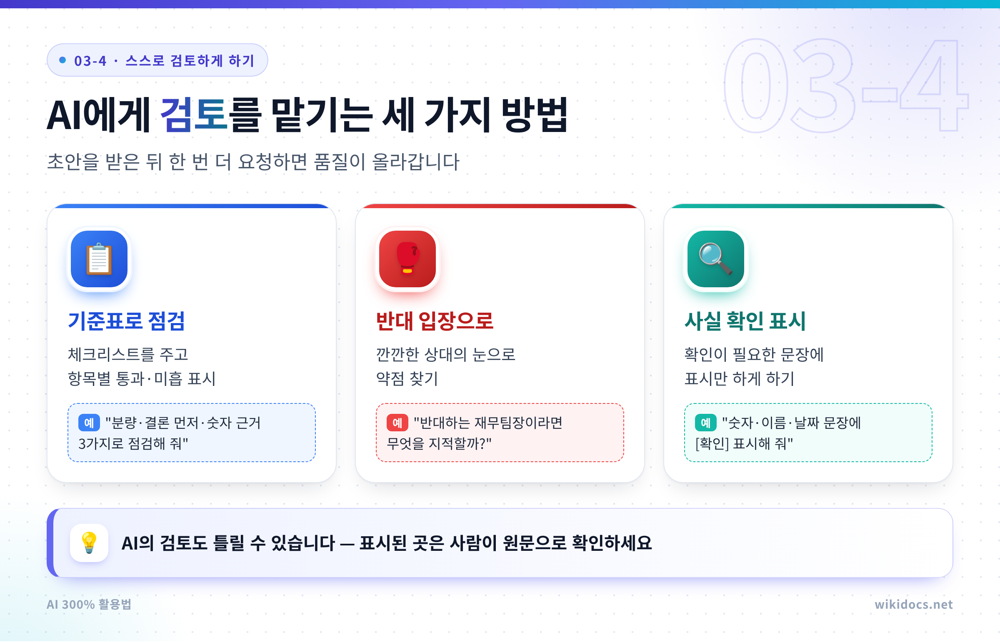

<!--
**상태**: 🔵 검토 중
**분류**: 03. 프롬프트 고급
**태그**: #프롬프트 #고급 #검증
**작성일**: 2026-11-22
-->
> 📅 **최종 확인**: 2026-11-24

AI의 첫 결과를 그대로 쓰기보다, **AI에게 자기 결과를 다시 검토하게 하면** 놓친 부분과 실수를 상당수 찾아낼 수 있습니다. 사람이 쓴 글을 다른 사람이 교정하듯, AI에게 "검토자" 역할을 맡기는 방법입니다.

## 요약

- 결과를 받은 뒤 **검토 기준을 주고 다시 점검**하게 합니다.
- "괜찮아?"보다 **"문제점 3가지를 찾아 줘"**처럼 구체적으로 물어야 효과가 있습니다.
- 자기 검토도 완벽하지 않습니다. **사실 확인은 사람이** 합니다.



## 검토를 요청하는 세 가지 방법

| 방법 | 프롬프트 | 효과 |
|---|---|---|
| 기준표로 점검 | "아래 기준으로 점수를 매기고 부족한 점을 고쳐 줘" | 빠뜨린 요소 발견 |
| 반대 입장 검토 | "까다로운 상사 입장에서 반박해 줘" | 논리의 빈틈 발견 |
| 사실 확인 대상 표시 | "확인이 필요한 문장을 골라 줘" | 검증 범위 축소 |

## 예시 1: 기준표로 점검

```text
방금 쓴 제안서 초안을 아래 기준으로 검토해 줘.

[검토 기준]
1. 첫 문단만 읽어도 무엇을 제안하는지 알 수 있는가
2. 제안의 근거가 숫자나 사례로 뒷받침되는가
3. 예상 비용과 기간이 있는가
4. 반대 의견에 대한 대응이 있는가
5. 다음 행동(결정 요청)이 분명한가

기준마다 ○/△/× 로 평가하고, △와 ×인 부분만 고친 수정본을 보여 줘.
```

**결과 예시** (설명용)

| 기준 | 평가 | 이유 |
|---|---|---|
| 1. 첫 문단 | ○ | 제안 내용이 첫 문장에 있음 |
| 2. 근거 | △ | 효과 수치가 없음 |
| 3. 비용·기간 | × | 언급 없음 |
| 4. 반대 의견 | × | 언급 없음 |
| 5. 다음 행동 | ○ | 결정 요청 있음 |

→ 2, 3, 4번을 보완한 수정본

## 예시 2: 반대 입장으로 검토

```text
너는 비용에 매우 엄격한 재무팀장이야.
아래 제안서를 읽고 결재를 거절할 만한 이유 3가지를 날카롭게 지적해 줘.
그다음, 각 지적에 대한 대응 방안을 제안서 작성자 입장에서 써 줘.

[제안서]
(초안 붙여 넣기)
```

보고 전에 예상 질문과 답을 미리 준비하는 데 특히 유용합니다.

## 예시 3: 사실 확인 대상 표시

```text
방금 답변에서 사실 확인이 필요한 문장을 모두 골라 표로 정리해 줘.
| 문장 | 확인할 내용 | 확신 정도(높음/중간/낮음) | 확인 방법 |
```

[[TIP("요령: 새 대화에서 검토하기")]]

같은 대화 안에서 검토를 시키면 AI가 자기가 쓴 글을 감싸는 경향이 있습니다. 중요한 글은 **새 대화를 열어** "다음 글을 검토해 줘"라고 처음 보는 글처럼 맡기면 더 객관적인 지적을 받을 수 있습니다.

[[/TIP]]

## 자주 하는 실수

| 실수 | 바로잡기 |
|---|---|
| "괜찮아?"라고만 물음 → "네, 좋습니다" | "문제점 3가지", "기준별 평가"처럼 구체적으로 |
| 자기 검토 결과를 사실 확인으로 착각 | 숫자·출처는 원문으로 직접 확인 |
| 검토 의견을 모두 반영 | 내 판단으로 필요한 것만 반영 |

## 실무 체크포인트

- [ ] 중요한 결과물은 검토 기준을 주고 다시 점검시켰는가
- [ ] 반대 입장의 검토를 받아 봤는가
- [ ] 사실 확인이 필요한 문장을 따로 표시하게 했는가

## 관련 페이지

- 03-1. 단계별로 생각하게 하기
- 📚 01-3. 환각과 검증하는 습관
- 📚 08-3. 결과 검증 체크리스트
