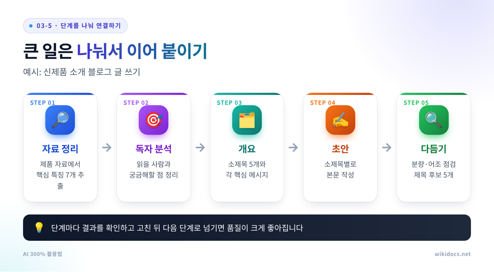

<!--
**상태**: 🔵 검토 중
**분류**: 03. 프롬프트 고급
**태그**: #프롬프트 #고급
**작성일**: 2026-11-22
-->
> 📅 **최종 확인**: 2026-11-22

큰 일을 한 번의 프롬프트로 맡기면 결과가 평범해지기 쉽습니다. **일을 여러 단계로 나누고, 앞 단계의 결과를 다음 단계의 입력으로** 이어 붙이면 단계마다 확인하고 고칠 수 있어 품질이 크게 올라갑니다. 이 방법을 프롬프트 체이닝(Prompt Chaining)이라고 합니다.

## 요약

- 큰 일을 **3~6단계**로 나눕니다.
- 각 단계의 결과를 **확인하고 고친 뒤** 다음 단계로 넘깁니다.
- 단계별 프롬프트를 저장해 두면 **다음에 그대로 재사용**할 수 있습니다.

## 큰 일은 나눠서 이어 붙이기



## 예시: 신제품 소개 블로그 글

**한 번에 요청하면**
```text
신제품 소개 블로그 글 써 줘.
```
→ 어디서 본 듯한 평범한 글이 나오고, 어디를 고쳐야 할지도 막막합니다.

**단계를 나누면**

```text
[1단계: 자료 정리]
아래 제품 자료에서 고객에게 중요한 특징 7개를 뽑아 줘.
각 특징마다 "고객이 얻는 이익"을 한 줄로 바꿔 써 줘.
(제품 자료 붙여 넣기)
```
→ 결과를 보고 빼거나 순서를 바꿉니다.

```text
[2단계: 독자 분석]
이 글의 독자는 "회의 일정을 엑셀로 관리하는 10~30명 규모 회사의 팀장"이야.
이 독자가 위 특징 중 가장 궁금해할 3가지와, 도입을 망설이는 이유 3가지를 정리해 줘.
```

```text
[3단계: 개요]
1~2단계 결과를 바탕으로 블로그 글 개요를 만들어 줘.
소제목 5개, 소제목마다 핵심 메시지 한 줄. 망설이는 이유에 답하는 소제목을 꼭 넣어 줘.
```
→ 개요를 확정합니다. **이 단계에서 고치는 것이 가장 효율적**입니다.

```text
[4단계: 초안]
확정한 개요로 본문을 써 줘. 소제목마다 3~4문장, 친근한 존댓말, 전체 1,500자 안팎.
```

```text
[5단계: 다듬기]
초안에서 ① 너무 긴 문장을 나누고 ② 같은 표현 반복을 줄이고
③ 클릭하고 싶은 제목 후보 5개를 만들어 줘.
```

## 단계를 나누는 기준

| 기준 | 예 |
|---|---|
| 성격이 다른 일은 나눈다 | 조사 / 분석 / 작성 / 교정 |
| 사람이 판단해야 하는 지점에서 끊는다 | 개요 확정, 방향 선택 |
| 한 단계의 결과가 한 화면에 들어오게 한다 | 너무 길면 더 쪼갬 |

[[TIP("요령: 단계별 프롬프트를 레시피로 저장")]]

잘 된 단계별 프롬프트는 메모장이나 대화형 AI의 **프로젝트 지침**에 저장해 두세요. 다음에는 1단계 자료만 바꿔 넣으면 같은 품질의 결과를 빠르게 얻을 수 있습니다. 04장의 레시피가 바로 이런 방식으로 만든 것입니다.

[[/TIP]]

## 실무 체크포인트

- [ ] 큰 일을 성격별로 3~6단계로 나눴는가
- [ ] 사람이 판단해야 하는 지점(개요 등)에서 결과를 확인했는가
- [ ] 잘 된 단계별 프롬프트를 저장했는가

## 관련 페이지

- 03-1. 단계별로 생각하게 하기
- 📚 04-1. 보고서·이메일 쓰기 레시피
- 📚 06-1. 리서치 → 정리 → 발행
