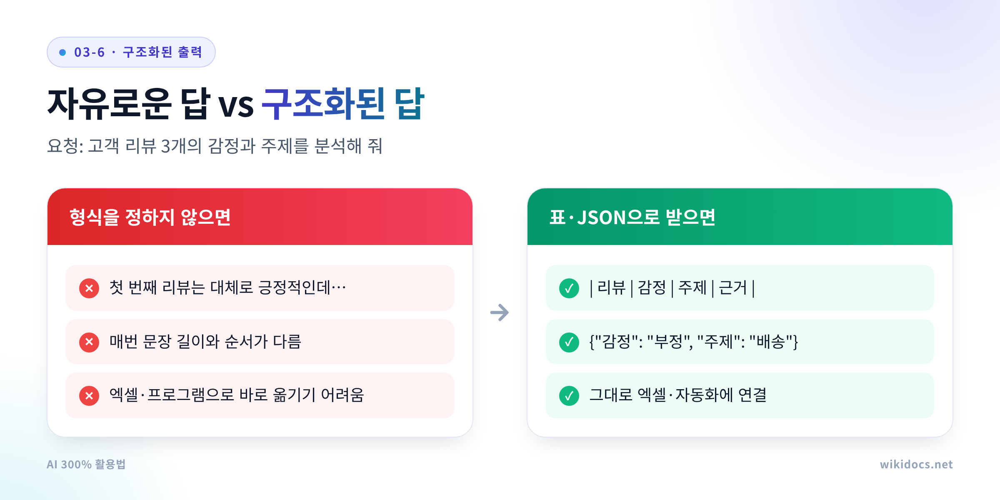

<!--
**상태**: 🔵 검토 중
**분류**: 03. 프롬프트 고급
**태그**: #프롬프트 #고급
**작성일**: 2026-11-22
-->
> 📅 **최종 확인**: 2026-11-22

AI의 답을 엑셀에 붙이거나 다른 프로그램에 넘기려면, 매번 모양이 다른 문장보다 **정해진 형식(표, 목록, JSON)**이 훨씬 편합니다. 형식을 정해 주면 결과를 비교하기도 쉽고, 자동화로 이어 붙이기도 쉽습니다.

## 요약

- 결과의 **형식을 먼저 정해** 주면 매번 같은 모양으로 받을 수 있습니다.
- 사람이 볼 결과는 **표**, 프로그램이 쓸 결과는 **JSON**이 좋습니다.
- 칸마다 **허용하는 값**을 정해 두면 결과가 흔들리지 않습니다.

## 자유로운 답 vs 구조화된 답



## 예시 1: 표로 받기

```text
아래 고객 리뷰 3개를 분석해 표로 정리해 줘.

| 번호 | 감정(긍정/부정/중립) | 주제(제품/배송/가격/서비스) | 핵심 내용(15자 이내) | 근거 문장 |

[리뷰]
1. "디자인은 예쁜데 배송이 일주일이나 걸렸어요."
2. "가격 대비 성능 최고! 재구매 의사 있어요."
3. "문의했는데 답이 없네요."
```

**결과 예시** (설명용)

| 번호 | 감정 | 주제 | 핵심 내용 | 근거 문장 |
|---|---|---|---|---|
| 1 | 중립 | 배송 | 디자인 만족, 배송 지연 | "배송이 일주일이나 걸렸어요" |
| 2 | 긍정 | 가격 | 가성비 만족, 재구매 | "가격 대비 성능 최고" |
| 3 | 부정 | 서비스 | 문의 무응답 | "답이 없네요" |

감정·주제 칸에 **고를 수 있는 값을 괄호로 정해 둔 것**이 핵심입니다. 그렇지 않으면 "약간 부정", "배송 관련" 같은 제각각의 값이 나옵니다.

## 예시 2: JSON으로 받기

자동화 도구(05-6)나 프로그램에 넘길 때는 JSON이 편합니다.

```text
아래 이메일에서 회의 일정을 뽑아 JSON으로만 답해 줘. 설명 문장은 쓰지 마.
날짜는 YYYY-MM-DD, 시간은 24시간제 HH:MM으로.
정보가 없으면 null.

{"제목": "", "날짜": "", "시작": "", "종료": "", "장소": "", "참석자": []}

[이메일]
다음 주 수요일(11/25) 오후 2시부터 3시 반까지 3층 회의실에서
신제품 출시 회의가 있습니다. 김팀장님, 박대리님 참석 부탁드립니다.
```

**결과 예시** (설명용)
```json
{"제목": "신제품 출시 회의", "날짜": "2025-11-25", "시작": "14:00", "종료": "15:30",
 "장소": "3층 회의실", "참석자": ["김팀장", "박대리"]}
```

[[TIP("주의: 날짜의 연도")]]

위 결과 예시처럼 이메일에 연도가 없으면 AI가 **연도를 추측**합니다. 실제로 틀린 연도가 들어가는 경우가 많으니, 프롬프트에 "오늘은 2026-11-22이야"처럼 기준 날짜를 알려 주세요.

[[/TIP]]

## 형식별 추천 용도

| 형식 | 장점 | 추천 용도 |
|---|---|---|
| 표 | 한눈에 비교 | 보고서, 비교 분석, 엑셀 붙여넣기 |
| 번호 목록 | 순서가 분명 | 절차, 할 일 |
| JSON | 프로그램이 바로 읽음 | 자동화, 데이터 처리 |
| 정해진 템플릿 | 문서 양식 통일 | 회의록, 주간 보고 |

일부 AI 서비스와 API에는 답을 **정해진 JSON 형식으로만 내도록 강제하는 기능**이 있습니다. 자동화에서 형식 오류가 자주 나면 이 기능을 확인해 보세요.

## 실무 체크포인트

- [ ] 결과의 형식(표·JSON·템플릿)을 먼저 정했는가
- [ ] 칸마다 허용하는 값을 정해 주었는가
- [ ] 날짜·단위 등 기준을 명시했는가
- [ ] 정보가 없을 때의 표시 방법(null, "없음")을 정했는가

## 관련 페이지

- 03-2. 예시로 가르치기
- 📚 04-4. 데이터 분석 레시피
- 📚 05-6. 업무 자동화 도구
- 📚 『LLM × 온톨로지』 05-1. 스키마 기반 정보 추출
