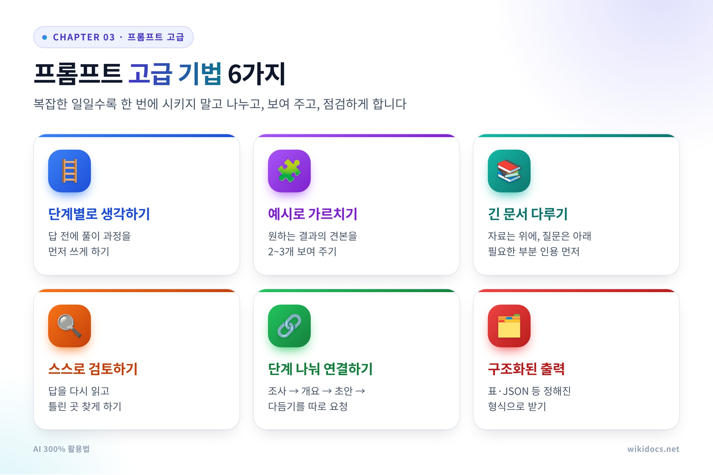

복잡한 과제에서 정확도와 품질을 끌어올리는 기법입니다.

[[TIP("이 장을 읽고 나면")]]

- 복잡한 문제를 단계별로 풀게 해 정확도를 높일 수 있습니다.
- 예시와 형식을 주어 매번 같은 품질의 결과를 받을 수 있습니다.
- 큰 일을 나눠 이어 붙이고, AI에게 스스로 검토하게 할 수 있습니다.

[[/TIP]]

## 이 장의 구성

- 03-1. 단계별로 생각하게 하기
- 03-2. 예시로 가르치기
- 03-3. 긴 문서 다루기
- 03-4. 스스로 검토하게 하기
- 03-5. 단계를 나눠 연결하기
- 03-6. 표·JSON 등 구조화된 출력 받기
