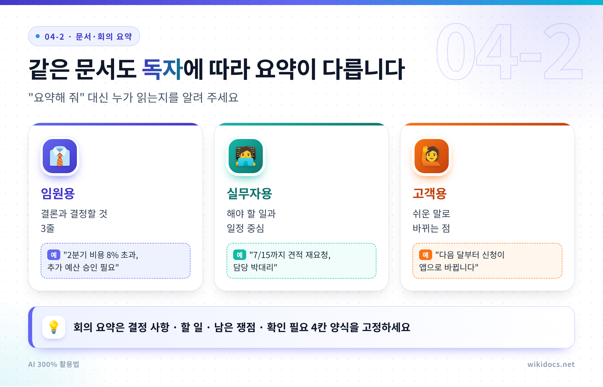

<!--
**상태**: 🔵 검토 중
**분류**: 04. 업무별 프롬프트 레시피
**태그**: #레시피 #요약
**작성일**: 2026-11-22
-->
> 📅 **최종 확인**: 2026-11-24 · 🧪 **마지막 테스트**: 미실시 · **테스트 도구**: —

## 이럴 때 쓰세요

- 긴 보고서·기사·논문의 핵심만 빨리 파악하고 싶을 때
- 회의 메모나 녹취록에서 **결정 사항과 할 일**을 뽑을 때
- 같은 내용을 **읽는 사람에 맞게** 다른 길이로 요약할 때

## 효과

| | AI 없이 | AI 활용 (예상) |
|---|---|---|
| 소요 시간 | 30쪽 보고서 정독 1시간, 회의록 정리 30분 | 핵심 파악 10분, 회의록 5분 (원문 확인 포함) |
| 결과물 | 요약하는 사람마다 관점이 다름 | 정해진 틀로 일관된 요약 |



## 프롬프트 A: 독자 맞춤 요약

```text
아래 문서를 ______(읽을 사람)를 위해 요약해 줘.
- 이 사람이 알고 싶은 것: ______
- 분량: ______ (예: 3줄 / 1문단 / 1쪽)
- 형식: 결론 먼저, 근거는 숫자 중심으로
- 문서에 없는 내용은 쓰지 말고, 중요한 숫자에는 문서 속 위치(쪽·문단)를 붙여 줘.

<문서>
______
</문서>
```

## 프롬프트 B: 회의록 정리

```text
아래 회의 메모를 정리해 줘.
1. 회의 목적 (1줄)
2. 결정된 사항 (번호 목록)
3. 할 일: | 할 일 | 담당자 | 마감일 | (메모에 없으면 "미정")
4. 결정되지 않고 남은 쟁점
5. 다음 회의 안건 제안

<회의 메모>
______
</회의 메모>
```

## 입력 예시 (프롬프트 B)

```text
<회의 메모>
11/20 주간회의. 참석: 김팀장, 이과장, 박대리, 최사원
- 신규 앱 출시 12/10 → 테스트 부족해서 12/17로 미루자는 의견. 김팀장 동의. 확정.
- 출시 홍보 영상 외주 견적 2곳 받음. A사 300, B사 450. 이과장이 A사 포트폴리오 더 보고 금요일까지 결정
- 고객센터 FAQ 업데이트 필요. 박대리 담당. 언제까지?
- 앱 아이콘 디자인 아직 의견 갈림. 다음 주 다시 논의
</회의 메모>
```

## 결과 예시

설명을 위해 작성한 예시입니다.

```text
1. 회의 목적: 신규 앱 출시 준비 상황 점검

2. 결정 사항
   ① 출시일을 12/10에서 12/17로 연기 (테스트 기간 확보)

3. 할 일
| 할 일 | 담당자 | 마감일 |
|---|---|---|
| 홍보 영상 외주사 결정 (A사 포트폴리오 추가 검토) | 이과장 | 11/21(금) |
| 고객센터 FAQ 업데이트 | 박대리 | 미정 |

4. 남은 쟁점
   - 앱 아이콘 디자인 (의견 갈림)
   - FAQ 업데이트 마감일

5. 다음 회의 안건: 앱 아이콘 디자인 결정, FAQ 일정 확정, 외주사 결정 결과 공유
```

## 더 잘 쓰는 팁

- "요약해 줘"보다 **"누가, 무엇을 알고 싶은지"**를 알려 주면 요약의 초점이 정확해집니다.
- 같은 문서를 **임원용 3줄 / 실무자용 1쪽**으로 동시에 요청하면 보고 자료를 한 번에 준비할 수 있습니다.
- 메모에 마감일이 없으면 AI가 지어낼 수 있습니다. **"없으면 미정"**이라고 꼭 적어 주세요.

## 주의할 점

- 개인정보·회사 기밀은 입력하지 않습니다 (가명처리 후 사용).
- 요약은 원문의 뉘앙스를 놓칠 수 있습니다. 중요한 결정 사항은 원문과 대조합니다.
- 녹음 파일을 쓸 때는 참석자 동의를 받습니다.

## 관련 페이지

- 04-1. 보고서·이메일 쓰기
- 📚 03-3. 긴 문서 다루기
- 📚 06-3. 회의 녹음 → 요약 → 할 일 정리
