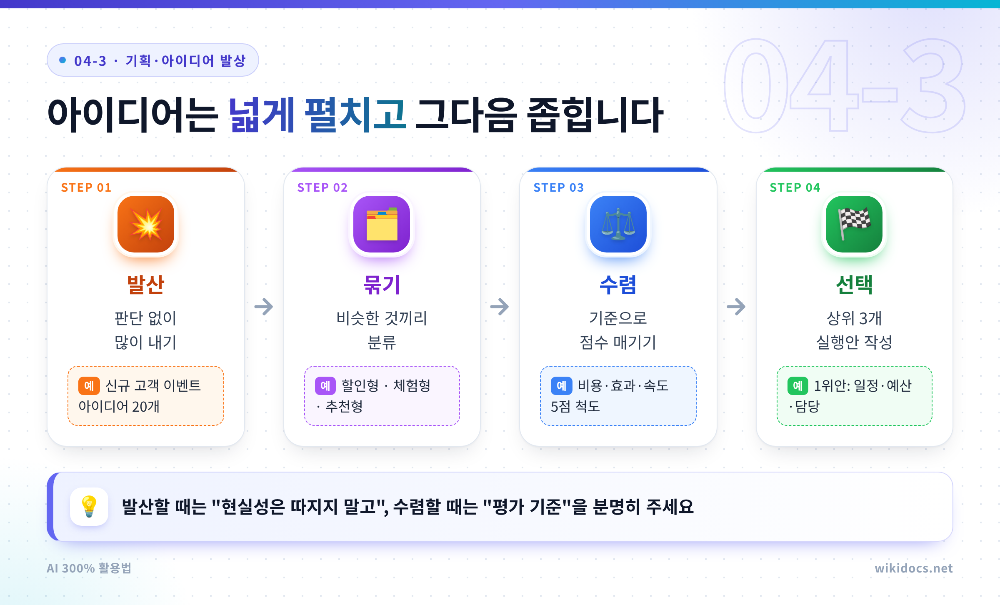

<!--
**상태**: 🔵 검토 중
**분류**: 04. 업무별 프롬프트 레시피
**태그**: #레시피 #기획
**작성일**: 2026-11-22
-->
> 📅 **최종 확인**: 2026-11-24 · 🧪 **마지막 테스트**: 미실시 · **테스트 도구**: —

## 이럴 때 쓰세요

- 새 기획의 아이디어를 **많이, 빠르게** 뽑아야 할 때
- 떠오른 아이디어를 **기준에 따라 골라내고** 다듬을 때
- 기획안의 빈틈을 미리 점검하고 싶을 때

## 효과

| | AI 없이 | AI 활용 (예상) |
|---|---|---|
| 소요 시간 | 아이디어 회의 1~2시간 | 후보 30개 + 평가표 20분 |
| 결과물 | 익숙한 아이디어 위주 | 다양한 관점의 후보, 평가 근거 정리 |



## 프롬프트: 발산 → 수렴 2단계

**1단계: 아이디어 많이 뽑기**

```text
[맥락] 우리는 ______(회사/팀)이고, 목표는 ______야.
       대상 고객: ______ / 예산: ______ / 기간: ______
[과제] 목표를 이룰 아이디어를 20개 뽑아 줘.
[조건] - 평범한 것 10개, 과감한 것 10개로 나눠 줘
       - 아이디어마다 한 줄 설명
       - 서로 비슷한 아이디어는 하나로 합쳐 줘
```

**2단계: 기준으로 고르기**

```text
위 아이디어를 아래 기준으로 평가해 표로 만들어 줘. 각 1~5점.
| 아이디어 | 효과 | 비용(낮을수록 높은 점수) | 실행 난이도(쉬울수록 높은 점수) | 차별성 | 합계 |
합계 상위 3개는 실행 계획 초안(첫 2주 할 일, 필요한 사람, 성공 지표)을 써 줘.
```

## 입력 예시

```text
[맥락] 우리는 동네 독립 서점이고, 목표는 평일 오후 방문객을 30% 늘리는 거야.
       대상 고객: 근처 직장인과 대학생 / 예산: 월 100만 원 / 기간: 3개월
```

## 결과 예시

설명을 위해 작성한 예시입니다 (2단계 평가 일부).

| 아이디어 | 효과 | 비용 | 난이도 | 차별성 | 합계 |
|---|---|---|---|---|---|
| 점심시간 30분 '책 한 챕터 읽기' 모임 | 4 | 5 | 4 | 4 | 17 |
| 대학 과제용 조용한 좌석 유료 예약 | 4 | 4 | 3 | 3 | 14 |
| 직장인 퇴근 전 '오늘의 한 문장' 엽서 증정 | 3 | 5 | 5 | 3 | 16 |
| 작가 초청 북토크 (월 1회) | 5 | 2 | 2 | 4 | 13 |

**1위 실행 계획 예:** 첫 2주에 근처 회사 3곳에 안내문 배포, 진행자 1명(사장), 성공 지표: 모임 참가자 주 15명 이상

## 더 잘 쓰는 팁

- 처음부터 "좋은 아이디어"를 요구하면 무난한 것만 나옵니다. **발산(많이)과 수렴(고르기)을 나누세요.**
- 평가 기준과 점수는 **내가 고치는 것**이 핵심입니다. AI의 점수는 출발점일 뿐입니다.
- "이 기획이 실패한다면 이유는?"이라고 물으면(사전 부검) 빈틈을 미리 찾을 수 있습니다.

## 주의할 점

- 개인정보·회사 기밀은 입력하지 않습니다 (가명처리 후 사용).
- 시장 규모·통계 같은 숫자는 AI가 지어낼 수 있으니 검색형 AI나 공식 자료로 확인합니다.
- 다른 회사의 상표·캐릭터를 흉내 낸 아이디어는 쓰지 않습니다.

## 관련 페이지

- 04-1. 보고서·이메일 쓰기
- 📚 03-4. 스스로 검토하게 하기
- 📚 05-2. 검색·리서치 AI
