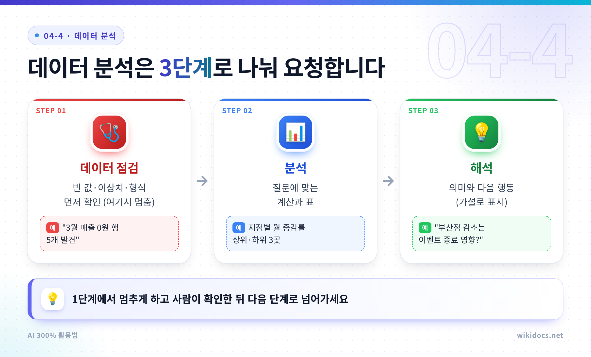

<!--
**상태**: 🔵 검토 중
**분류**: 04. 업무별 프롬프트 레시피
**태그**: #레시피 #분석
**작성일**: 2026-11-22
-->
> 📅 **최종 확인**: 2026-11-24 · 🧪 **마지막 테스트**: 미실시 · **테스트 도구**: —

## 이럴 때 쓰세요

- 엑셀·CSV 데이터를 올려 **흐름과 특이점**을 빠르게 파악하고 싶을 때
- 분석 결과를 **보고용 문장과 차트**로 바꿀 때
- 어떤 분석을 해야 할지부터 막막할 때

## 효과

| | AI 없이 | AI 활용 (예상) |
|---|---|---|
| 소요 시간 | 피벗·차트 작성 1~2시간 | 탐색 분석 15분 + 확인 15분 |
| 결과물 | 익숙한 분석만 반복 | 다양한 관점 제안, 보고 문장까지 |



## 프롬프트: 3단계 분석

```text
첨부한 파일은 ______ 데이터야. 각 열의 뜻: ______
분석 목적: ______

아래 순서로 진행해 줘.
1. 데이터 점검: 행·열 수, 빈 값, 이상해 보이는 값을 먼저 알려 줘. (분석 전에 나에게 확인받기)
2. 분석: 목적에 맞는 분석 3가지를 제안하고, 내가 고른 것을 실행해 줘.
   계산은 반드시 코드나 수식으로 해서 결과를 보여 줘.
3. 정리: 핵심 발견 3가지를 숫자와 함께, 그리고 보고용 차트 1개.
추정이나 해석은 "추정"이라고 표시해 줘.
```

## 입력 예시

```text
첨부한 파일은 2026년 1~10월 온라인 쇼핑몰 월별 매출 데이터야.
각 열의 뜻: 월, 카테고리(의류/잡화/식품), 주문수, 매출액(원), 반품수
분석 목적: 다음 분기 마케팅 예산을 어느 카테고리에 더 쓸지 판단
```

## 결과 예시

설명을 위해 작성한 예시입니다 (가상 데이터 기준).

```text
1. 데이터 점검
   - 30행 × 5열 (10개월 × 3개 카테고리)
   - 빈 값: 7월 식품 반품수 1곳 → 0으로 볼지 확인이 필요합니다
   - 이상값: 3월 잡화 매출이 다른 달의 약 3배 → 행사가 있었는지 확인이 필요합니다

2. 제안하는 분석
   ① 카테고리별 월 매출 추이와 증가율
   ② 카테고리별 반품률(반품수 ÷ 주문수)
   ③ 주문 1건당 평균 매출(객단가) 비교

3. 핵심 발견 (①~③ 실행 후)
   - 식품: 10개월간 매출이 꾸준히 증가, 반품률 가장 낮음
   - 의류: 매출은 가장 크지만 반품률이 가장 높아 실제 이익은 확인 필요 (추정)
   - 잡화: 3월 행사 효과를 빼면 정체
```

## 더 잘 쓰는 팁

- **1단계(데이터 점검)에서 멈추게 하는 것**이 가장 중요합니다. 잘못된 데이터로 분석하면 결과가 모두 틀립니다.
- 대화형 AI의 데이터 분석 기능은 내부에서 코드를 실행해 계산합니다. **"계산은 코드로"**라고 요청하면 숫자 실수가 줄어듭니다.
- 결과 숫자 2~3개는 **엑셀에서 직접 검산**하세요.

## 주의할 점

- 고객 이름·연락처 등 개인정보가 들어간 열은 **삭제하거나 가명처리한 뒤** 올립니다.
- 회사 데이터를 외부 AI에 올려도 되는지 보안 규정을 먼저 확인합니다.
- AI의 "원인 해석"은 추정입니다. 실제 원인은 담당자에게 확인합니다.

## 관련 페이지

- 04-6. 코딩·자동화 스크립트
- 📚 03-6. 표·JSON 등 구조화된 출력 받기
- 📚 08-1. 개인정보와 기밀 정보 지키기
- 📚 『파이썬으로 시작하는 실전 퀀트 투자』 08장 AI 퀀트
