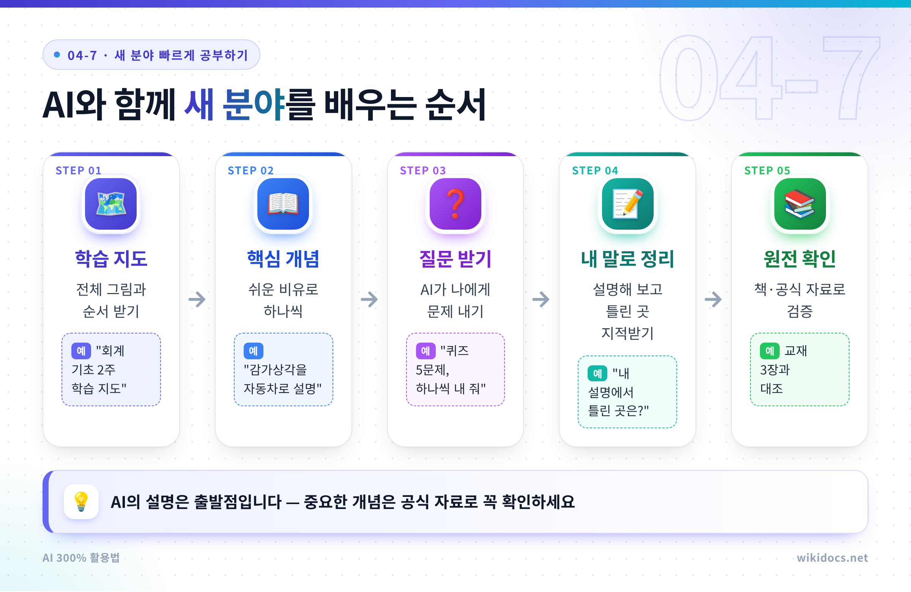

<!--
**상태**: 🔵 검토 중
**분류**: 04. 업무별 프롬프트 레시피
**태그**: #레시피 #학습
**작성일**: 2026-11-22
-->
> 📅 **최종 확인**: 2026-11-24 · 🧪 **마지막 테스트**: 미실시 · **테스트 도구**: —

## 이럴 때 쓰세요

- 새 업무·새 분야를 **짧은 시간에 익혀야** 할 때
- 어려운 개념을 **내 수준에 맞게** 이해하고 싶을 때
- 배운 내용을 제대로 이해했는지 **확인**하고 싶을 때

## 효과

| | AI 없이 | AI 활용 (예상) |
|---|---|---|
| 소요 시간 | 입문서·강의 찾기부터 며칠 | 첫 지도 30분, 이후 매일 20분 |
| 결과물 | 일반적인 순서로 학습 | 내 업무와 수준에 맞춘 학습 계획 |



## 프롬프트 A: 학습 지도 만들기

```text
나는 ______(현재 수준·배경)이고, ______을 배워야 해.
목표: ______ (예: 2주 뒤 회의에서 이 주제로 의견을 낼 수 있을 정도)
하루 학습 시간: ______

1. 이 분야의 핵심 개념 10개를 배우는 순서대로 정리해 줘 (개념마다 한 줄 설명)
2. 내 목표에 맞춘 날짜별 학습 계획을 표로 만들어 줘
3. 처음 배우는 사람이 가장 많이 헷갈리는 부분 3가지를 알려 줘
```

## 프롬프트 B: 개인 과외 선생님

```text
너는 친절한 ______ 선생님이야. ______ 개념을 나에게 가르쳐 줘.
- 한 번에 하나씩, 짧게 설명하고 내가 이해했는지 질문해 줘
- 내 업무(______)에서 쓰이는 예시로 설명해 줘
- 내가 틀리면 바로 답을 주지 말고 힌트부터 줘
```

## 입력 예시 (프롬프트 A)

```text
나는 마케팅 경력 5년인데 데이터 분석은 엑셀 피벗 정도만 해 봤어.
이번에 A/B 테스트 결과를 해석해야 해.
목표: 2주 뒤 회의에서 A/B 테스트 결과를 보고 "의미 있는 차이인지" 판단해 의견을 낼 수 있을 정도
하루 학습 시간: 30분
```

## 결과 예시

설명을 위해 작성한 예시입니다 (일부).

| 날짜 | 주제 | 할 일 |
|---|---|---|
| 1일 | A/B 테스트란 | 개념 이해, 우리 회사 사례 떠올리기 |
| 2일 | 전환율 계산 | 엑셀로 두 그룹 전환율 계산해 보기 |
| 3일 | 표본 크기 | "왜 100명으로는 부족한가" 이해 |
| 4일 | 통계적 유의성 | p값의 뜻을 쉬운 말로 설명해 보기 |
| … | … | … |
| 14일 | 종합 | 실제 테스트 결과 1건 해석해 발표 연습 |

**헷갈리는 부분 예:** "전환율 차이가 크다 = 효과가 있다"가 아님 (표본이 작으면 우연일 수 있음)

## 더 잘 쓰는 팁

- **내 수준과 목표**를 구체적으로 알려 줄수록 계획이 현실적이 됩니다.
- 배운 뒤 **"내가 이해한 내용을 설명해 볼게, 틀린 곳을 짚어 줘"**라고 하면 이해도를 확인할 수 있습니다.
- 중요한 개념은 AI 설명만 믿지 말고 **공식 문서·교재 한 권**으로 확인합니다.

## 주의할 점

- AI의 설명에도 틀린 내용이 섞일 수 있습니다. 특히 최신 정보, 숫자, 인용은 확인합니다.
- 자격증·시험 준비라면 공식 기관의 최신 출제 기준을 따릅니다.
- 회사 내부 자료로 학습할 때는 보안 규정을 확인합니다.

## 관련 페이지

- 04-2. 문서·회의 요약
- 📚 05-3. 문서·노트 AI (자료로 공부하기)
- 📚 01-3. 환각과 검증하는 습관
