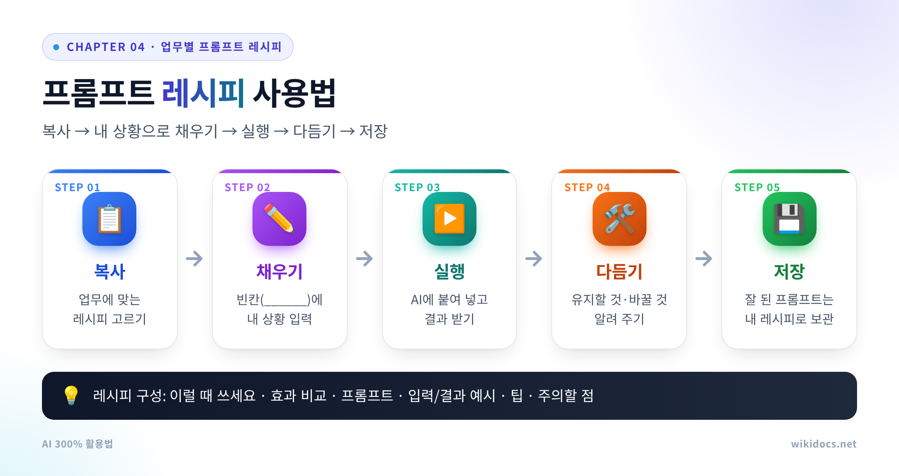
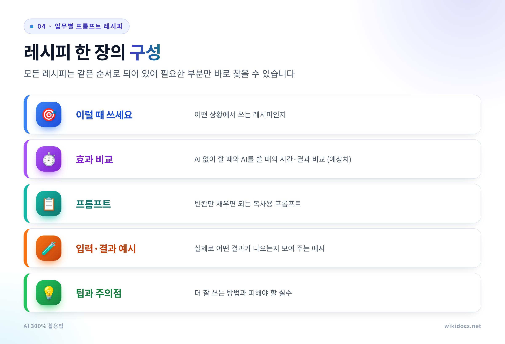

바로 복사해 쓸 수 있는 업무별 프롬프트 모음입니다.

[[TIP("이 장을 읽고 나면")]]

- 업무별로 바로 복사해 쓰는 프롬프트 7개를 얻습니다.
- 레시피마다 입력·결과 예시로 어떤 결과가 나오는지 미리 봅니다.
- 레시피를 내 업무에 맞게 고쳐 나만의 레시피북을 만들 수 있습니다.

[[/TIP]]

## 이 장의 구성

- 04-1. 보고서·이메일 쓰기
- 04-2. 문서·회의 요약
- 04-3. 기획·아이디어 발상
- 04-4. 데이터 분석
- 04-5. 번역·교정
- 04-6. 코딩·자동화 스크립트
- 04-7. 새 분야 빠르게 공부하기
