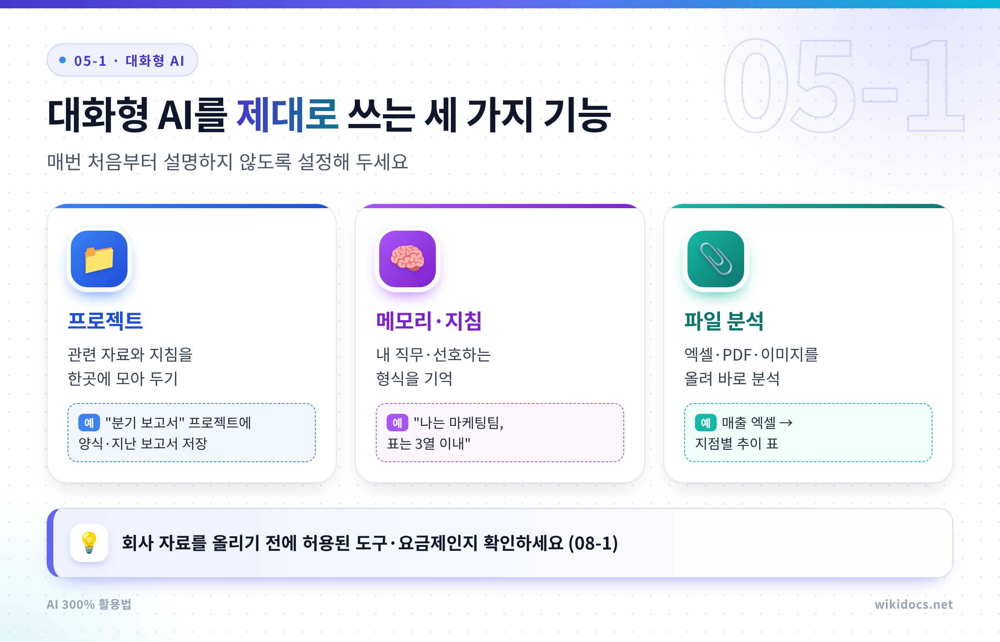

<!--
**상태**: 🔵 검토 중
**분류**: 05. AI 도구 지도
**태그**: #도구
**작성일**: 2026-11-21
-->
> 📅 **최종 확인**: 2026-11-24

대화형 AI는 가장 기본이 되는 AI 도구입니다. 질문하고, 글을 쓰게 하고, 파일을 올려 분석시키는 등 **대부분의 업무를 여기서 시작**합니다.

[TOC]

## 요약

- 대표 도구는 **ChatGPT, Claude, Gemini**입니다. 기본 기능은 비슷하고 강점이 조금씩 다릅니다.
- 같은 일을 반복한다면 **프로젝트(작업 공간)** 기능에 자료와 지시를 저장해 두면 매번 설명할 필요가 없습니다.
- 긴 글을 고칠 때는 **옆 화면 편집 기능**(Canvas, Artifacts)을 쓰면 편합니다.



## 언제 쓰나

- 이메일·보고서·기획안 초안을 쓸 때
- 긴 문서를 요약하거나 표로 정리할 때
- 엑셀·PDF 파일을 올려 내용을 분석할 때
- 아이디어를 내거나 생각을 정리할 때
- 모르는 개념을 쉽게 배우고 싶을 때

## 대표 도구와 기능 이름

세 도구는 비슷한 기능을 서로 다른 이름으로 부릅니다. 이름만 알면 어느 도구에서든 같은 방법을 쓸 수 있습니다.

| 하고 싶은 일 | ChatGPT | Claude | Gemini |
|---|---|---|---|
| 자료·지시를 모아 둔 작업 공간 | 프로젝트(Projects) | 프로젝트(Projects) | Gem, 노트북 |
| 내 정보·선호 기억 | 메모리(Memory) | 메모리(Memory) | 개인 맞춤 기능 |
| 옆 화면에서 글·코드 편집 | 캔버스(Canvas) | 아티팩트(Artifacts) | 캔버스(Canvas) |
| 여러 자료를 찾아 보고서 작성 | 딥 리서치(Deep research) | 리서치(Research) | 딥 리서치(Deep Research) |
| 나만의 맞춤 AI 만들기 | GPT 만들기 | 프로젝트 지침 | Gem 만들기 |

> 기능 이름과 사용 가능한 요금제는 바뀔 수 있습니다. 무료 요금제에서는 일부 기능이 제한될 수 있습니다.

## 바로 쓰는 활용 예시

### 예시 1. 회의록 → 할 일 표

```text
아래 회의 메모를 정리해 줘.
1. 결정된 사항 3줄 요약
2. 할 일을 [할 일 | 담당자 | 마감일] 표로 정리
3. 담당자나 마감일이 메모에 없으면 "미정"으로 표시

[회의 메모]
(붙여 넣기)
```

### 예시 2. 엑셀 파일 분석

```text
첨부한 엑셀은 월별 매출 자료야.
1. 매출이 가장 많이 오른 달과 떨어진 달을 찾아 줘.
2. 원인을 추정할 수 있는 항목이 있으면 알려 줘. (추정이라고 표시)
3. 결과를 임원 보고용 3줄 요약으로 써 줘.
계산 결과는 수식이나 계산 과정도 함께 보여 줘.
```

### 예시 3. 생각 정리 파트너

```text
나는 팀 업무 방식을 바꾸고 싶은데 생각이 정리가 안 돼.
바로 답을 주지 말고, 내 생각을 정리할 수 있게 질문을 한 번에 하나씩 해 줘.
5개 정도 질문한 뒤에 내 답을 바탕으로 제안서 개요를 만들어 줘.
```

## 도구별 팁

### ChatGPT
- **프로젝트**에 자주 쓰는 자료와 지시를 넣어 두면, 그 안의 대화는 같은 맥락을 공유합니다.
- **메모리**를 켜 두면 직무·선호 말투 등을 기억합니다. 기억된 내용은 설정에서 확인하고 지울 수 있습니다.
- 반복 업무는 **GPT 만들기**로 나만의 도우미를 만들어 두면 편합니다.

### Claude
- 긴 문서나 여러 파일을 한 번에 읽고 정리하는 작업에 자주 쓰입니다.
- **아티팩트**는 글·코드뿐 아니라 간단한 웹 화면이나 도구도 만들어 옆 화면에 보여 줍니다. 만든 결과물을 공유할 수도 있습니다.
- **프로젝트 지침**에 "항상 합니다체로, 결론부터" 같은 규칙을 적어 두면 매번 말하지 않아도 됩니다.

### Gemini
- Gmail, Google 문서, Google 드라이브 등 **Google 서비스와 함께 쓰기** 편합니다.
- **Gem**으로 역할과 지시를 저장한 맞춤 도우미를 만들 수 있습니다.
- **딥 리서치**를 무료 요금제에서도 일부 쓸 수 있다고 알려져 있습니다. 한도는 공식 안내를 확인하세요.

[[TIP("요령: 두 개를 같이 써 보기")]]

중요한 글은 **같은 프롬프트를 두 도구에 넣고** 결과를 비교해 보세요. 한쪽이 놓친 부분을 다른 쪽이 잡아 주는 경우가 많습니다. 좋은 부분을 골라 합치면 품질이 올라갑니다.

[[/TIP]]

## 주의할 점

- 회사 기밀·개인정보는 입력하지 않습니다. 회사에서 허용한 도구와 요금제인지 먼저 확인합니다.
- 메모리 기능은 편리하지만, 기억하면 안 되는 정보가 저장되지 않았는지 가끔 확인합니다.
- 수치·날짜·출처는 원문으로 확인합니다. (01-3 참고)

## 근거·출처

| 구분 | 출처 | 비고 |
|---|---|---|
| 기능 이름 비교 | [ChatGPT vs Claude vs Gemini: Feature & Terminology Map (2026)](https://bootstrapcreative.com/chatgpt-vs-claude-vs-gemini-terminology/) | 기능 이름 대응표 |
| 작업 공간 비교 | [Gemini Notebooks vs Claude Projects vs ChatGPT Memory](https://www.mindstudio.ai/blog/gemini-notebooks-vs-claude-projects-vs-chatgpt-memory) | 프로젝트·메모리 |
| 종합 비교 | [ChatGPT vs Claude vs Gemini (2026)](https://dataaspirant.com/blog/chatgpt-vs-claude-vs-gemini/) | 강점 비교 |

## 실무 체크포인트

- [ ] 반복하는 일은 프로젝트·Gem에 자료와 지시를 저장해 두었는가
- [ ] 긴 글은 캔버스·아티팩트에서 부분 수정했는가
- [ ] 중요한 글은 두 도구의 결과를 비교해 봤는가
- [ ] 입력한 정보가 회사 보안 기준에 맞는가

## 관련 페이지

- 05-2. 검색·리서치 AI
- 05-7. 목적별 도구 고르기
- 📚 02-1. 프롬프트 5요소
- 📚 08-1. 개인정보와 기밀 정보 지키기
