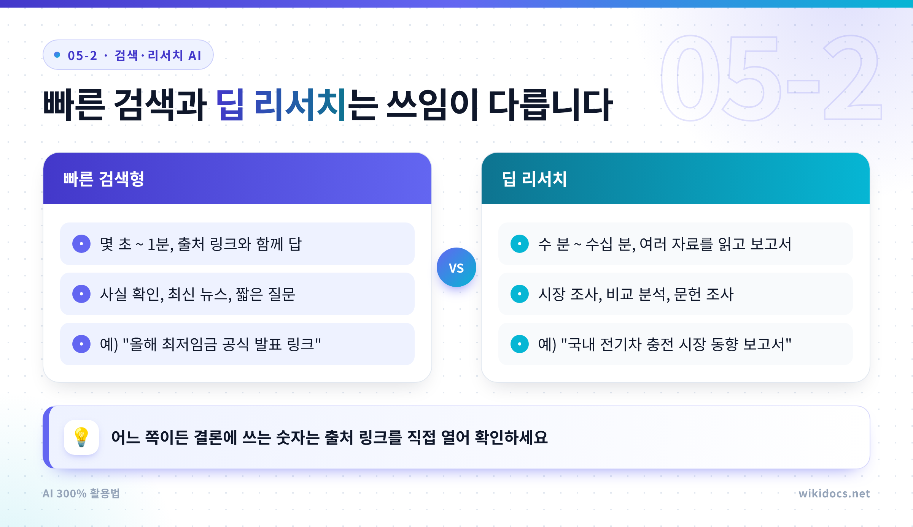

<!--
**상태**: 🔵 검토 중
**분류**: 05. AI 도구 지도
**태그**: #도구 #리서치
**작성일**: 2026-11-21
-->
> 📅 **최종 확인**: 2026-11-24

검색·리서치 AI는 **웹을 직접 찾아보고, 출처를 붙여서** 답합니다. 최신 정보나 사실 확인이 필요할 때는 일반 대화보다 이 유형이 훨씬 안전합니다.

## 요약

- 대표 도구는 **Perplexity**, 그리고 대화형 AI의 **딥 리서치** 기능입니다.
- 짧은 질문은 검색형 AI로, 여러 자료를 모아 보고서를 만들 때는 딥 리서치로 합니다.
- 출처가 붙어 있어도 **링크를 직접 열어 확인**해야 합니다.



## 언제 쓰나

- 최근 소식, 새 제도, 최신 통계를 알아볼 때
- 경쟁사·시장 동향을 빠르게 훑어볼 때
- AI가 말한 내용이 사실인지 확인할 때
- 여러 자료를 비교해 조사 보고서 초안을 만들 때

## 두 가지 방식

| 방식 | 대표 | 걸리는 시간 | 결과 |
|---|---|---|---|
| 빠른 검색형 | Perplexity, 대화형 AI의 웹 검색 | 수 초 | 출처 링크가 달린 짧은 답 |
| 딥 리서치형 | ChatGPT 딥 리서치, Claude 리서치, Gemini 딥 리서치 | 수 분 이상 | 여러 자료를 모아 정리한 긴 보고서 |

## 바로 쓰는 활용 예시

### 예시 1. 사실 확인

```text
다음 문장이 사실인지 확인해 줘.
"(확인할 문장)"
- 사실 / 일부 사실 / 사실 아님 / 확인 불가 중 하나로 판단
- 판단 근거가 된 출처를 2개 이상, 공식 기관·원문 자료를 우선으로
```

### 예시 2. 시장 동향 빠르게 훑기

```text
최근 6개월 동안 국내 ○○ 시장의 주요 소식을 정리해 줘.
- 표: [날짜 | 소식 | 출처]
- 언론 보도와 회사 공식 발표를 구분해서 표시
- 마지막에 눈여겨볼 흐름 3가지
```

### 예시 3. 딥 리서치로 조사 보고서 초안

```text
(딥 리서치 기능에서)
중소기업이 생성형 AI를 업무에 도입할 때의 효과와 위험을 조사해 줘.
- 독자: 도입을 검토하는 중소기업 경영진
- 구성: 도입 효과 / 대표 사례 / 위험 요소 / 도입 단계별 체크리스트
- 각 주장에 출처를 달고, 출처의 발행 연도를 함께 표시
- 공공기관·연구기관 자료를 우선
```

[[TIP("요령: 조사 범위를 먼저 정하기")]]

딥 리서치는 시작 전에 범위를 물어보는 경우가 많습니다. **독자, 기간, 지역, 원하는 출처 종류**를 처음부터 적어 주면 질문 없이 바로 원하는 방향으로 조사합니다.

[[/TIP]]

## 도구별 팁

### Perplexity
- 답변 옆에 **출처 목록**이 붙습니다. 출처 탭에서 어떤 사이트를 근거로 했는지 먼저 훑어보세요.
- **스페이스(Spaces)** 에 주제별로 질문과 자료를 모아 두면, 같은 주제의 조사를 이어서 할 수 있습니다.
- 출처가 웹페이지라서 유료 기사나 삭제된 페이지가 섞일 수 있습니다.

### 대화형 AI의 딥 리서치
- 같은 주제라도 도구마다 찾는 자료가 다릅니다. 중요한 조사는 **두 도구의 보고서를 비교**하세요.
- 보고서가 길게 나오므로 "핵심 5줄 요약을 맨 위에 붙여 줘"라고 요청하면 읽기 편합니다.
- 요금제에 따라 사용 횟수가 제한될 수 있습니다.

## 주의할 점

- 출처가 붙어 있다고 정확한 것은 아닙니다. **출처 링크를 직접 열어** 내용이 실제로 그 페이지에 있는지 확인합니다.
- 오래된 자료가 섞일 수 있으니 **발행 날짜**를 확인합니다.
- 공식 통계·법령은 반드시 원래 기관 사이트에서 다시 확인합니다.

## 근거·출처

| 구분 | 출처 | 비고 |
|---|---|---|
| 리서치 기능 비교 | [ChatGPT vs Claude vs Gemini: Feature & Terminology Map (2026)](https://bootstrapcreative.com/chatgpt-vs-claude-vs-gemini-terminology/) | 딥 리서치 이름·요금제 |
| Perplexity 특징 | [NotebookLM vs Perplexity (2026)](https://elephas.app/blog/notebooklm-vs-perplexity) | 웹 출처, 스페이스 |
| 함께 쓰기 | [I paired NotebookLM with Perplexity for a week](https://www.xda-developers.com/i-paired-notebooklm-with-perplexity-for-a-week-and-it-feels-like-theyre-meant-to-work-together/) | 조합 사례 |

## 실무 체크포인트

- [ ] 최신 정보는 검색형 AI나 딥 리서치로 찾았는가
- [ ] 출처 링크를 직접 열어 내용을 확인했는가
- [ ] 자료의 발행 날짜를 확인했는가
- [ ] 공식 수치는 원래 기관 사이트에서 다시 확인했는가

## 관련 페이지

- 05-1. 대화형 AI
- 05-3. 문서·노트 AI
- 📚 01-3. 환각과 검증하는 습관
- 📚 06-1. 리서치 → 정리 → 발행
