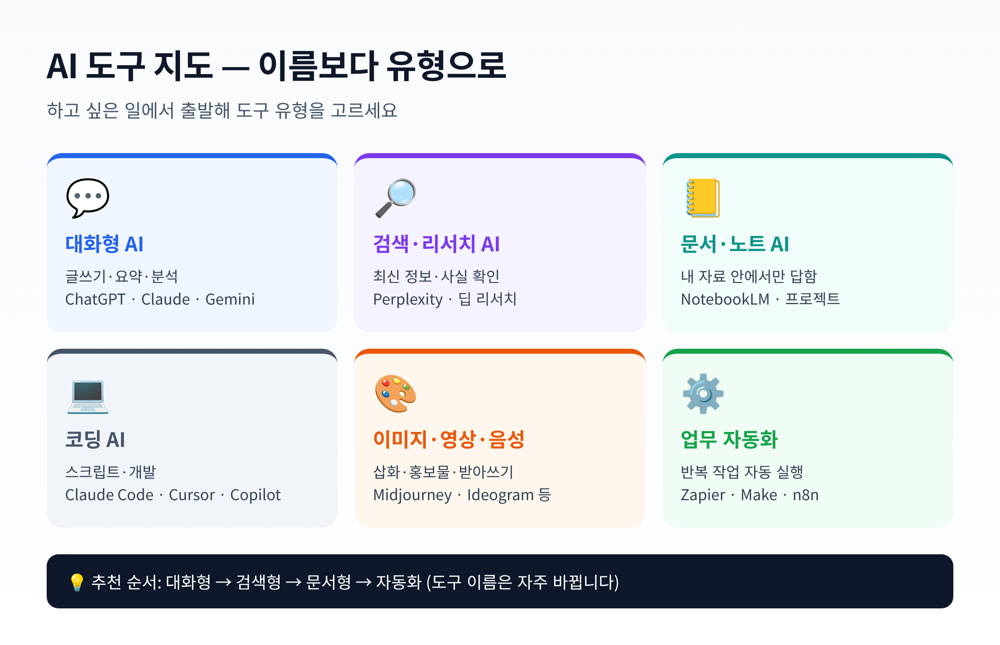

<!--
**상태**: 🔵 검토 중
**분류**: 05. AI 도구 지도
**태그**: #도구 #선택
**작성일**: 2026-11-21
-->
> 📅 **최종 확인**: 2026-11-21

도구가 많아서 무엇을 써야 할지 모르겠다면, **하고 싶은 일**에서 출발하면 됩니다. 이 페이지는 목적별로 어떤 유형의 도구를 쓰면 좋은지 한눈에 정리한 지도입니다.

## 요약

- 처음에는 **대화형 AI 하나**만 제대로 써도 대부분의 일을 할 수 있습니다.
- 부족함을 느낄 때 **검색형(최신 정보) → 문서형(자료 분석) → 자동화(반복 업무)** 순서로 넓혀 갑니다.
- 도구를 고를 때는 기능보다 **회사 보안 규정**을 먼저 확인합니다.

## 목적별 도구 고르기



| 하고 싶은 일 | 추천 유형 | 대표 도구 | 참고 |
|---|---|---|---|
| 글 초안, 이메일, 보고서 | 대화형 AI | ChatGPT, Claude, Gemini | 05-1 |
| 최신 정보·사실 확인 | 검색형 AI | Perplexity, 대화형 AI 웹 검색 | 05-2 |
| 여러 자료로 조사 보고서 | 딥 리서치 | 각 대화형 AI의 딥 리서치·리서치 | 05-2 |
| 두꺼운 문서 분석·공부 | 문서·노트 AI | NotebookLM, 대화형 AI 프로젝트 | 05-3 |
| 엑셀 수식, 간단한 스크립트 | 대화형 AI | ChatGPT, Claude, Gemini | 05-4 |
| 개발, 여러 파일 수정 | 코딩 에이전트 | Claude Code, Cursor, GitHub Copilot | 05-4 |
| 발표 삽화, 홍보 이미지 | 이미지 AI | 대화형 AI 이미지 생성, Midjourney | 05-5 |
| 회의 녹음 정리 | 음성 받아쓰기 + 대화형 AI | 받아쓰기 기능 + 요약 | 05-5 |
| 매일 반복하는 일 | 업무 자동화 | Zapier, Make, n8n | 05-6 |

## 단계별로 넓혀 가기

```text
1단계  대화형 AI 하나를 매일 쓰기 (02장 프롬프트 기본기 적용)
2단계  최신 정보가 필요할 때 검색형 AI 추가
3단계  자료가 많은 업무에 문서·노트 AI 추가
4단계  반복 업무를 찾아 자동화 도구로 연결
```

[[TIP("요령: 도구보다 사용 습관")]]

여러 도구를 조금씩 쓰는 것보다 **한 도구를 깊이 쓰는 것**이 효과가 큽니다. 프로젝트·메모리·지침 기능까지 제대로 설정해 두면, 같은 도구라도 결과가 훨씬 좋아집니다.

[[/TIP]]

## 도구를 고를 때 확인할 것

| 확인 항목 | 질문 |
|---|---|
| 보안 | 회사에서 허용한 도구인가? 입력한 정보가 학습에 쓰이지 않는 요금제인가? |
| 비용 | 무료로 충분한가? 팀 요금제가 필요한가? |
| 연동 | 지금 쓰는 서비스(메일, 문서, 메신저)와 연결되는가? |
| 한국어 | 한국어 결과의 품질이 충분한가? 직접 몇 번 시험해 봤는가? |

## 같은 일, 도구 조합 예시

```text
시장 조사 보고서 만들기
  검색형 AI로 자료 찾기 → 문서 AI로 원문 분석 → 대화형 AI로 보고서 작성
  → 이미지 AI로 표지 삽화 → 사람이 최종 확인
```

이처럼 여러 도구를 이어 쓰는 방법은 06장 「도구 조합 워크플로」에서, 문서·발표·영상·음성·회의·번역 같은 **장르별 전문 도구**와 직무별 조합 사례는 10장에서 자세히 다룹니다.

## 실무 체크포인트

- [ ] 하고 싶은 일에서 출발해 도구 유형을 골랐는가
- [ ] 회사 보안 규정에서 허용한 도구인가
- [ ] 한 도구의 프로젝트·지침 기능까지 설정해 봤는가

## 관련 페이지

- 05-1. 대화형 AI
- 05-2. 검색·리서치 AI
- 05-6. 업무 자동화 도구
- 📚 06-1. 리서치 → 정리 → 발행
- 📚 90-2. AI 도구 비교표
- 📚 10장 장르별 AI 도구와 활용 사례 (문서·발표·영상·음성·회의·번역)
