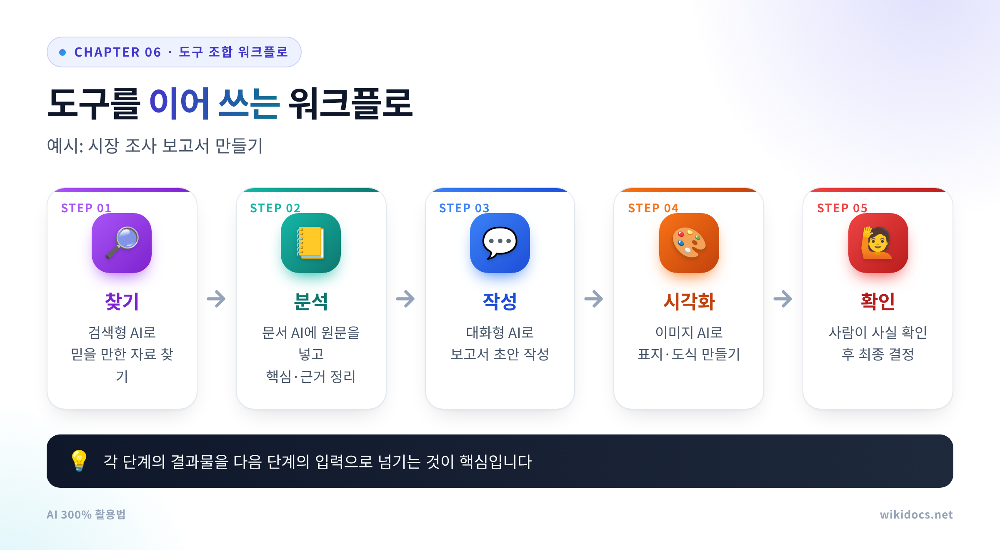

<!--
**상태**: 🔵 검토 중
**분류**: 06. 도구 조합 워크플로
**태그**: #워크플로
**작성일**: 2026-11-22
-->
> 📅 **최종 확인**: 2026-11-22

AI 도구 하나로 모든 일을 하기보다, **각 도구가 잘하는 단계를 이어 붙이면** 결과가 훨씬 좋아집니다. 이 페이지에서는 조사 보고서를 만드는 과정을 예로 "리서치 → 정리 → 발행" 워크플로를 단계별로 따라가 봅니다.

## 요약

- **찾기**(검색형) → **분석**(문서형) → **작성**(대화형) → **시각화**(이미지) → **확인**(사람)
- 단계마다 **결과물을 파일로 저장**해 다음 단계의 입력으로 넘깁니다.
- 마지막 확인은 반드시 사람이 합니다.

## 워크플로 한눈에 보기



## 예시: "중소기업 생성형 AI 도입 현황" 보고서

### 1단계: 찾기 — 검색형 AI

```text
중소기업의 생성형 AI 도입 현황과 효과에 대한 최근 2년 자료를 찾아 줘.
- 공공기관·연구기관 보고서와 통계를 우선으로
- 표: [자료명 | 발행 기관 | 발행일 | 핵심 내용 1줄 | 링크]
- 언론 기사와 원 보고서를 구분해 표시
```

**저장할 것:** 자료 목록 표 + 원 보고서 PDF 3~5개 (링크를 직접 열어 받음)

### 2단계: 분석 — 문서·노트 AI

받은 PDF를 문서 AI(예: 노트북 기능)에 올립니다.

```text
올린 자료만 근거로 답해 줘.
1. 도입률·도입 분야·효과·어려움에 대한 수치를 표로 모아 줘 (자료명과 쪽 표시)
2. 자료끼리 수치가 다른 부분이 있으면 따로 표시해 줘
```

**저장할 것:** 근거 표 (수치 + 출처 위치)

### 3단계: 작성 — 대화형 AI

```text
아래 근거 표만 사용해 경영진 보고서 초안을 써 줘.
구성: 요약(3줄) → 현황 → 효과 → 어려움 → 우리 회사 시사점 → 제안
수치마다 출처를 괄호로 표시하고, 근거 표에 없는 내용은 쓰지 마.
[근거 표] (2단계 결과 붙여 넣기)
```

### 4단계: 시각화 — 이미지 AI·차트

```text
보고서 표지에 쓸 이미지를 만들어 줘.
- 중소기업 사무실에서 여러 사람이 AI 화면을 보며 협업하는 모습
- 평면 일러스트, 남색·흰색, 가로형 16:9, 오른쪽에 제목 공간
- 글자와 로고 넣지 않기
```

수치 차트는 이미지 AI보다 **엑셀이나 데이터 분석 기능**으로 만드는 것이 정확합니다.

### 5단계: 확인 — 사람

- [ ] 보고서의 수치를 근거 표 → 원 보고서 쪽수까지 3개 이상 대조
- [ ] 링크를 직접 열어 확인
- [ ] 우리 회사 시사점이 실제 상황과 맞는지 판단

[[TIP("요령: 단계 사이에 파일로 넘기기")]]

단계마다 결과를 메모장·문서 파일로 저장해 두면 ① 다른 도구로 옮기기 쉽고 ② 어느 단계에서 오류가 생겼는지 추적할 수 있으며 ③ 다음 보고서를 만들 때 같은 흐름을 재사용할 수 있습니다.

[[/TIP]]

## 시간 비교 (예상)

| 단계 | AI 없이 | 워크플로 |
|---|---|---|
| 자료 찾기 | 반나절 | 30분 |
| 자료 읽고 정리 | 하루 | 1시간 |
| 초안 작성 | 반나절 | 1시간 |
| 검토·수정 | 2시간 | 2시간 (줄이면 안 됨) |

## 실무 체크포인트

- [ ] 단계마다 알맞은 도구 유형을 골랐는가
- [ ] 단계별 결과를 파일로 저장해 넘겼는가
- [ ] 최종 수치를 원 자료까지 거슬러 확인했는가

## 관련 페이지

- 06-2. 이 시리즈를 AI로 만든 과정
- 📚 05-2. 검색·리서치 AI
- 📚 05-3. 문서·노트 AI
- 📚 03-5. 단계를 나눠 연결하기
