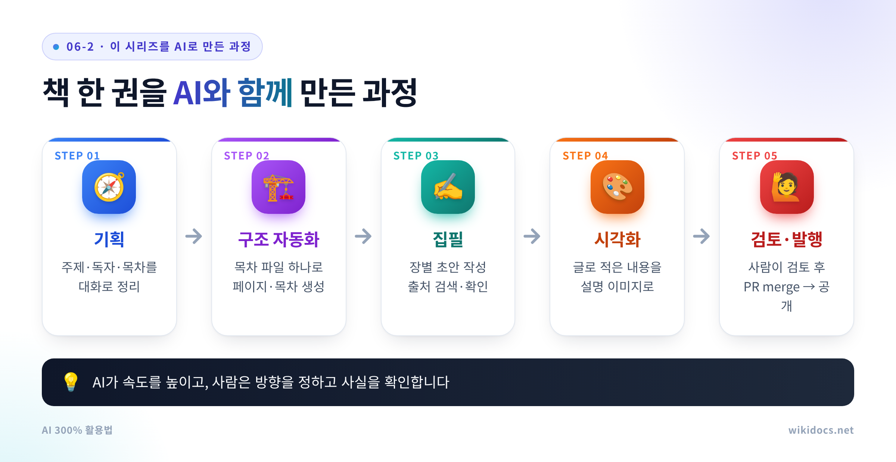

<!--
**상태**: 🔵 검토 중
**분류**: 06. 도구 조합 워크플로
**태그**: #워크플로 #사례
**작성일**: 2026-11-22
-->
> 📅 **최종 확인**: 2026-11-22

지금 읽고 있는 이 책과 「AI 시대 데이터 실무 4부작」 시리즈는 **AI와 함께 만들었습니다.** 이 페이지는 그 과정을 실제 사례로 공개합니다. 책이 아니어도, 보고서·매뉴얼·교육 자료처럼 여러 페이지로 된 문서를 만들 때 그대로 응용할 수 있습니다.

## 요약

- 사람은 **방향·판단·확인**을, AI는 **초안·구조화·반복 작업**을 맡았습니다.
- 목차 파일 하나를 고치면 페이지와 목차가 **자동으로** 만들어지게 했습니다.
- 모든 원고는 GitHub에서 관리하고, 사람이 검토해 merge하면 위키독스에 공개됩니다.

## 전체 과정



## 단계별로 한 일

| 단계 | 사람이 한 일 | AI가 한 일 |
|---|---|---|
| 기획 | 쓰고 싶은 주제 4가지와 독자 결정 | 시리즈 구성·책 제목 후보·목차 초안 제안 |
| 구조 자동화 | 관리 방식 결정 (GitHub + 위키독스) | 목차 파일(structure.yaml)에서 페이지·목차를 만드는 스크립트 작성 |
| 집필 | 장별 작성 요청, 방향 수정 | 페이지 초안 작성, 공식 자료 검색해 출처 정리, 예제 코드 실행 |
| 시각화 | 디자인 수준 요청 ("더 예쁘게") | 글로 정의한 내용을 설명 이미지로 만드는 도구 작성 |
| 검토·발행 | PR 검토 후 merge, 위키독스 화면 확인 | PR 작성, 변경 내역 기록 |

## 실제로 도움이 된 요청들

```text
"위키독스에 업로드하기 좋은 스타일도 추천해 줘"
→ 위키독스 공식 예제 저장소를 찾아 형식(목차 문법, 이미지 경로, 팁 상자)을 확인하고 적용

"각 장에 설명을 쉽게 해 주는 이미지가 들어갈 수 있게 해 줘"
→ 흐름도·카드·비교·판단표 모양의 이미지를 글로 정의해 자동 생성

"이미지는 좀 더 예쁘게 디자인되어 작성해 줘"
→ 책별 색 테마, 장 라벨, 강조 색 등 디자인 개선
```

## 사람이 잡아낸 것, AI가 잡아낸 것

이 과정에서 AI와 사람이 서로의 실수를 보완했습니다.

| 발견 | 누가 | 내용 |
|---|---|---|
| 목차 형식이 위키독스와 다름 | AI (공식 예제 확인) | 처음 만든 구조를 공식 형식으로 수정 |
| 가명처리 절차가 4단계로 잘못됨 | AI (최신 가이드라인 검색) | 2024년 개정 가이드라인의 5단계로 수정 |
| 이미지가 merge에서 빠짐 | AI (저장소 확인) | 새 PR로 다시 올림 |
| 책 제목 | 사람 | 위키독스에서 정한 제목을 그대로 유지 |
| 최종 공개 여부 | 사람 | 모든 변경은 사람이 검토 후 merge |

[[TIP("교훈")]]

AI가 빠르게 만들수록 **확인하는 단계가 더 중요**해집니다. 이 시리즈에서는 ① 공식 자료로 사실 확인 ② 예제 코드 실제 실행 ③ 사람의 최종 검토 세 가지를 지켰습니다.

[[/TIP]]

## 내 업무에 응용하기

| 이 책에서 | 내 업무에서 |
|---|---|
| 목차 파일 → 페이지 자동 생성 | 보고서 목차 → 장별 초안 틀 자동 생성 |
| 장별로 나눠 작성 요청 | 큰 문서를 장별로 나눠 요청 (03-5) |
| 공식 자료로 사실 확인 | 수치·규정은 원문으로 확인 (08-3) |
| 변경 내역 기록 | 문서 버전별 변경 사항 기록 |

## 실무 체크포인트

- [ ] 사람과 AI의 역할을 미리 나눴는가
- [ ] 반복되는 구조는 자동화했는가
- [ ] 사실 확인과 최종 검토는 사람이 했는가

## 관련 페이지

- 06-1. 리서치 → 정리 → 발행
- 📚 03-5. 단계를 나눠 연결하기
- 📚 08-3. 결과 검증 체크리스트
