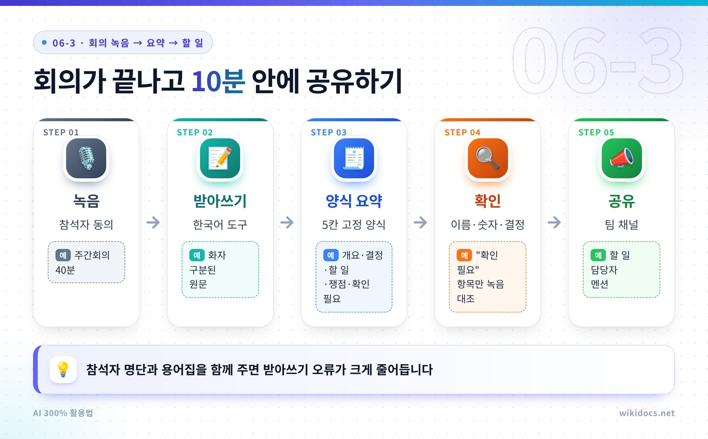

<!--
**상태**: 🔵 검토 중
**분류**: 06. 도구 조합 워크플로
**태그**: #워크플로
**작성일**: 2026-11-22
-->
> 📅 **최종 확인**: 2026-11-24

회의가 끝나면 회의록 정리, 할 일 공유, 다음 일정 잡기가 남습니다. 이 페이지에서는 **회의 녹음 → 받아쓰기 → 요약 → 할 일 공유**를 이어 붙여 회의 후 정리 시간을 줄이는 방법을 다룹니다.

## 요약

- **녹음**(동의 필수) → **받아쓰기**(음성 AI) → **요약·할 일 추출**(대화형 AI) → **공유**(메신저·메일)
- 받아쓰기 결과는 틀린 곳이 있으므로 **이름·숫자·결정 사항은 확인**합니다.
- 반복되는 회의는 **같은 프롬프트**로 회의록 양식을 통일합니다.



## 워크플로

```text
[1] 녹음        참석자 동의 → 녹음 시작
   ↓
[2] 받아쓰기     녹음 파일 → 음성 AI → 텍스트 (말한 사람 구분)
   ↓
[3] 요약        텍스트 → 대화형 AI → 회의록 양식 (04-2 레시피)
   ↓
[4] 확인        담당자가 이름·숫자·결정 사항 확인 (5분)
   ↓
[5] 공유        팀 메신저·메일로 전송, 할 일은 업무 도구에 등록
```

## 3단계 프롬프트 (회의록 양식 고정)

```text
아래는 회의 받아쓰기 결과야. 받아쓰기 오류가 있을 수 있어.
아래 양식으로 정리해 줘.

## 회의 개요
- 일시 / 참석자 / 목적

## 결정 사항
1.

## 할 일
| 할 일 | 담당자 | 마감일 |

## 남은 쟁점

## 확인 필요
- 받아쓰기가 불분명하거나, 담당자·마감일이 없는 항목

[받아쓰기 결과]
______
```

**"확인 필요" 칸**을 두는 것이 핵심입니다. AI가 애매한 부분을 지어내지 않고 따로 모아 줍니다.

## 받아쓰기 결과의 흔한 오류

| 오류 | 예 | 대처 |
|---|---|---|
| 이름 오인식 | "박지원" → "박지훈" | 참석자 명단을 프롬프트에 함께 제공 |
| 숫자 오인식 | "15일" → "50일" | 숫자는 반드시 확인 |
| 전문 용어 | 제품명·약어가 엉뚱한 단어로 | 용어집을 함께 제공 |
| 말한 사람 구분 오류 | 발언자가 바뀜 | 결정 사항의 발언자는 확인 |

[[TIP("요령: 참석자 명단과 용어집 함께 주기")]]

프롬프트에 "참석자: 김민수(팀장), 박지원(대리) / 용어: 플랜온 = 우리 제품 이름"처럼 넣어 주면 받아쓰기 오류를 AI가 문맥으로 바로잡는 경우가 많습니다.

[[/TIP]]

## 주의할 점

- 녹음 전에 **모든 참석자의 동의**를 받습니다.
- 인사·평가·고객 개인정보 등 **민감한 회의는 외부 AI에 올리지 않습니다.**
- 회사에서 허용한 녹음·받아쓰기 도구인지 확인합니다.

## 실무 체크포인트

- [ ] 녹음 동의를 받았는가
- [ ] 참석자 명단과 용어집을 프롬프트에 넣었는가
- [ ] 이름·숫자·결정 사항을 확인했는가
- [ ] 반복 회의에 같은 양식을 쓰는가

## 관련 페이지

- 06-1. 리서치 → 정리 → 발행
- 📚 04-2. 문서·회의 요약 레시피
- 📚 05-5. 이미지·영상·음성 AI
- 📚 08-1. 개인정보와 기밀 정보 지키기
