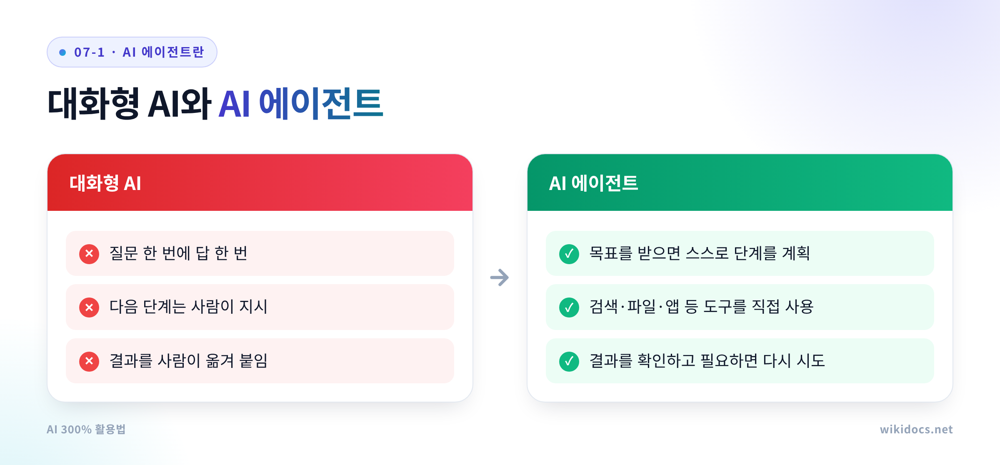
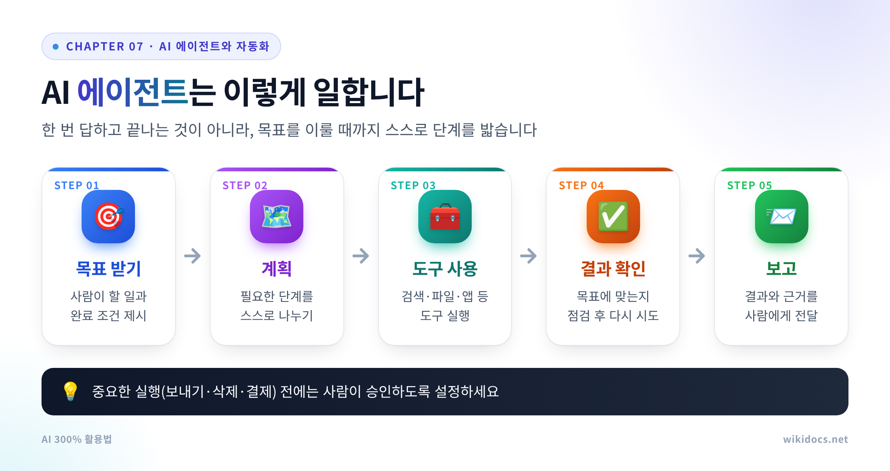

<!--
**상태**: 🔵 검토 중
**분류**: 07. AI 에이전트와 자동화
**태그**: #에이전트
**작성일**: 2026-11-22
-->
> 📅 **최종 확인**: 2026-11-22

AI 에이전트는 **목표를 받으면 스스로 계획을 세우고, 도구를 사용해 여러 단계의 일을 처리하는 AI**입니다. 대화형 AI가 "질문에 답하는 비서"라면, 에이전트는 "일을 맡기면 처리해 오는 조수"에 가깝습니다.

## 요약

- 에이전트는 **계획 → 도구 사용 → 결과 확인 → 다시 시도**를 스스로 반복합니다.
- 검색, 파일 읽기·쓰기, 앱 조작 같은 **도구**를 쓸 수 있습니다.
- 일을 맡길수록 **권한 관리와 사람의 승인**이 중요해집니다.

## 대화형 AI와 에이전트

## 에이전트가 일하는 방식

## 예시: 같은 일을 맡겼을 때

**요청:** "다음 주 출장 준비해 줘. 부산, 화~수요일, 고객사 미팅 2건."

| 단계 | 대화형 AI | 에이전트 (도구 연결 시) |
|---|---|---|
| 1 | 준비물 목록과 일정표 양식을 알려 줌 | 캘린더에서 화·수요일 일정 확인 |
| 2 | (사람이 직접 기차 검색) | 기차 시간표 검색, 미팅 시간에 맞는 열차 후보 3개 제시 |
| 3 | (사람이 직접 메일 작성) | 고객사 미팅 확인 메일 초안 2통 작성 |
| 4 | — | 출장 일정표 문서 작성 후 "예약·발송 전에 확인해 주세요" 요청 |

에이전트도 **예약·결제·메일 발송 같은 되돌리기 어려운 행동 전에는 사람의 승인을 받도록** 설정하는 것이 좋습니다.

## 지금 쓸 수 있는 에이전트 유형

| 유형 | 하는 일 | 예 |
|---|---|---|
| 리서치 에이전트 | 여러 자료를 찾아 읽고 보고서 작성 | 대화형 AI의 딥 리서치 기능 (05-2) |
| 코딩 에이전트 | 코드를 읽고 고치고 실행 | 05-4의 코딩 에이전트 |
| 브라우저·컴퓨터 조작 에이전트 | 웹페이지·앱을 직접 조작 | 일부 AI 도구의 브라우저 조작 기능 |
| 업무 자동화 에이전트 | 여러 서비스를 이어 반복 작업 | 자동화 도구의 AI 에이전트 기능 (05-6) |

> 각 도구의 에이전트 기능 이름과 지원 범위는 빠르게 바뀝니다. 최신 정보는 09장에서 다룹니다.

[[TIP("에이전트에게 일을 잘 맡기는 법")]]

1. **목표와 완료 조건**을 분명히: "출장 준비"보다 "화요일 오전 10시 미팅에 늦지 않는 열차 후보 3개와 일정표"
2. **할 수 있는 일과 없는 일**을 정하기: "예약은 하지 말고 후보만"
3. **중간 보고** 요청: "큰 결정 전에 물어봐 줘"

[[/TIP]]

## 주의할 점

| 위험 | 대책 |
|---|---|
| 잘못된 행동(엉뚱한 메일 발송 등) | 되돌리기 어려운 행동은 사람 승인 필수 |
| 지나친 권한 | 필요한 앱·폴더에만 접근 허용 |
| 웹페이지 속 악성 지시 | 에이전트가 읽은 웹페이지의 지시를 따르지 않도록 설정·감시 |
| 과정을 모름 | 에이전트의 작업 기록 확인 |

## 실무 체크포인트

- [ ] 목표와 완료 조건을 분명히 적었는가
- [ ] 되돌리기 어려운 행동에 승인 단계를 넣었는가
- [ ] 필요한 범위의 권한만 주었는가
- [ ] 작업 기록을 확인했는가

## 관련 페이지

- 07-2. MCP: AI와 도구를 잇는 표준
- 07-3. 반복 업무 자동화 설계
- 📚 『LLM × 온톨로지』 05-4. 온톨로지 기반 AI 에이전트
