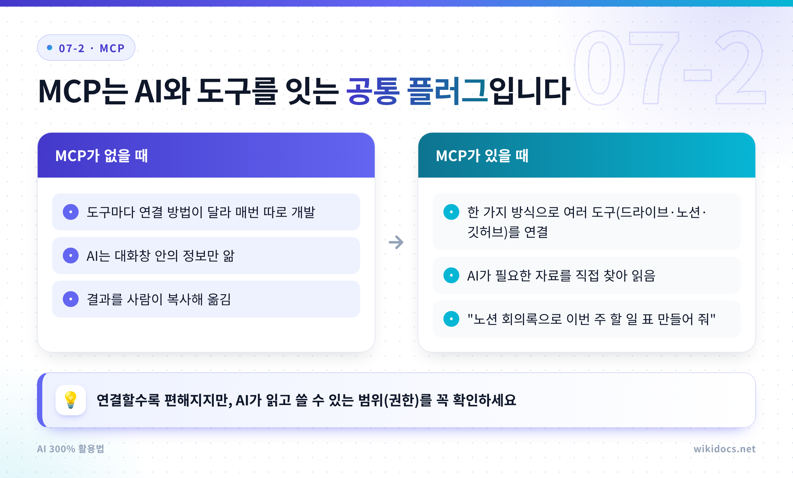
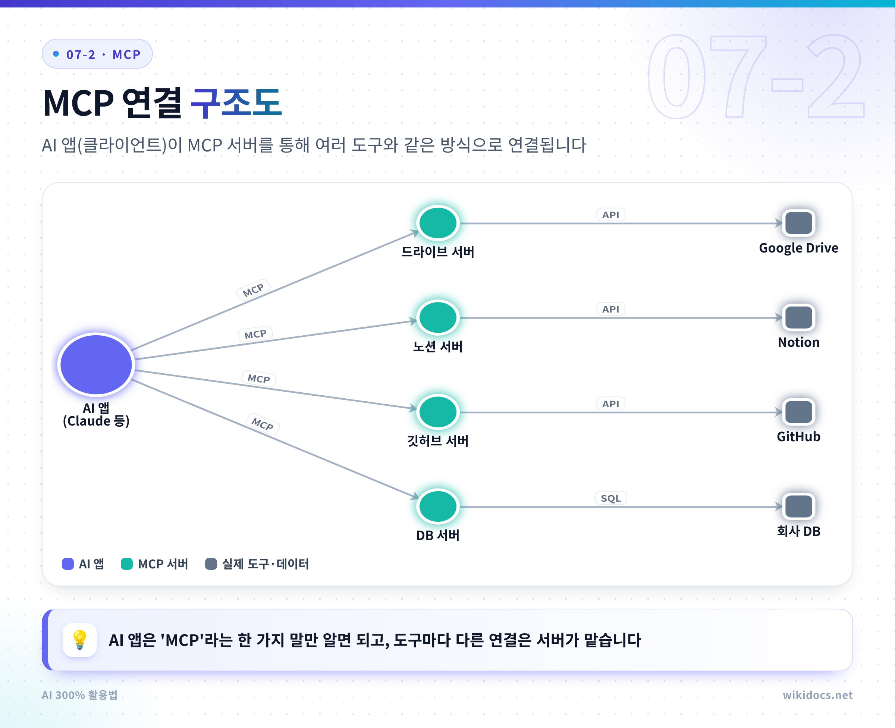

<!--
**상태**: 🔵 검토 중
**분류**: 07. AI 에이전트와 자동화
**태그**: #에이전트 #MCP
**작성일**: 2026-11-22
-->
> 📅 **최종 확인**: 2026-11-24

AI가 회사 문서, 일정, 데이터베이스 같은 외부 도구를 쓰려면 서로 연결하는 방법이 필요합니다. **MCP(Model Context Protocol)**는 AI 애플리케이션과 외부 도구·데이터를 **같은 방식으로 연결하는 표준**입니다. 흔히 "AI용 USB-C"에 비유합니다.

## 요약

- MCP는 2024년 Anthropic이 공개한 **개방형 표준**이며, 여러 AI 도구와 서비스가 지원하고 있습니다.
- 도구를 **MCP 서버**로 한 번 만들어 두면, MCP를 지원하는 여러 AI 앱에서 쓸 수 있습니다.
- 연결이 쉬워진 만큼 **어떤 서버에 어떤 권한을 주는지** 관리가 중요합니다.



## MCP가 없을 때와 있을 때

| | MCP 없이 | MCP로 |
|---|---|---|
| 연결 방법 | AI 앱마다, 도구마다 따로 연결 개발 | 표준 방식 하나로 연결 |
| 도구 재사용 | 앱을 바꾸면 다시 개발 | MCP를 지원하는 앱이면 그대로 사용 |
| 비유 | 기기마다 다른 충전기 | USB-C 하나로 충전 |

## 구성 요소

```text
[AI 앱 (MCP 클라이언트)]  ←—MCP—→  [MCP 서버]  ←→  [실제 도구·데이터]
 대화형 AI, 코딩 도구 등              연결 담당          파일, 일정, DB, 사내 시스템
```

| 요소 | 역할 | 예 |
|---|---|---|
| MCP 클라이언트 | AI가 들어 있는 앱 | 대화형 AI 데스크톱 앱, 코딩 에이전트 |
| MCP 서버 | 도구 기능을 AI가 쓸 수 있게 제공 | 파일 서버, 캘린더 서버, DB 서버 |
| 도구(Tools) | AI가 호출하는 기능 | "일정 조회", "파일 읽기" |
| 리소스(Resources) | AI가 읽는 자료 | 문서, 데이터 |



## 활용 예시

| 상황 | 연결하는 MCP 서버 | AI에게 할 수 있는 요청 |
|---|---|---|
| 개인 업무 | 파일·캘린더 | "다음 주 일정 보고 회의 준비 자료 폴더를 정리해 줘" |
| 개발 | 코드 저장소·이슈 관리 | "이번 주 열린 이슈를 요약하고 우선순위를 제안해 줘" |
| 데이터 분석 | 사내 데이터베이스 (읽기 전용) | "지난달 지역별 매출을 조회해 표로 만들어 줘" |
| 지식 관리 | 사내 위키·지식그래프 | "결제 시스템 담당자와 장애 매뉴얼을 찾아 줘" |

[[TIP("주의: MCP 서버는 신뢰할 수 있는 것만")]]

MCP 서버는 AI에게 실제 권한(파일 읽기·쓰기, 메일 보내기 등)을 줍니다. ① **공식 제공처나 검증된 출처**의 서버만 설치하고 ② **필요한 권한만** 주며(가능하면 읽기 전용) ③ 회사에서는 **보안 담당자와 협의**한 뒤 사용하세요.

[[/TIP]]

## 시작하는 방법

1. 사용 중인 AI 앱이 MCP를 지원하는지 확인합니다 (설정 메뉴나 공식 문서).
2. 연결하고 싶은 도구의 공식 MCP 서버가 있는지 찾아봅니다.
3. 읽기 전용 기능부터 연결해 시험해 봅니다.
4. 익숙해지면 쓰기 기능을 승인 절차와 함께 추가합니다.

## 실무 체크포인트

- [ ] 사용하는 AI 앱이 MCP를 지원하는지 확인했는가
- [ ] 신뢰할 수 있는 출처의 MCP 서버만 쓰는가
- [ ] 읽기 전용부터 시작했는가
- [ ] 회사 보안 정책을 확인했는가

## 근거·출처

| 구분 | 출처 | 비고 |
|---|---|---|
| 공식 | [Model Context Protocol](https://modelcontextprotocol.io/) | 소개·명세 |
| 발표 | [Introducing the Model Context Protocol (Anthropic, 2024)](https://www.anthropic.com/news/model-context-protocol) | 공개 발표 |

## 관련 페이지

- 07-1. AI 에이전트란
- 07-3. 반복 업무 자동화 설계
- 📚 『LLM × 온톨로지』 05-4. 온톨로지 기반 AI 에이전트
