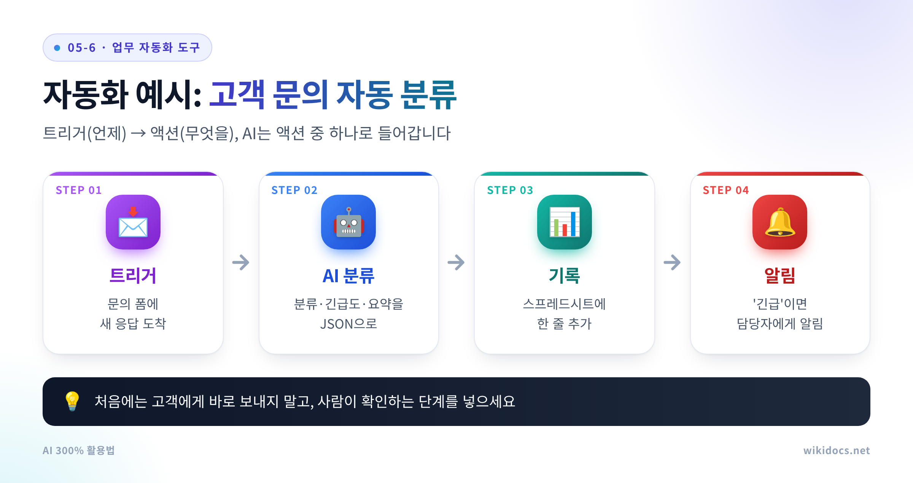

<!--
**상태**: 🔵 검토 중
**분류**: 07. AI 에이전트와 자동화
**태그**: #에이전트 #자동화
**작성일**: 2026-11-22
-->
> 📅 **최종 확인**: 2026-11-22

자동화는 "어떤 도구를 쓸까"보다 **"어떤 일을 자동화할까"**를 고르는 것이 먼저입니다. 이 페이지에서는 자동화할 업무를 찾고, 설계하고, 안전하게 운영하는 방법을 단계별로 정리합니다.

## 요약

- **자주, 같은 방식으로, 규칙이 분명한** 일부터 자동화합니다.
- 설계는 **트리거 → 처리 → 확인 → 결과** 네 칸으로 그려 봅니다.
- 처음에는 **사람이 확인하는 단계**를 넣고, 충분히 검증된 뒤에 뺍니다.

## 1단계: 자동화할 업무 찾기

일주일 동안 반복한 업무를 적고 점수를 매깁니다.

| 업무 | 빈도 | 1회 시간 | 규칙이 분명한가 | 실수 시 피해 | 우선순위 |
|---|---|---|---|---|---|
| 지점 매출 파일 합치기 | 매주 | 60분 | 분명 | 작음 | ⭐ 1순위 |
| 고객 문의 분류·배정 | 매일 | 30분 | 대체로 분명 | 중간 | ⭐ 2순위 |
| 업계 뉴스 요약 공유 | 매주 | 40분 | 분명 | 작음 | ⭐ 3순위 |
| 거래처 계약 조건 협상 | 가끔 | 2시간 | 불분명 | 큼 | ✕ 자동화 부적합 |

**판단 기준:** 자주 하고, 오래 걸리고, 규칙이 분명하고, 실수해도 피해가 작은 일이 1순위입니다.

## 2단계: 네 칸으로 설계하기

```text
┌ 트리거 ──────┐ ┌ 처리 ─────────┐ ┌ 확인 ─────────┐ ┌ 결과 ─────────┐
│ 언제 시작?   │→│ 무엇을 하나?   │→│ 누가 확인?     │→│ 어디에 남기나? │
└─────────────┘ └──────────────┘ └──────────────┘ └──────────────┘
```

**예: 고객 문의 분류**

| 칸 | 내용 |
|---|---|
| 트리거 | 문의 폼에 새 응답 도착 |
| 처리 | AI가 분류·긴급도·요약을 JSON으로 작성 (05-6의 프롬프트) |
| 확인 | 첫 2주: 담당자가 분류 결과를 보고 승인 → 이후: "긴급"만 확인 |
| 결과 | 스프레드시트 기록 + 긴급 건은 담당자 메신저 알림 |



## 3단계: 작게 시험하기

| 기간 | 할 일 | 확인할 것 |
|---|---|---|
| 1주차 | 자동화와 사람이 **나란히** 처리 | 결과가 얼마나 일치하는가 |
| 2주차 | 자동화 결과를 사람이 **승인만** | 고친 비율, 고친 이유 |
| 3주차~ | 문제 없는 부분만 승인 단계 제거 | 오류 알림이 오는가 |

[[TIP("요령: 고친 기록이 최고의 개선 자료")]]

2주차에 사람이 AI 결과를 고친 사례를 모아 두세요. 그 사례를 프롬프트의 **예시(03-2)**로 넣으면 다음 자동화의 정확도가 올라갑니다.

[[/TIP]]

## 4단계: 운영 규칙

| 규칙 | 이유 |
|---|---|
| 담당자를 정한다 | 멈추거나 오류 날 때 누가 볼지 |
| 오류 알림을 켠다 | 조용히 실패하는 자동화가 가장 위험 |
| 월 1회 결과를 표본 점검 | 시간이 지나며 품질이 떨어지는지 확인 |
| 연결된 서비스의 권한을 최소화 | 사고 범위 제한 |
| 자동화 목록을 문서로 관리 | 담당자가 바뀌어도 이어서 운영 |

## 실무 체크포인트

- [ ] 빈도·시간·규칙·피해 기준으로 업무를 골랐는가
- [ ] 트리거·처리·확인·결과 네 칸으로 설계했는가
- [ ] 나란히 → 승인 → 자동 순서로 단계적으로 도입했는가
- [ ] 담당자·오류 알림·정기 점검을 정했는가

## 관련 페이지

- 07-1. AI 에이전트란
- 📚 05-6. 업무 자동화 도구
- 📚 04-6. 코딩·자동화 스크립트
