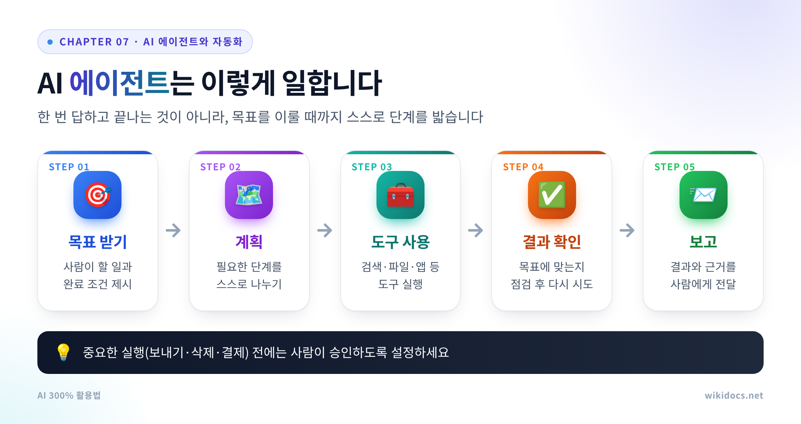

스스로 여러 단계를 수행하는 에이전트와 반복 업무 자동화를 다룹니다.

[[TIP("이 장을 읽고 나면")]]

- AI 에이전트가 대화형 AI와 어떻게 다른지 이해합니다.
- MCP로 AI와 도구가 연결되는 방식을 압니다.
- 반복 업무를 골라 안전하게 자동화하는 순서를 익힙니다.

[[/TIP]]

## 이 장의 구성

- 07-1. AI 에이전트란
- 07-2. MCP: AI와 도구를 잇는 표준
- 07-3. 반복 업무 자동화 설계
