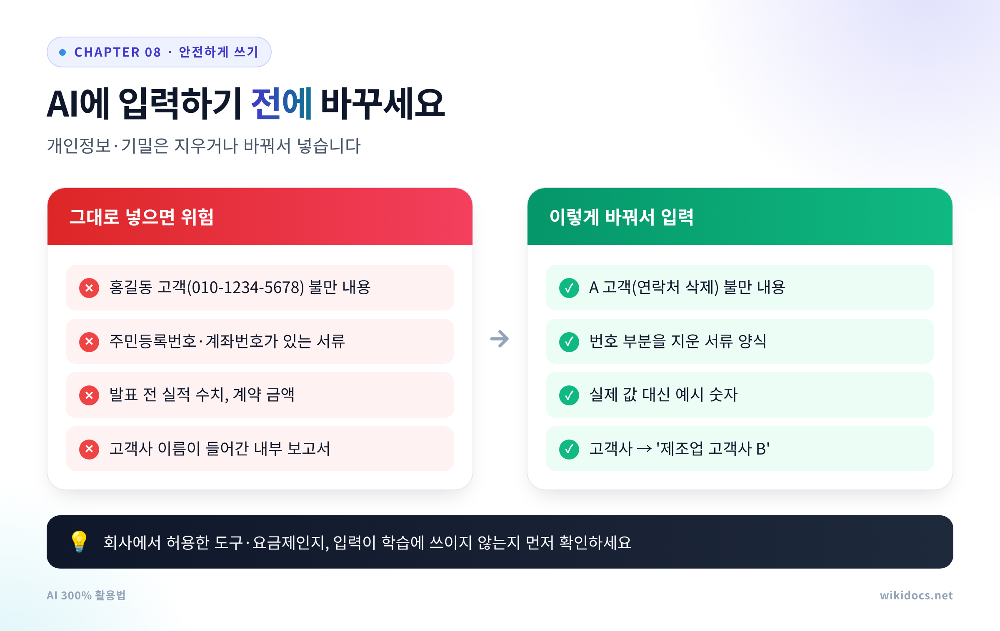

<!--
**상태**: 🔵 검토 중
**분류**: 08. 안전하게 쓰기
**태그**: #안전 #개인정보
**작성일**: 2026-11-22
-->
> 📅 **최종 확인**: 2026-11-22

AI에 붙여 넣은 내용은 서비스 회사의 서버로 전송됩니다. 요금제와 설정에 따라 **저장되거나 서비스 개선(학습)에 쓰일 수도** 있습니다. 그래서 무엇을 입력하는지가 AI 활용에서 가장 중요한 안전 습관입니다.

## 요약

- **개인정보와 회사 기밀은 그대로 입력하지 않습니다.** 지우거나 바꿔서 넣습니다.
- 사용하는 도구의 **데이터 처리 설정**(학습 활용 여부, 대화 기록 보관)을 확인합니다.
- 회사에서는 **허용된 도구와 요금제**만 사용합니다.

## 입력하기 전에 바꾸기



## 무엇을 조심해야 하나

| 구분 | 예 | 입력 전 처리 |
|---|---|---|
| 개인 식별 정보 | 이름, 주민등록번호, 휴대폰 번호, 이메일, 주소 | 삭제 또는 "고객A", "010-****" |
| 민감 정보 | 건강, 질병, 신용, 정치 성향 | 삭제 (꼭 필요하면 범주로: "만성질환 있음") |
| 금융 정보 | 계좌번호, 카드번호 | 삭제 |
| 회사 기밀 | 발표 전 실적, 계약 금액, 미공개 제품, 소스코드 | 예시 값으로 대체, 회사 규정 확인 |
| 로그인 정보 | 비밀번호, API 키, 인증 토큰 | 절대 입력 금지 |

## 예시: 고객 상담 기록 요약

**❌ 그대로 입력**
```text
아래 상담 기록 요약해 줘.
김민수(1983년생, 010-2345-6789) 고객이 3월 15일 카드 대금 이중 결제(카드번호 1234-****)로 항의...
```

**✅ 가명처리 후 입력**
```text
아래 상담 기록 요약해 줘. (개인정보는 미리 지웠어)
고객A(40대)가 3월 중순 카드 대금 이중 결제로 항의...
```

요약 결과는 원래 기록과 함께 회사 시스템 안에서 관리합니다.

[[TIP("요령: 개인정보 지우기도 AI 없이 먼저")]]

개인정보를 지우려고 원문을 AI에 넣으면 이미 입력한 것이 됩니다. 엑셀의 찾아 바꾸기, 회사의 마스킹 도구처럼 **AI에 넣기 전 단계**에서 지우세요. 회사 내부에서 승인된 AI 환경이 있다면 그 환경을 사용합니다.

[[/TIP]]

## 도구 설정 확인하기

| 확인할 것 | 어디서 |
|---|---|
| 입력 내용이 모델 학습에 쓰이는지 | 계정 설정의 데이터·개인정보 항목, 요금제 약관 |
| 대화 기록 보관 기간 | 설정, 개인정보 처리방침 |
| 팀·기업 요금제의 데이터 보호 조건 | 기업용 약관 (회사 IT·보안 담당자와 확인) |
| 메모리(기억) 기능에 저장된 내용 | 설정의 메모리 관리 화면 |

## 회사에서 지켜야 할 것

- 회사의 **AI 사용 지침**이 있는지 먼저 확인합니다.
- 고객 개인정보를 AI로 처리하는 업무는 **개인정보 보호 담당자와 협의**합니다.
- 개인정보보호위원회는 2025년 8월 「생성형 인공지능(AI) 개발·활용을 위한 개인정보 처리 안내서」를 공개했습니다. AI를 업무 시스템에 도입하는 경우 참고하세요.

## 실무 체크포인트

- [ ] 입력 내용에 개인정보·기밀이 없는가
- [ ] 개인정보는 AI에 넣기 전 단계에서 지웠는가
- [ ] 도구의 학습 활용·기록 보관 설정을 확인했는가
- [ ] 회사에서 허용한 도구와 요금제인가

## 근거·출처

| 구분 | 출처 | 비고 |
|---|---|---|
| 안내서 | [생성형 AI 개발·활용을 위한 개인정보 처리 기준 (개인정보보호위원회, 2025.8., 보도)](https://smartcity.go.kr/?p=48889) | 기업·기관용 안내서 |
| 관련 도서 | 『가명정보 A to Z』 | 가명처리 방법 |

## 관련 페이지

- 08-2. 저작권과 출처 표기
- 08-3. 결과 검증 체크리스트
- 📚 『가명정보 A to Z』 08장 AI 시대의 가명정보
