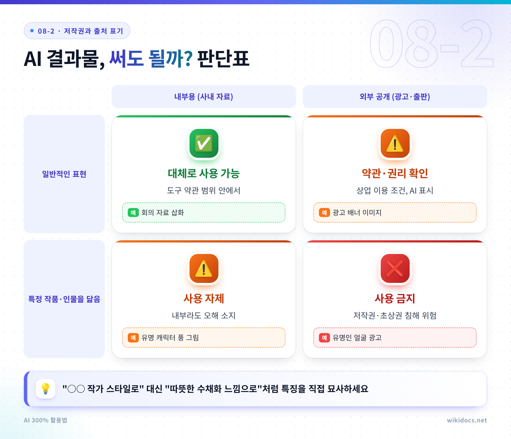

<!--
**상태**: 🔵 검토 중
**분류**: 08. 안전하게 쓰기
**태그**: #안전 #저작권
**작성일**: 2026-11-22
-->
> 📅 **최종 확인**: 2026-11-24

AI로 만든 글과 이미지를 업무에 쓸 때는 **다른 사람의 저작권을 침해하지 않는지**, 그리고 **AI 결과물을 내 것처럼 주장할 수 있는지**를 함께 생각해야 합니다. 이 분야는 법과 판례가 계속 정리되고 있으므로, 이 페이지는 실무에서 지킬 기본 원칙을 다룹니다.

## 요약

- 다른 사람의 작품을 **그대로 넣어 비슷하게 만들어 달라**는 요청은 피합니다.
- AI 결과물이 **기존 작품과 지나치게 닮았는지** 확인합니다.
- 공개하거나 판매할 때는 **서비스 약관과 공식 안내서**를 확인하고, 필요하면 AI 활용 사실을 밝힙니다.



## 상황별 판단

| 상황 | 위험도 | 이유와 대처 |
|---|---|---|
| 내가 쓴 초안을 AI로 다듬기 | 낮음 | 내 글을 바탕으로 한 수정 |
| 공개 자료를 요약해 내부 참고용으로 | 낮음~중간 | 출처 표기, 외부 배포 시 인용 범위 확인 |
| 특정 작가·화가 "스타일로" 그려 달라고 요청 | 중간~높음 | 특정 작품과 닮은 결과물 위험. 일반적인 스타일 묘사로 |
| 유명 캐릭터·로고·상표가 들어간 이미지 | 높음 | 저작권·상표권 침해 위험. 사용하지 않음 |
| 남의 기사·책을 통째로 넣고 비슷한 글 작성 | 높음 | 원문을 바꿔 쓴 것으로 볼 수 있음 |

## 프롬프트 바꾸기 예시

**❌ 위험한 요청**
```text
○○ 애니메이션 주인공처럼 생긴 캐릭터를 그려 줘.
```

**✅ 바꾼 요청**
```text
둥근 얼굴에 큰 눈, 노란 우비를 입은 밝은 성격의 어린이 캐릭터를 그려 줘.
부드러운 수채화 느낌, 흰 배경.
```

특정 작품 이름 대신 **원하는 특징을 직접 묘사**하면 결과물도 더 독창적이 됩니다.

## 출처 표기 원칙

| 경우 | 표기 예 |
|---|---|
| AI로 초안을 쓰고 사람이 수정 | "이 글은 AI의 도움을 받아 작성하고 저자가 검토했습니다." |
| AI로 만든 이미지 사용 | 이미지 아래 "AI 생성 이미지" |
| AI가 요약한 외부 자료 인용 | 원래 자료의 출처를 표기 (AI가 아니라 원 출처) |

[[TIP("알아두기: 공식 안내서")]]

문화체육관광부와 한국저작권위원회는 생성형 AI와 저작권에 관한 안내서를 펴내고 있습니다. 2025년 6월에는 AI 활용 저작물의 **저작권 등록 안내서**와 **분쟁 예방 안내서**를, 2026년 2월에는 AI 학습과 관련한 **공정이용 안내서**를 공개했습니다. 콘텐츠를 판매하거나 등록하려면 최신 안내서를 확인하세요.

[[/TIP]]

## 실무 체크포인트

- [ ] 특정 작품·캐릭터·상표를 흉내 내도록 요청하지 않았는가
- [ ] 결과물이 기존 작품과 지나치게 닮지 않았는지 확인했는가
- [ ] 사용하는 AI 서비스의 약관(상업적 이용 조건)을 확인했는가
- [ ] 필요한 경우 AI 활용 사실과 원 출처를 밝혔는가

## 근거·출처

| 구분 | 출처 | 비고 |
|---|---|---|
| 안내서 | [생성형 인공지능 결과물에 의한 저작권 분쟁 예방 안내서 (한국저작권위원회, 2025.6.)](https://www.copyright.or.kr/information-materials/publication/research-report/view.do?brdctsno=54253) | 분쟁 예방 |
| 해설 | [저작권 등록·분쟁 예방 안내서 주요 내용 (법률신문)](https://www.lawtimes.co.kr/news/articleView.html?idxno=209882) | 안내서 요약 |
| 보도 | [생성형 AI 학습 공정이용 안내서 발간 (뉴시스, 2026.2.)](https://www.newsis.com/view/NISX20260226_0003527302) | 공정이용 |

## 관련 페이지

- 08-1. 개인정보와 기밀 정보 지키기
- 08-3. 결과 검증 체크리스트
- 📚 05-5. 이미지·영상·음성 AI
