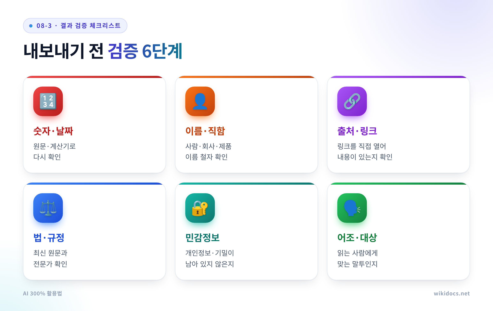

<!--
**상태**: 🔵 검토 중
**분류**: 08. 안전하게 쓰기
**태그**: #안전 #검증
**작성일**: 2026-11-22
-->
> 📅 **최종 확인**: 2026-11-22

AI 결과물을 메일로 보내거나, 보고하거나, 공개하기 전에 **마지막으로 확인할 목록**입니다. 출력해서 모니터 옆에 붙여 두고 쓰세요.

## 요약

- 내보내기 전 **6가지**를 확인합니다: 숫자·날짜, 이름, 출처·링크, 법·규정, 민감정보, 어조
- 확인에 드는 시간은 **결과물의 중요도**에 맞춥니다.
- 확인하지 못한 내용은 **빼거나 "확인 필요"로 표시**합니다.

## 검증 6단계

## 상세 체크리스트

### 1. 숫자·날짜
- [ ] 모든 수치를 원 자료와 대조했다
- [ ] 계산은 계산기·엑셀로 검산했다
- [ ] 연도·요일이 맞다 (AI는 연도를 자주 추측합니다)

### 2. 이름·직함
- [ ] 사람·회사·제품 이름의 철자가 맞다
- [ ] 직함·부서가 현재 기준이다

### 3. 출처·링크
- [ ] 링크를 직접 열어 봤다
- [ ] 인용한 문장이 그 자료에 실제로 있다
- [ ] 자료의 발행 날짜가 너무 오래되지 않았다

### 4. 법·규정
- [ ] 법령·사내 규정은 최신 원문으로 확인했다
- [ ] 법률·의료·투자 판단은 전문가 확인을 받았다

### 5. 민감정보
- [ ] 개인정보·기밀이 결과물에 남아 있지 않다
- [ ] 받는 사람이 봐도 되는 정보만 들어 있다

### 6. 어조·대상
- [ ] 받는 사람에게 맞는 말투다
- [ ] AI 특유의 과장 표현("혁신적인", "획기적인")을 줄였다

## 중요도별 확인 수준

| 결과물 | 예 | 확인 수준 |
|---|---|---|
| 개인 참고용 | 공부 메모, 아이디어 | 이상한 점만 확인 |
| 팀 내부 공유 | 회의록, 초안 | 숫자·이름·결정 사항 |
| 회사 밖으로 | 고객 메일, 제안서 | 6단계 모두 |
| 공개·법적 효력 | 보도자료, 계약, 공시 | 6단계 + 담당 부서·전문가 검토 |

[[TIP("요령: AI에게 확인 대상을 먼저 뽑게 하기")]]

"이 글에서 사실 확인이 필요한 문장을 모두 골라 표로 만들어 줘"라고 요청하면 확인할 범위를 빠르게 정할 수 있습니다(03-4). 단, **확인 자체는 사람이 원문으로** 합니다.

[[/TIP]]

## 실무 체크포인트

- [ ] 결과물의 중요도에 맞는 확인 수준을 정했는가
- [ ] 6단계 중 해당 항목을 모두 확인했는가
- [ ] 확인하지 못한 내용을 빼거나 표시했는가

## 관련 페이지

- 08-1. 개인정보와 기밀 정보 지키기
- 📚 01-3. 환각과 검증하는 습관
- 📚 03-4. 스스로 검토하게 하기
