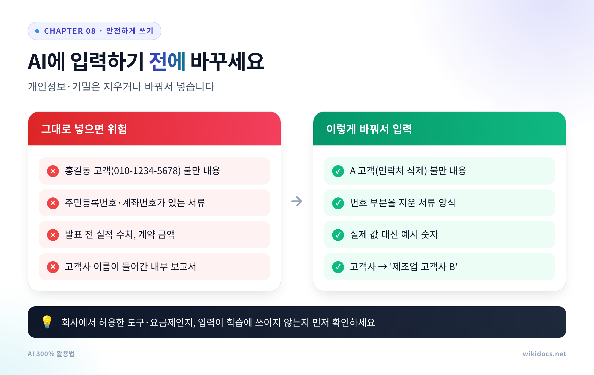

개인정보·보안·저작권을 지키며 AI를 쓰는 법입니다.

[[TIP("이 장을 읽고 나면")]]

- AI에 넣으면 안 되는 정보와 바꿔 넣는 방법을 압니다.
- 저작권 위험이 큰 요청을 피하는 법을 익힙니다.
- 내보내기 전 검증 체크리스트를 바로 쓸 수 있습니다.

[[/TIP]]

## 이 장의 구성

- 08-1. 개인정보와 기밀 정보 지키기
- 08-2. 저작권과 출처 표기
- 08-3. 결과 검증 체크리스트
