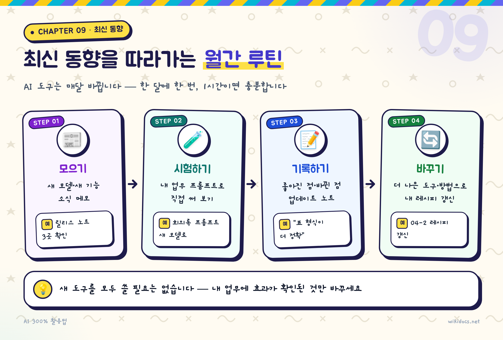

<!--
**상태**: 🔵 검토 중
**분류**: 09. 최신 동향
**태그**: #동향
**작성일**: 2026-11-22
-->
> 📅 **최종 확인**: 2026-11-23

AI 도구는 매달 새 기능이 나옵니다. 모든 소식을 따라갈 필요는 없습니다. 이 페이지는 **한 달에 한 번, 내 업무에 의미 있는 변화만** 확인하고 기록하는 노트입니다.

## 요약

- 월 1회 **모으기 → 시험하기 → 기록하기 → 바꾸기** 루틴으로 따라갑니다.
- 새 기능은 **내 업무 프롬프트로 직접 시험**한 뒤에만 도입합니다.
- 이 책도 매달 이 페이지를 갱신하고, 바뀐 내용을 해당 장에 반영합니다.

## 월간 루틴



| 단계 | 시간 | 할 일 |
|---|---|---|
| 모으기 | 20분 | 사용하는 AI 도구의 공식 업데이트 소식·릴리스 노트 확인 |
| 시험하기 | 20분 | 새 기능을 내가 자주 쓰는 프롬프트 2~3개로 시험 |
| 기록하기 | 10분 | 아래 양식으로 노트에 기록 |
| 바꾸기 | 10분 | 효과가 확인된 것만 내 레시피·업무 방식에 반영 |

## 기록 양식

```text
## 2026년 ○월
| 도구 | 바뀐 점 | 내 업무로 시험한 결과 | 도입 여부 |
|---|---|---|---|
|  |  |  |  |
```

[[TIP("요령: 정보원은 공식 채널 위주로")]]

소문이나 과장된 소개 글보다 **각 서비스의 공식 블로그, 릴리스 노트, 도움말 센터**를 먼저 확인하세요. 기능 이름과 요금제 조건은 공식 문서가 가장 정확합니다.

[[/TIP]]

## 이 책의 업데이트 노트

| 날짜 | 내용 | 반영한 곳 |
|---|---|---|
| 2026-11-21 | 책 구조 생성, 01·02장 작성 | 01~02장 |
| 2026-11-22 | 05장 AI 도구 지도 작성 (2026년 비교 자료 기준) | 05장 |
| 2026-11-22 | 03·04·06~09장, 부록 작성, 설명 이미지 추가 | 03~09장, 부록 |
| 2026-11-22 | 10장 장르별 AI 도구와 활용 사례 추가 (2026년 비교 자료 기준) | 10장, 90-2 |
| 2026-11-23 | 2026년 11월 순위권 LLM 모델(Fable 5.2, GPT-6.2, Gemini 4, Muse Wonder, Grok 4.7, 오픈 모델) 특징·장단점 정리 | 09-3 |
| 2026-11-23 | 09-3에 순위표(Arena TOP 10, 시험 점수 TOP 8, 회사별 위치, 종합 비교표)와 순위 그래프 추가, Gemini 4 Neon·Hydrogen 반영 | 09-3 |
| 2026-11-24 | 10장 장르별 사례 보강: 특성 비교표, 사례 14개(결과 예시 포함), 설명 이미지 7개 | 10장 |
| 2026-11-24 | 설명 이미지 디자인 v3로 전체 재작성, 이미지 없던 23개 페이지에 그림 추가 (총 56개) | 전 장 |
| 2026-11-24 | 그래프·관계도·흐름도·타임라인 10개 추가 (09-3 성능·가격 산점도 등) | 01·05·06·07·09·10장 |

## 매월 점검 목록

- [ ] 05장 도구 지도와 10장 장르별 도구의 기능 이름·요금 조건이 바뀌지 않았는가
- [ ] 04장 레시피 중 다시 시험해 볼 것이 있는가 (`마지막 테스트` 날짜 확인)
- [ ] 09-3 모델 순위·요금이 바뀌지 않았는가 (Arena, Artificial Analysis 확인)
- [ ] 부록 도구 비교표에 새로 넣거나 뺄 도구가 있는가
- [ ] 08장 안전 관련 공식 안내서가 새로 나왔는가

## 관련 페이지

- 09-2. 주요 모델 변화
- 09-3. 주요 LLM 모델 순위와 특징
- 📚 05-7. 목적별 도구 고르기
- 📚 90-2. AI 도구 비교표
