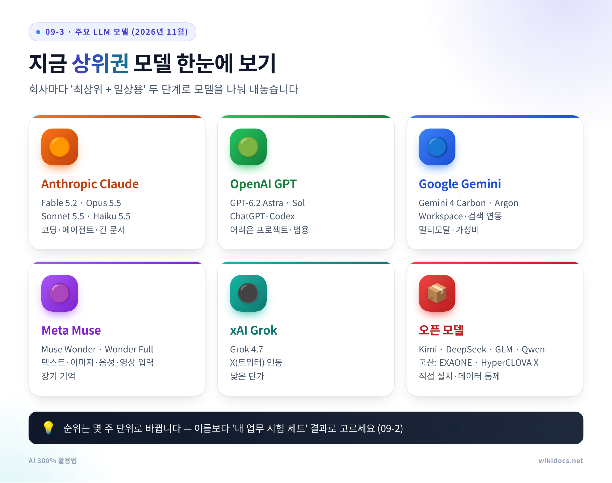
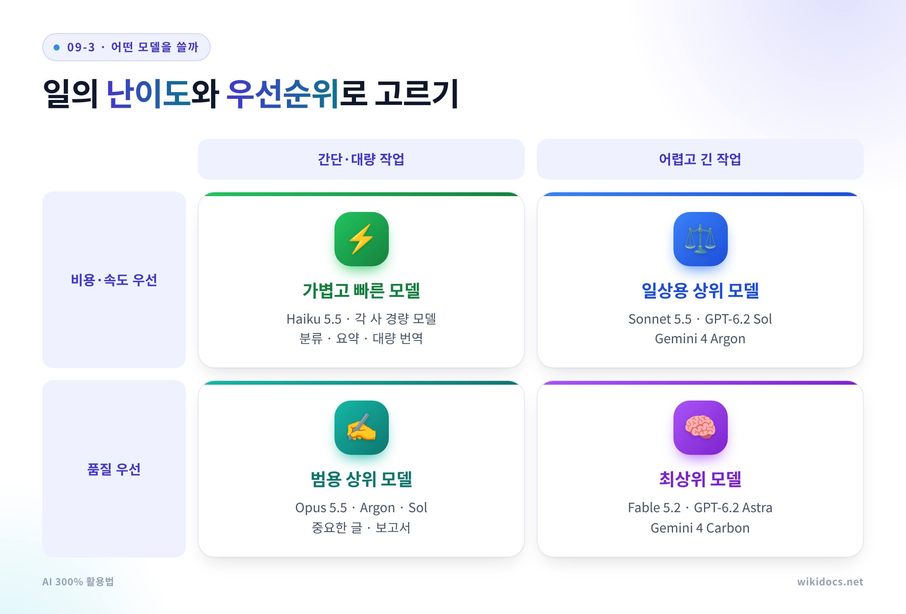

<!--
**상태**: 🔵 검토 중
**분류**: 09. 최신 동향
**태그**: #동향 #모델 #비교
**작성일**: 2026-11-23
-->
> 📅 **최종 확인**: 2026-11-23

09-2에서는 모델을 **고르는 기준**을 다뤘습니다. 이 페이지는 그 기준을 적용해 볼 수 있도록 **2026년 11월 현재 순위권에 있는 주요 모델**과 각 모델의 특징·장단점, 그리고 어떤 일에 쓰면 좋은지를 정리합니다.

[[TIP("먼저 읽어 주세요: 이 페이지는 '스냅숏'입니다")]]

- 아래 내용은 **2026년 11월 23일 기준**입니다. 이 분야는 몇 주마다 새 모델이 나와 순위가 바뀝니다.
- 순위는 **평가 방법에 따라 다르게** 나옵니다. 사람들이 직접 투표하는 순위(Arena)와 시험 문제 점수 순위(Artificial Analysis)에서 1위가 다릅니다.
- 요금·컨텍스트 창 같은 수치는 각 회사 공식 발표를 기준으로 썼습니다. 공식 발표로 확인하지 못한 수치는 **(보도)** 라고 표시했습니다.
- 특정 모델을 추천하거나 보증하지 않습니다. 결정은 **내 업무 시험 세트(09-2)** 로 하세요.

[[/TIP]]

[TOC]

## 요약

- 2026년 11월 현재 최상위권은 **Claude Fable 5.2(Anthropic)·GPT-6.2 Astra(OpenAI)·Gemini 4 Carbon(Google)** 세 모델입니다. 시험 점수 순위에서는 Fable 5.2, 사람 투표 순위에서는 Gemini 4 Carbon이 1위로 집계됩니다.
- 회사마다 **최상위 모델 + 일상용 모델** 두 단계로 나눠 내놓습니다. 대부분의 업무는 일상용 모델로 충분하고, 어렵고 긴 작업에만 최상위 모델을 씁니다.
- 고르는 순서: **회사 허용 여부 → 내가 쓰는 도구와의 연동 → 시험 세트 결과 → 비용**.

## 1. 지금 순위권 모델 한눈에 보기



| 회사 | 최상위 모델 | 일상·범용 모델 | 가볍고 빠른 모델 | 주로 쓰는 곳 |
|---|---|---|---|---|
| Anthropic | Claude Fable 5.2 | Claude Opus 5.5, Claude Sonnet 5.5 | Claude Haiku 5.5 | Claude 앱, Claude Code, API |
| OpenAI | GPT-6.2 Astra | GPT-6.2 Sol | — | ChatGPT(Work), Codex, API |
| Google | Gemini 4 Carbon | Gemini 4 Argon | — | Gemini 앱, 검색 AI 모드, Workspace, API |
| Meta | Muse Wonder Full | Muse Wonder | Muse Glimmer(오픈 모델) | Muse Code, Meta Model API |
| xAI | Grok 4.7 | — | — | Grok 앱, X, API |

> 표의 '—'는 이 페이지 작성 시점에 해당 단계의 새 모델을 공식 발표로 확인하지 못했다는 뜻입니다. 이전 세대 모델은 대부분 계속 제공됩니다.

## 2. 순위는 어떻게 매기나: 두 가지 대표 리더보드

| 리더보드 | 매기는 방법 | 무엇을 알 수 있나 | 주의할 점 |
|---|---|---|---|
| **Arena** (옛 LMArena, arena.ai) | 사람들이 두 모델의 답을 익명으로 비교해 투표 → 점수(Elo) | 사람이 **읽기에 좋은 답**을 내는 모델 | 말투·형식이 좋은 답이 유리, 신규 모델은 '잠정' 점수 |
| **Artificial Analysis Intelligence Index** | 추론·지식·수학·코딩 등 여러 시험 점수를 합산 | **어려운 문제를 푸는 능력** | 시험 문제와 내 업무는 다를 수 있음 |

### 2026년 11월 순위 스냅숏

두 리더보드의 공식 사이트는 이 책 작업 환경에서 직접 열 수 없어, 여러 집계 사이트가 옮겨 적은 11월 중순 값을 교차 확인했습니다. 집계 사이트마다 1~2점씩 차이가 있으므로 **대략적인 위치**로만 보세요.

| 순위(대략) | 시험 점수 순위 (Artificial Analysis) | 사람 투표 순위 (Arena 텍스트) |
|---|---|---|
| 1 | Claude Fable 5.2 (약 65) | Gemini 4 Carbon (잠정, 약 1,526) |
| 2 | GPT-6.2 Astra (약 62) | Gemini 4 Argon (약 1,522) |
| 3 | Gemini 4 Carbon (약 60) | 상위 5위 안: Muse Wonder, Claude Opus 5.5, Claude Fable 5 |
| 4~5 | Claude Opus 5.5 (약 58), Muse Wonder Full·Claude Sonnet 5.5 (약 56) | 상위 10위 안에 Claude 계열 여러 모델 |

- GPT-6.2(11월 17일 출시)는 출시 직후라 Arena 투표가 충분히 쌓이지 않았습니다. 11월 초 기준 Arena에서는 OpenAI 모델이 20위권 밖이었다는 집계가 있지만, 새 모델이 반영되면 달라질 수 있습니다.
- 최신 값은 [Arena 리더보드](https://arena.ai/leaderboard)와 [Artificial Analysis](https://artificialanalysis.ai/leaderboards/models)에서 직접 확인하세요.

[[TIP("순위표를 읽는 요령")]]

1. **1~2점 차이는 사실상 같은 수준**입니다. 순위 숫자보다 '상위권 묶음'으로 보세요.
2. **'잠정(preliminary)' 표시**가 있는 신규 모델은 투표가 쌓이면 순위가 바뀝니다.
3. 나에게 중요한 **분야별 순위**(코딩, 한국어, 긴 문서, 이미지 이해)를 따로 보세요. 종합 1위가 내 일에서도 1위는 아닙니다.

[[/TIP]]

## 3. 모델별 특징과 장단점

### Anthropic Claude: Fable 5.2 · Opus 5.5 · Sonnet 5.5 · Haiku 5.5

| 모델 | 위치 | 컨텍스트 창 | API 요금 (100만 토큰당 입력/출력) |
|---|---|---|---|
| Claude Fable 5.2 (11월 9일) | Anthropic의 가장 강력한 일반 공개 모델 | 100만 토큰 | $8 / $40 |
| Claude Opus 5.5 | 상위 범용 모델 | 100만 토큰 | $4 / $20 |
| Claude Sonnet 5.5 | 속도·성능 균형, 일상 코딩·업무 | 100만 토큰 | $2 / $10 |
| Claude Haiku 5.5 | 가볍고 빠름, 대량 처리 | 100만 토큰 | $0.10 / $0.50 (10만 토큰 이하 요청 기준) |

- **장점**: 코딩·에이전트(여러 단계를 스스로 진행하는 작업)와 긴 문서 작업에 강하다는 평가가 많습니다. 모든 모델이 100만 토큰 컨텍스트를 지원해 두꺼운 자료를 한 번에 다룰 수 있습니다. 시험 점수 순위 1위(Fable 5.2), Arena 상위 10위 안에 여러 모델이 들어 있습니다.
- **단점**: 최상위 Fable 5.2는 요금이 높고, 어려운 작업에서는 답이 나오기까지 시간이 오래 걸릴 수 있습니다. 같은 계열의 Claude Mythos 5.2는 검증된 기관만 쓸 수 있습니다.
- **이럴 때 쓰세요**: 코드 작성·수정(Claude Code, 05-4), 긴 보고서·계약서 분석(03-3), 여러 단계를 이어 가는 업무 자동화(07장). 대량 분류·요약은 Haiku 5.5로 비용을 낮춥니다.

### OpenAI GPT-6.2: Astra · Sol

| 모델 | 위치 | 컨텍스트 창 | API 요금 (입력/출력) |
|---|---|---|---|
| GPT-6.2 Astra (11월 17일) | 가장 어려운 프로젝트용 최상위 모델 | 약 105만 토큰 (보도) | $8 / $40 |
| GPT-6.2 Sol | 일상 업무용 효율 모델 | 약 105만 토큰 (보도) | $2 / $10 |

- **장점**: 시험 점수 순위 2위권(Astra). ChatGPT는 사용자가 가장 많은 대화형 AI라 사용법 자료와 연동 서비스가 풍부합니다. Codex로 코딩 작업에도 바로 쓸 수 있습니다.
- **단점**: 출시 초기에는 ChatGPT Work·Codex 등 일부 화면과 유료 요금제(Plus, Pro, Enterprise, Edu)에서 먼저 제공되어, 일반 대화 화면에서는 바로 보이지 않을 수 있습니다. 매우 긴 입력(약 27만 토큰 초과)은 단가가 올라간다는 보도가 있습니다.
- **이럴 때 쓰세요**: 이미 ChatGPT로 업무를 하는 팀의 기본 도구, 웹사이트·앱 시제품 만들기, 일상 문서 작업(Sol).

### Google Gemini 4: Carbon · Argon

| 모델 | 위치 | API 요금 (입력/출력) |
|---|---|---|
| Gemini 4 Carbon (11월 10일 정식 출시) | Google의 가장 강력한 모델, 어려운 다단계 작업용 | 출시 기념가 $2 / $10 (이후 인상 예정) |
| Gemini 4 Argon | 대부분의 코딩·지식 업무용 기본 모델 | $2 / $10 (출시 기념가) |

- **장점**: 사람 투표 순위(Arena) 1·2위. 출시 기념가 기준으로 최상위 모델 중 단가가 가장 낮습니다. Gmail·문서·스프레드시트(Workspace)와 검색에 자연스럽게 연결되고, 이미지·영상 같은 멀티모달 이해에 강점이 있습니다.
- **단점**: Carbon은 처음에 Google AI Ultra 구독자와 유료 API 사용자부터 제공되어 무료·하위 요금제에서는 쓰기 어렵습니다. 기념가가 끝나면 요금이 오릅니다(보도: 11월 30일 이후 $4 / $20).
- **이럴 때 쓰세요**: Google Workspace를 쓰는 회사의 문서·메일 업무(10-1), 사진·화면·영상 속 내용 이해, 비용 대비 성능이 중요한 대량 작업(Argon).

### Meta Muse: Wonder · Wonder Full

- **특징**: Meta가 10월 12일 내놓은 첫 최상위급 모델입니다. 텍스트·이미지·음성·영상을 입력받아 글로 답하고, 컨텍스트 창은 약 100만 토큰입니다. 대화를 넘어 사용자 정보를 기억해 두는 **Active Memory**, 막혀도 다른 방법을 찾아 계속 진행하는 **Active Focus** 기능을 내세웁니다. API 요금은 $4 / $20입니다(보도).
- **장점**: Arena 상위 5위권. 음성·영상까지 한 번에 입력할 수 있습니다.
- **단점**: 더 강한 Wonder Full은 Muse Code 구독자만 쓸 수 있습니다. 예전 Llama와 달리 Wonder 계열은 **가중치를 공개하지 않아** 직접 설치할 수 없습니다(작은 Muse Glimmer만 Apache 2.0으로 공개).
- **이럴 때 쓰세요**: 회의 영상·음성 자료를 함께 다루는 일, 오래 이어지는 개인 비서형 사용.

### xAI Grok 4.7

- **특징**: 9월 21일 출시, 코딩·에이전트·지식 업무용 최상위 모델로 소개됩니다. 컨텍스트 창 50만 토큰, API 요금 $2 / $6(보도)으로 출력 단가가 낮은 편입니다.
- **장점**: X(트위터)의 실시간 게시물 흐름과 연결되어 화제·여론 파악에 쓰기 좋습니다. 출력이 많은 작업의 비용이 낮습니다.
- **단점**: 11월 기준 상위 순위표에서는 위 회사들보다 아래에 있습니다. 다음 버전(Grok 4.8, Grok 5)은 출시 시점이 확인되지 않았습니다.
- **이럴 때 쓰세요**: 소셜 미디어 반응 조사, 비용이 중요한 긴 글 생성.

### 오픈 모델(직접 설치해 쓰는 모델)

| 계열 | 회사 | 자주 언급되는 점 |
|---|---|---|
| Kimi K3.1 | Moonshot AI | 11월 여러 집계에서 오픈 모델 1위권 |
| DeepSeek V4 계열 | DeepSeek | MIT 라이선스, 긴 문서·범용 |
| GLM-5.3 | Z.ai | 오픈 모델 상위권 |
| Qwen3.8 | Alibaba | 크기별로 다양한 모델, 작은 모델은 PC에서도 실행 |
| EXAONE · HyperCLOVA X | LG AI연구원 · 네이버클라우드 | 국산 모델, 한국어·국내 업무 맥락 강점 |

- **장점**: 데이터를 외부로 보내지 않고 **회사 서버 안에서** 쓸 수 있습니다. 사용량이 많으면 비용을 줄일 수 있고, 우리 데이터로 추가 학습(미세조정)도 가능합니다.
- **단점**: 최상위 상용 모델보다 성능이 한 단계 낮은 경우가 많고, 서버·GPU 준비와 운영을 직접 해야 합니다. 라이선스 조건(상업 이용, 출처 표시)이 모델마다 다릅니다.
- **이럴 때 쓰세요**: 개인정보·기밀 때문에 외부 AI를 쓰기 어려운 업무(08-1), 같은 작업을 아주 많이 반복하는 경우.

> 오픈 모델의 점수와 매개변수 수는 집계 사이트마다 크게 달라, 이 페이지에는 적지 않았습니다. 쓰기 전에 각 모델의 공식 모델 카드에서 라이선스와 사양을 확인하세요.

## 4. 어떤 모델을 쓸까: 상황별 추천



| 하고 싶은 일 | 먼저 써 볼 모델 | 이유 |
|---|---|---|
| 매일 쓰는 글·메일·요약 | 각 사의 일상용 모델 (Sonnet 5.5, GPT-6.2 Sol, Gemini 4 Argon) | 품질이 충분하고 빠르며 저렴 |
| 어려운 분석·전략 문서 | 최상위 모델 (Fable 5.2, GPT-6.2 Astra, Gemini 4 Carbon) | 여러 조건을 따지는 깊은 추론 |
| 코딩·여러 파일 수정 | Claude 계열 + Claude Code, GPT-6.2 + Codex | 코딩 도구와 함께 쓸 때 효과가 큼 (05-4) |
| 수백 쪽 문서 분석 | 100만 토큰급 컨텍스트 모델 (Claude 계열, GPT-6.2, Muse Wonder) | 자료를 잘라 넣지 않아도 됨 (03-3) |
| 사진·화면·영상 이해 | Gemini 4, Muse Wonder | 멀티모달 입력 강점 |
| 대량 분류·태깅 | Claude Haiku 5.5 등 경량 모델 | 단가가 낮고 빠름 |
| 기밀 데이터 처리 | 오픈 모델 직접 설치, 또는 기업용 요금제 | 데이터가 밖으로 나가지 않음 |
| 소셜 반응 조사 | Grok 4.7 | X 실시간 정보 연동 |

### 실전 예시: 같은 업무, 모델 나눠 쓰기

```text
[월간 시장 동향 보고서 만들기]
1. 기사 200건 분류 (긍정/부정/중립)      → 가볍고 빠른 모델 (비용 ↓)
2. 분류 결과 + 원문으로 핵심 흐름 정리   → 일상용 상위 모델
3. "우리 회사가 취할 전략 3가지" 도출    → 최상위 모델 (깊은 추론)
4. 최종 보고서 숫자·출처 확인            → 사람 (08-3)
```

모든 단계를 최상위 모델로 돌리는 것보다 **비용은 줄고 시간도 짧아집니다**. 단계마다 결과를 파일로 남겨 두면 모델을 바꿔도 같은 흐름을 그대로 쓸 수 있습니다(06-1).

[[TIP("요령: 모델 고르기 3단계")]]

1. **회사 규정 확인**: 허용된 도구·요금제인지, 입력이 학습에 쓰이지 않는지 (08-1)
2. **연동 확인**: 지금 쓰는 메일·문서·개발 도구와 붙는 모델이 무엇인지 (Workspace면 Gemini, Microsoft 365면 Copilot, 개발이면 Claude Code·Codex 등)
3. **시험 세트로 비교**: 상위권 2~3개를 09-2의 5문항 시험 세트로 돌려 보고 결정

[[/TIP]]

## 5. 공통 주의점

- **최상위 모델도 틀립니다.** 숫자·인용·법률 내용은 항상 원문으로 확인합니다(01-3, 08-3).
- **요금제마다 쓸 수 있는 모델이 다릅니다.** 무료 요금제에서는 최상위 모델이 안 보이거나 사용 횟수가 제한될 수 있습니다.
- **모델을 바꾸면 자동화 결과 형식이 바뀔 수 있습니다.** 자동화(07장)에 쓰는 프롬프트는 바꾸기 전에 나란히 시험합니다(09-2).
- **순위 1위라는 말에 휘둘리지 마세요.** 이 페이지의 순위도 한 달 뒤에는 바뀌어 있을 가능성이 큽니다.

## 실무 체크포인트

- [ ] 두 종류의 순위(사람 투표, 시험 점수)를 구분해서 봤는가
- [ ] 내 업무에 필요한 것(코딩, 긴 문서, 멀티모달, 비용, 보안)을 먼저 정했는가
- [ ] 최상위 모델과 일상용 모델을 업무 단계별로 나눠 쓰는가
- [ ] 상위권 2~3개 모델을 내 시험 세트로 비교했는가
- [ ] 이 페이지의 '최종 확인' 날짜가 한 달 넘게 지났다면 공식 발표를 다시 확인했는가

## 근거·출처

| 구분 | 출처 | 위치(URL) | 비고 |
|---|---|---|---|
| 공식 | Anthropic, Introducing Claude Fable 5.2 and Claude Mythos 5.2 | [anthropic.com](https://www.anthropic.com/claude-fable-and-mythos-5-2) | 2026-11-09 출시, 제공 플랫폼 |
| 공식 | Anthropic 모델 개요·요금 | [platform.claude.com](https://platform.claude.com/docs/en/about-claude/models/overview) | 모델 ID, 컨텍스트 창, API 요금 |
| 공식 | OpenAI, Introducing GPT-6.2 Astra and Sol | [openai.com](https://openai.com/index/introducing-gpt-6-2-astra-sol/) | 2026-11-17 출시, Astra 요금, 제공 범위 |
| 공식 | OpenAI Developer Community 공지 | [community.openai.com](https://community.openai.com/t/gpt-6-2-astra-and-sol-are-now-available/1417531) | Sol 요금, API 이름 |
| 보도 | GPT-6.2 Astra Explained (Layer3 Labs) | [layer3labs.io](https://www.layer3labs.io/guides/gpt-6-2-astra-explained) | 컨텍스트 창, 긴 입력 단가 |
| 공식 | Google, Gemini 4 Carbon is now available | [blog.google](https://blog.google/innovation-and-ai/models-and-research/gemini-models/gemini-4-carbon-now-available/) | 2026-11-10 정식 출시, Argon과의 역할 구분, 요금 |
| 보도 | 9to5Google, Gemini 4 Carbon rolling out | [9to5google.com](https://9to5google.com/2026/11/10/gemini-app-4-carbon/) | 앱 제공 요금제 |
| 보도 | Gemini 4 Carbon general availability (Resultsense) | [resultsense.com](https://www.resultsense.com/news/2026-11-11-gemini-4-carbon-general-availability/) | 기념가 이후 인상 |
| 보도 | VentureBeat, Meta Muse Wonder / Wonder Full | [venturebeat.com](https://venturebeat.com/technology/metas-new-muse-wonder-and-muse-wonder-full-models-achieve-frontier-performance-but-only-the-weaker-one-is-available-via-api) | 2026-10-12 출시, 제공 범위 |
| 보도 | Android Authority, Muse Wonder | [androidauthority.com](https://www.androidauthority.com/meta-muse-wonder-ai-models-3722247/) | 입력 형식, 컨텍스트, 요금 |
| 보도 | Grok Models Explained 2026 (AI Toolbox) | [ai-toolbox.co](https://www.ai-toolbox.co/grok-models/grok-models-explained-2026) | Grok 4.7 출시일·컨텍스트·요금 |
| 공식 | xAI API | [x.ai/api](https://x.ai/api) | 모델·요금 최신 확인용 |
| 순위 | Arena 리더보드 (공식) | [arena.ai](https://arena.ai/leaderboard) | 최신 값 확인용 |
| 순위 | Artificial Analysis (공식) | [artificialanalysis.ai](https://artificialanalysis.ai/leaderboards/models) | 최신 값 확인용 |
| 순위 | Benchleader – LMArena Text (Nov 2026) | [benchleader.com](https://www.benchleader.com/benchmarks/lmarena_text) | 11월 Arena 스냅숏 (집계) |
| 순위 | Developers Digest – LMArena / AA Index | [developersdigest.tech](https://www.developersdigest.tech/benchmarks/lmarena) | 11월 스냅숏 (집계) |
| 순위 | ModelCap – AA Intelligence Index | [modelcap.ai](https://modelcap.ai/benchmarks/aa-intelligence-index) | Fable 5.2 1위 스냅숏 (집계) |
| 순위 | ArtificialWatch – open weights | [artificialwatch.com](https://artificialwatch.com/open-weights) | 오픈 모델 순위 (집계) |
| 국내 | 머니투데이, 국가대표 AI 선발전 성적표 (2026-01) | [mt.co.kr](https://www.mt.co.kr/tech/2026/01/13/2026010916205589870) | 국산 모델 비교 |

> 집계 사이트의 순위 값은 사이트마다 1~2점씩 차이가 납니다. 이 페이지는 여러 사이트에서 공통으로 나타난 위치만 적었습니다.

## 관련 페이지

- 09-2. 주요 모델 변화 (모델 고르는 기준, 내 업무 시험 세트)
- 09-1. 월간 업데이트 노트
- 📚 05-1. 대화형 AI
- 📚 05-4. 코딩 AI
- 📚 08-1. 개인정보와 기밀 정보 지키기
