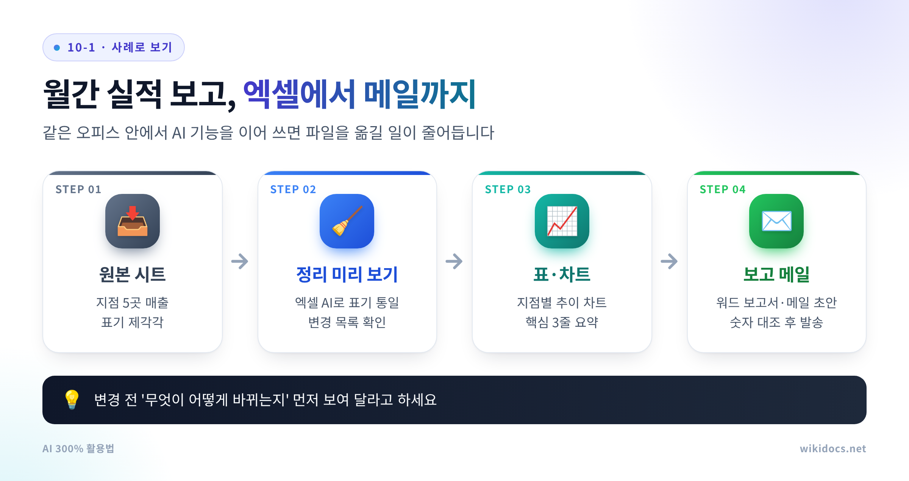

<!--
**상태**: 🔵 검토 중
**분류**: 10. 장르별 AI 도구와 활용 사례
**태그**: #도구 #오피스
**작성일**: 2026-11-22
-->
> 📅 **최종 확인**: 2026-11-24

워드, 엑셀, 메일, 메모처럼 매일 쓰는 업무 프로그램에 AI가 직접 들어오고 있습니다. 대화형 AI 창을 따로 열지 않고 **작업하던 문서 안에서 바로** AI를 쓸 수 있다는 것이 가장 큰 장점입니다.

## 요약

- **Microsoft 365 Copilot**: 워드·엑셀·파워포인트·아웃룩·팀즈 안에서 작동합니다.
- **Gemini (Google Workspace)**: 구글 문서·스프레드시트·Gmail·드라이브에서 작동합니다.
- **Notion AI**: 노트·위키·프로젝트 문서 안에서 요약·작성·검색을 돕습니다.
- 회사에서 이미 쓰는 오피스 제품에 맞춰 고르는 것이 가장 자연스럽습니다. 대부분 **유료 라이선스**가 필요합니다.

## 도구별 특징

| 도구 | 쓰는 곳 | 잘하는 일 (예) | 참고 |
|---|---|---|---|
| Microsoft 365 Copilot | Word, Excel, PowerPoint, Outlook, Teams | 문서 초안·수정, 엑셀 데이터 정리·분석, 회의 요약, 메일 정리 | 2026년에도 엑셀 데이터 정리 기능, 워드의 변경 내용 추적 편집 등 기능이 계속 추가됨 |
| Gemini (Google Workspace) | Docs, Sheets, Slides, Gmail, Drive | 문서 작성 도움, 메일 요약·답장 초안, 드라이브 문서 기반 답변 | 일부 AI 기능은 유료 Workspace 요금제 필요 |
| Notion AI | Notion 페이지·데이터베이스 | 회의 노트 요약, 문서 초안, 워크스페이스 내용 검색 | 팀 위키를 Notion으로 쓰는 경우 유리 |

> 기능과 요금제 조건은 자주 바뀝니다. 공식 릴리스 노트와 요금 안내를 확인하세요.

## 특성 한눈에 보기

| 항목 | 문서·오피스 AI |
|---|---|
| 넣는 것 | 작업 중인 엑셀 시트, 워드 문서, 메일함, 노트 |
| 얻는 것 | 정리된 표·차트, 문서 초안·수정본, 메일 요약·답장 초안 |
| 효과가 가장 큰 일 | 매주·매달 반복하는 정리·보고, 긴 메일 스레드 따라잡기 |
| AI가 약한 부분 | 숫자 계산 실수, 회사만의 맥락(누가 결정권자인지 등) |
| 사람이 꼭 할 일 | 숫자 원본 대조, 대외 문서 최종 문장 확인 |
| 시작 난이도 | ⭐ 쉬움 — 이미 쓰는 프로그램 안에서 바로 시작 |

## 활용 사례

### 사례 1: 엑셀 매출 데이터 정리와 보고서 (엑셀 + AI)

```text
[상황] 지점 5곳의 월별 매출 시트, 지점명 표기가 제각각("강남점", "강남 지점", "GN")

[요청 예시]
이 시트의 지점명 표기를 통일하고, 빈 값이 있는 행을 표시해 줘.
바꾸기 전에 어떤 값이 어떻게 바뀌는지 먼저 보여 줘.
그다음 지점별 월 매출 추이 차트와 핵심 3줄 요약을 만들어 줘.
```

**포인트:** 바꾸기 전에 **변경 내용을 미리 보여 달라고** 요청하세요. 최근 엑셀용 AI 기능도 변경 사항을 미리 보여 주고 확인을 받는 방향으로 발전하고 있습니다.

### 사례 2: 메일함 정리와 답장 초안 (메일 + AI)

```text
[요청 예시]
지난주 받은 메일 중 내가 답장해야 할 것만 골라 목록으로 만들어 줘.
각각 보낸 사람, 요청 내용 한 줄, 마감일을 표로 정리하고,
급한 2건은 정중한 답장 초안을 써 줘.
```

### 사례 3: 회의 노트 → 업무 문서 (Notion AI)

```text
[상황] 팀 위키에 쌓인 주간회의 노트 4주치
[요청 예시]
최근 4주 회의 노트에서 결정 사항과 아직 끝나지 않은 할 일만 모아
"이번 달 진행 현황" 페이지를 만들어 줘. 담당자별로 묶어 줘.
```

[[TIP("요령: 변경 내용 추적과 함께 쓰기")]]

워드 문서를 AI로 수정할 때는 **변경 내용 추적(Track Changes)**을 켠 상태에서 수정하게 하면, 무엇이 바뀌었는지 하나씩 확인하고 받아들이거나 거절할 수 있습니다. 계약서·보고서처럼 중요한 문서에 특히 유용합니다.

[[/TIP]]

## 사례로 더 보기: 처음부터 끝까지

> 아래 사례의 데이터·결과는 이해를 돕기 위한 **설명용 가상 예시**입니다.

### 사례 4: 월간 실적 보고를 엑셀에서 메일까지



**상황**: 영업지원팀 A 대리는 매달 첫 주에 지점 5곳의 매출 시트를 모아 팀장 보고 메일을 씁니다. 지점마다 표기 방식이 달라 정리에만 반나절이 걸립니다.

| 단계 | 쓰는 곳 | 요청 예시 |
|---|---|---|
| 1. 정리 | 엑셀 + AI | "지점명·날짜 표기를 통일하고 빈 값이 있는 행을 노란색으로 표시해 줘. 바꾸기 전에 변경 목록을 먼저 보여 줘." |
| 2. 분석 | 엑셀 + AI | "지점별 월 매출과 전월 대비 증감률 표를 만들고, 증감률이 -10% 아래인 지점을 강조해 줘." |
| 3. 보고서 | 워드 + AI | "위 표를 근거로 1쪽 보고서 초안. 구성: 핵심 요약 3줄 → 지점별 현황 → 다음 달 확인할 점." |
| 4. 메일 | 메일 + AI | "보고서를 첨부하는 팀장 보고 메일. 5줄 이내, 첫 줄에 결론." |

**결과 예시 (2단계 표)**

| 지점 | 10월 매출(만 원) | 11월 매출(만 원) | 증감률 |
|---|---:|---:|---:|
| 강남 | 4,200 | 4,620 | +10.0% |
| 판교 | 3,100 | 3,255 | +5.0% |
| 부산 | 2,800 | 2,380 | **-15.0%** |

**결과 예시 (4단계 메일 첫 줄)**

```text
11월 전체 매출은 전월 대비 2.1% 늘었으나, 부산점이 15% 줄어 원인 확인이 필요합니다.
```

| 비교 | 기존 방식 | AI 활용 |
|---|---|---|
| 표기 통일 | 셀을 하나씩 찾아 고침 | 변경 목록을 보고 한 번에 승인 |
| 표·차트 | 수식·차트 직접 작성 | 요청 한 줄로 초안, 사람은 검토 |
| 보고 메일 | 빈 화면에서 작성 | 초안을 고쳐 쓰기 |
| 확인 | — | **증감률 2~3개를 계산기로 대조** |

### 사례 5: 규정 문서 두 버전 비교

**상황**: 인사팀에서 취업규칙 개정안을 검토합니다. 기존본과 개정안이 30쪽씩이라 바뀐 곳을 찾기 어렵습니다.

```text
[요청 예시 — 워드 + AI 또는 대화형 AI]
첨부한 두 문서(기존본, 개정안)를 비교해서 달라진 조항만 표로 정리해 줘.
열: 조항 | 기존 | 개정 | 바뀐 점 한 줄 | 직원에게 미치는 영향
문구만 다듬은 곳은 "표현 수정"으로 따로 묶어 줘.
```

**결과 예시**

| 조항 | 기존 | 개정 | 바뀐 점 | 직원 영향 |
|---|---|---|---|---|
| 제12조(근무시간) | 09:00~18:00 | 08:00~10:00 사이 출근 선택 | 시차출근 도입 | 출근 시간 선택 가능 |
| 제25조(연차) | 1년 후 15일 | 입사 첫 달부터 월 1일 | 표현 수정 + 안내 추가 | 변화 없음 |

**포인트**: 비교 결과는 **원문과 반드시 대조**합니다. AI가 비슷한 조항을 같은 것으로 묶어 버리는 경우가 있습니다. 워드의 '문서 비교' 기능으로 바뀐 곳을 표시한 뒤 AI에게 요약을 맡기면 더 안전합니다.

### 사례 6: 설문 응답 정리 (스프레드시트 + Gemini 등)

**상황**: 사내 교육 만족도 설문 응답 120건. 객관식은 통계가 나오지만 주관식 의견은 일일이 읽어야 합니다.

```text
[요청 예시]
'개선 의견' 열의 주관식 응답을 주제별로 분류해 줘.
새 열에 주제(예: 시간, 내용 난이도, 강사, 장소, 기타)를 넣고,
주제별 건수와 대표 의견 2개씩을 따로 표로 정리해 줘.
```

**결과 예시**

| 주제 | 건수 | 대표 의견 |
|---|---:|---|
| 내용 난이도 | 41 | "실습이 더 많았으면", "기초 설명이 길다" |
| 시간 | 33 | "점심 직후는 집중이 어렵다" |
| 장소 | 12 | "화면이 잘 안 보인다" |

**포인트**: 분류 결과 중 10건 정도를 무작위로 골라 맞게 분류됐는지 확인합니다. 응답에 이름·부서가 있으면 지우고 넣습니다(08-1).

## 주의할 점

- 회사 문서를 AI로 처리할 때는 **회사에서 허용한 라이선스와 보안 설정**인지 확인합니다.
- AI가 정리한 숫자는 원본 시트와 한두 개 대조합니다.
- 공유 드라이브 전체를 근거로 답하는 기능은 **접근 권한이 있는 문서**를 근거로 하므로, 권한 관리가 중요합니다.

## 실무 체크포인트

- [ ] 우리 회사 오피스 제품에 맞는 AI 기능과 라이선스를 확인했는가
- [ ] 데이터 변경 전 미리 보기·변경 내용 추적을 사용했는가
- [ ] AI가 정리한 숫자를 원본과 대조했는가

## 근거·출처

| 구분 | 출처 | 비고 |
|---|---|---|
| 공식 | [Release Notes for Microsoft 365 Copilot (Microsoft Learn)](https://learn.microsoft.com/en-us/microsoft-365/copilot/release-notes) | 기능 변경 기록 |
| 공식 | [What's New in Microsoft 365 Copilot (Microsoft Tech Community)](https://techcommunity.microsoft.com/blog/microsoft-copilot-blog/what%E2%80%99s-new-in-microsoft-365-copilot--july-2026/4538332) | 월별 신기능 |
| 보도 | [Microsoft 365 Copilot June 2026 features (Windows Report)](https://windowsreport.com/microsoft-365-copilot-received-these-new-features-in-june-2026/) | 엑셀·워드 기능 |

## 관련 페이지

- 10-2. 프레젠테이션·디자인 AI
- 📚 05-1. 대화형 AI
- 📚 04-4. 데이터 분석 레시피
