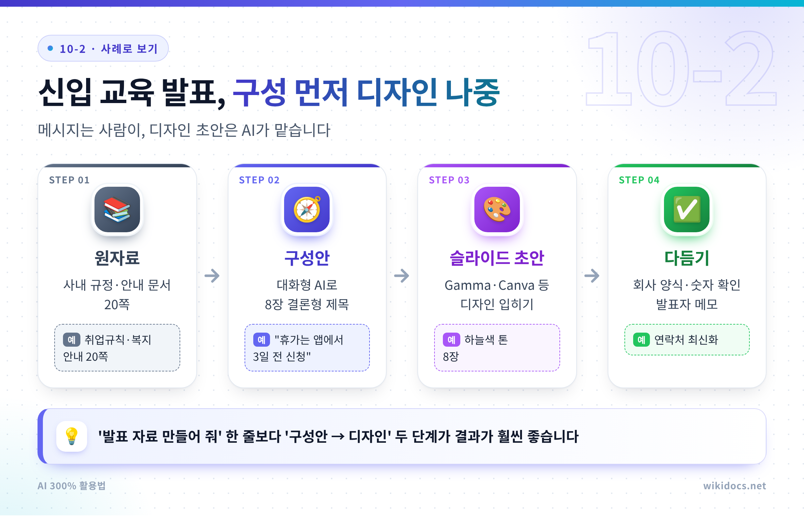

<!--
**상태**: 🔵 검토 중
**분류**: 10. 장르별 AI 도구와 활용 사례
**태그**: #도구 #발표
**작성일**: 2026-11-22
-->
> 📅 **최종 확인**: 2026-11-24

발표 자료를 만들 때 가장 오래 걸리는 일은 **구성 잡기와 디자인**입니다. 프레젠테이션·디자인 AI는 주제나 문서를 주면 슬라이드 초안을 디자인까지 입혀 만들어 줍니다.


<small>사진: [Monday Sessions, David Cage of Quantic Dream](https://www.flickr.com/photos/46982319@N06/4897801058) · Official GDC · [CC BY 2.0](https://creativecommons.org/licenses/by/2.0/) · Openverse 경유</small>

## 요약

- **Gamma**: 프롬프트나 문서로 슬라이드를 빠르게 만드는 AI 전용 도구로 자주 꼽힙니다.
- **Canva**: AI 생성과 디자인 품질의 균형, 다양한 템플릿이 강점입니다.
- **PowerPoint Copilot / Google Slides + Gemini**: 회사가 이미 쓰는 오피스 안에서 작업할 때 자연스럽습니다.
- 어떤 도구든 **내용(메시지)은 사람이 정하고**, AI는 구성과 디자인 초안을 맡기는 것이 좋습니다.

## 도구별 특징

| 도구 | 강점 | 잘 맞는 경우 |
|---|---|---|
| Gamma | 프롬프트 → 완성도 있는 슬라이드가 빠름 | 아이디어 발표, 내부 공유 자료 |
| Canva | 디자인 템플릿과 AI 생성의 균형, 이미지·SNS 소재까지 | 홍보물, 외부 발표, 디자인 일관성 |
| PowerPoint Copilot | 기존 파워포인트 문서·회사 템플릿 안에서 작업 | 회사 양식이 정해진 보고 |
| Google Slides + Gemini | 구글 Workspace 협업 | 팀 공동 작업 (AI 기능은 유료 요금제) |
| Beautiful.ai | 규칙 기반 레이아웃으로 일관된 디자인 | 깔끔한 정형 슬라이드 |

> 여러 비교 자료에서 Gamma와 Canva가 범용 추천으로 자주 언급되지만, 일부 비교는 도구를 판매하는 회사가 작성했습니다. 직접 같은 주제로 시험해 보고 고르세요.

## 특성 한눈에 보기

| 항목 | 프레젠테이션·디자인 AI |
|---|---|
| 넣는 것 | 주제 한 줄, 보고서·문서, 슬라이드 구성안 |
| 얻는 것 | 디자인이 입혀진 슬라이드 초안, 카드뉴스, 포스터 |
| 효과가 가장 큰 일 | 빈 슬라이드에서 시작하는 시간, 레이아웃·색 맞추기 |
| AI가 약한 부분 | 핵심 메시지 고르기, 회사 양식·브랜드 규칙, 정확한 숫자 |
| 사람이 꼭 할 일 | 발표 목적·메시지 결정, 숫자·이미지 권리 확인 |
| 시작 난이도 | ⭐⭐ 보통 — 구성안을 먼저 만드는 습관이 필요 |

## 활용 사례

### 사례 1: 보고서 → 발표 슬라이드 (Gamma·Canva 등)

```text
[1단계: 대화형 AI로 구성 먼저]
아래 보고서를 임원 대상 10분 발표로 바꾸려고 해.
슬라이드 7장 구성안을 만들어 줘. 장마다 제목(결론형 문장)과 핵심 근거 3개.
(보고서 붙여 넣기)

[2단계: 프레젠테이션 AI에 구성안 넣기]
위 7장 구성안으로 슬라이드를 만들어 줘. 남색·흰색 톤, 숫자는 차트로.

[3단계: 사람이 다듬기]
숫자 확인, 회사 로고·양식 적용, 발표자 메모 추가
```

**포인트:** 구성 없이 "발표 자료 만들어 줘"라고 하면 그럴듯하지만 메시지가 약한 슬라이드가 나옵니다. **구성 → 디자인** 순서로 나누세요. (03-5 단계 나누기)

### 사례 2: 수업·교육 자료

```text
"엑셀 피벗 테이블 기초" 60분 교육 슬라이드를 만들어 줘.
대상: 엑셀 초급 직장인 / 구성: 개념 → 따라 하기 3단계 → 실습 과제 → 퀴즈 3문제
장마다 실습 화면을 넣을 자리를 비워 줘.
```

### 사례 3: SNS 카드뉴스 (Canva)

```text
신제품 출시 카드뉴스 5장. 1장: 문제 제기, 2~4장: 기능 3가지, 5장: 행동 유도.
정사각형, 밝은 색, 장마다 문구 20자 이내.
```

[[TIP("요령: 결론형 제목")]]

슬라이드 제목을 "매출 현황"이 아니라 **"3분기 매출은 온라인이 견인했습니다"**처럼 결론으로 쓰게 하면, 제목만 넘겨 봐도 발표 내용이 전달됩니다. AI에게 "제목은 결론형 문장으로"라고 요청하세요.

[[/TIP]]

## 사례로 더 보기: 처음부터 끝까지

> 아래 사례의 내용·결과는 이해를 돕기 위한 **설명용 가상 예시**입니다.

### 사례 4: 신입사원 온보딩 발표 30분



**상황**: 인사팀 B 주임이 다음 주 신입사원 10명에게 30분 동안 회사 생활 안내를 해야 합니다. 원자료는 20쪽짜리 사내 안내 문서입니다.

```text
[1단계 — 대화형 AI로 구성안]
아래 사내 안내 문서로 신입사원 대상 30분 발표 구성안을 만들어 줘.
- 슬라이드 8장, 장마다 '결론형 제목' + 핵심 내용 3개
- 첫날 꼭 알아야 할 것 위주, 규정 조항 번호는 빼고 쉬운 말로
- 마지막 장은 '누구에게 물어보면 되는지' 연락처 표
(문서 붙여 넣기)
```

**결과 예시 (구성안)**

| 장 | 결론형 제목 | 핵심 내용 |
|---|---|---|
| 1 | 우리 회사는 고객의 시간을 아껴 주는 회사입니다 | 미션, 주요 제품, 고객 |
| 2 | 출근은 8~10시 사이에 고를 수 있습니다 | 시차출근, 근태 앱, 지각 기준 |
| 3 | 휴가는 앱에서 3일 전까지 신청합니다 | 연차, 반차, 신청 방법 |
| 4 | 보안 3원칙만 지키면 됩니다 | 화면 잠금, USB 금지, 메일 주의 |
| … | … | … |
| 8 | 궁금하면 이 사람에게 물어보세요 | 부서별 담당자 표 |

```text
[2단계 — 프레젠테이션 AI에 구성안 넣기]
위 8장 구성으로 슬라이드를 만들어 줘. 밝은 하늘색 톤, 장마다 아이콘 1개,
글자는 크게, 한 장에 문장 3줄 이내.

[3단계 — 사람이 다듬기]
회사 로고·양식 적용 → 연락처 최신화 → 발표자 메모 → 5분 리허설
```

| 비교 | 구성 없이 "발표 자료 만들어 줘" | 구성안 → 디자인 |
|---|---|---|
| 제목 | "근무 제도", "휴가 제도"처럼 주제만 나열 | "휴가는 앱에서 3일 전까지 신청합니다"처럼 결론이 보임 |
| 내용 | 일반적인 회사 이야기가 섞임 | 우리 회사 문서 내용만 들어감 |
| 수정 | 장마다 다시 고쳐야 함 | 디자인만 손보면 됨 |

### 사례 5: 연간 성과 인포그래픽 1장 (Canva 등)

**상황**: 마케팅팀이 올해 성과를 사내 게시판과 SNS에 올릴 한 장짜리 인포그래픽을 만듭니다.

```text
[요청 예시]
세로형 인포그래픽 1장. 제목 "2026년, 고객과 함께한 숫자들".
숫자 카드 4개: 신규 고객 12,000명 / 재구매율 38% / 고객센터 응답 평균 2분 / 앱 평점 4.7
아래에 "고객 여러분 감사합니다" 문구, 회사 색(남색·민트) 사용.
```

**포인트**
- 숫자는 **사람이 확정한 값만** 넣습니다. AI가 그럴듯한 숫자를 채워 넣지 않도록 "내가 준 숫자만 사용"이라고 적습니다.
- 넣은 아이콘·사진이 상업 이용 가능한 소재인지 확인합니다(08-2).

### 사례 6: 같은 내용, 대상별 3가지 버전

```text
[요청 예시 — 대화형 AI]
아래 신규 서비스 소개 내용을 세 가지 발표 구성으로 바꿔 줘.
1) 임원 보고 5장: 숫자와 결정 사항 중심
2) 고객 설명회 10장: 고객이 얻는 이익과 사용 방법 중심
3) 사내 공유 3장: 각 부서가 할 일 중심
```

| 대상 | 장 수 | 첫 장 제목 예시 |
|---|:---:|---|
| 임원 | 5 | "출시 3개월 안에 유료 전환 1,000건이 목표입니다" |
| 고객 | 10 | "보고서 작성 시간을 절반으로 줄여 드립니다" |
| 사내 | 3 | "12월 1일 출시, 부서별 준비 사항입니다" |

**포인트**: 같은 자료라도 **대상이 달라지면 메시지 순서가 달라집니다.** 구성안 단계에서 대상별로 나눠 두면 디자인 작업은 한 번에 끝낼 수 있습니다.

## 주의할 점

- AI가 넣은 **아이콘·이미지의 이용 조건**(상업적 사용 가능 여부)을 확인합니다. (08-2)
- 숫자·차트는 원본 데이터와 대조합니다.
- 회사 기밀이 담긴 보고서를 외부 도구에 올려도 되는지 확인합니다.

## 실무 체크포인트

- [ ] 구성(메시지)을 먼저 정하고 디자인을 맡겼는가
- [ ] 슬라이드 제목을 결론형으로 썼는가
- [ ] 숫자·이미지 이용 조건을 확인했는가

## 근거·출처

| 구분 | 출처 | 비고 |
|---|---|---|
| 비교 | [The 6 Best AI Presentation Makers in 2026 (Zapier)](https://zapier.com/blog/best-ai-presentation-maker/) | 도구 비교 |
| 비교 | [Best presentation software 2026 (Guideflow)](https://www.guideflow.com/blog/presentation-software-ai-tools) | 15개 도구 |
| 비교 | [Best AI for Presentations 2026 (The AI Rankings)](https://theairankings.com/best-ai-for-presentations/) | Gamma·Copilot |
| 참고 | [The Best AI Presentation Makers in 2026 (Gamma 작성)](https://gamma.app/explore/content/guides/best-ai-presentation-makers) | 판매사 작성 자료 |
| 사진 | [Monday Sessions, David Cage of Quantic Dream](https://www.flickr.com/photos/46982319@N06/4897801058) (Official GDC) | CC BY 2.0 |

## 관련 페이지

- 10-1. 문서·오피스 AI
- 10-3. 영상 생성·편집 AI
- 📚 05-5. 이미지·영상·음성 AI
- 📚 03-5. 단계를 나눠 연결하기
