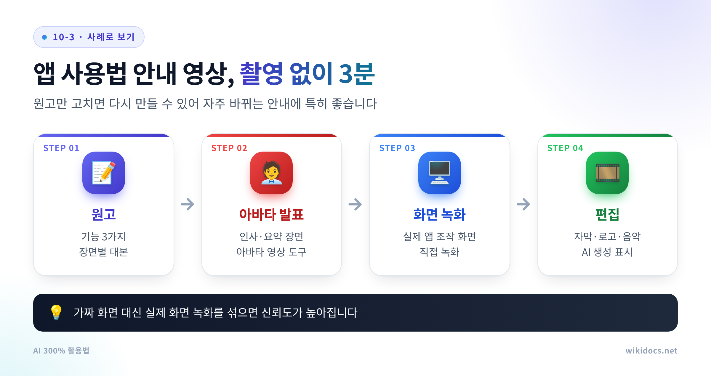

<!--
**상태**: 🔵 검토 중
**분류**: 10. 장르별 AI 도구와 활용 사례
**태그**: #도구 #영상
**작성일**: 2026-11-22
-->
> 📅 **최종 확인**: 2026-11-24

영상 AI는 글이나 이미지로 **짧은 영상을 만들거나**, 사람 대신 말하는 **아바타 영상**을 만들어 줍니다. 제품 소개, 교육 영상, SNS 숏폼처럼 촬영과 편집에 시간이 많이 드는 일을 크게 줄일 수 있습니다.

## 요약

- **장면 생성형**(Veo, Kling, Runway, Luma 등): 글·이미지로 영상 장면을 만듭니다.
- **아바타·발표형**(HeyGen, Synthesia 등): 원고를 주면 가상 발표자가 말하는 영상을 만듭니다.
- 영상 AI는 도구 순위와 기능이 **특히 빠르게** 바뀌므로, 목적별로 시험해 보고 고릅니다.

## 유형별 도구

| 유형 | 도구 예 (2026 비교 자료 기준) | 잘 맞는 일 |
|---|---|---|
| 장면 생성 (고품질) | Google Veo | 고화질 장면, 소리까지 함께 생성 |
| 장면 생성 (가성비) | Kling | 비용 대비 영화 같은 장면 |
| 장면 생성 (세밀한 제어) | Runway | 움직임·카메라 제어, 참조 이미지 기반 작업 |
| 장면 생성 (빠른 시안) | Luma Dream Machine | 카메라 움직임, 빠른 프로토타입 |
| 아바타·발표 영상 | HeyGen, Synthesia | 교육·안내 영상, 다국어 발표 |

> 2026년 비교 자료들 사이에서도 순위와 일부 서비스의 현재 상태에 대한 서술이 엇갈립니다. 사용 전에 각 서비스의 공식 안내를 확인하세요.

## 특성 한눈에 보기

| 항목 | 장면 생성형 (Veo·Kling·Runway 등) | 아바타·발표형 (HeyGen·Synthesia 등) |
|---|---|---|
| 넣는 것 | 장면 묘사 프롬프트, 참조 이미지 | 원고, 발표자·배경 선택 |
| 얻는 것 | 5~10초 장면 영상 | 가상 발표자가 말하는 설명 영상 |
| 효과가 가장 큰 일 | 촬영하기 어려운 장면, SNS 숏폼 시안 | 자주 바뀌는 교육·안내 영상, 다국어 버전 |
| AI가 약한 부분 | 긴 영상의 일관성, 글자·손 모양, 정확한 제품 모습 | 감정 표현, 현장감 |
| 사람이 꼭 할 일 | 장면 대본, 편집, 실존 인물 금지 확인 | 원고 정확성, AI 생성 표시 |
| 시작 난이도 | ⭐⭐⭐ 어려움 — 장면을 나눠 만드는 연습 필요 | ⭐⭐ 보통 — 원고만 있으면 시작 |

## 활용 사례

### 사례 1: 제품 소개 숏폼 (장면 생성형)

```text
[1단계: 대화형 AI로 장면 대본]
친환경 텀블러 신제품 15초 숏폼 대본을 장면 3개로 써 줘.
장면마다 화면 묘사, 카메라 움직임, 자막 문구(10자 이내)를 적어 줘.

[2단계: 장면별 영상 생성 프롬프트]
"아침 햇살이 드는 사무실 책상 위, 텀블러에서 김이 오른다,
 카메라가 천천히 다가간다, 따뜻한 색감, 세로 9:16, 5초"

[3단계: 편집]
생성한 장면 3개를 편집 도구에서 이어 붙이고 자막·로고·음악 추가
```

### 사례 2: 사내 교육 영상 (아바타형)

```text
신입사원 보안 교육 3분 영상
1. 대화형 AI로 교육 원고 작성 (요점 5개, 퀴즈 1개)
2. 아바타 영상 도구에 원고 입력, 발표자·배경 선택
3. 화면에 요점 자막 추가, 필요하면 영어 버전도 생성
```

**포인트:** 촬영·녹음 없이 원고만 고치면 영상을 다시 만들 수 있어 **내용이 자주 바뀌는 교육 자료**에 특히 유용합니다.

[[TIP("요령: 장면을 짧게 나눠 만들기")]]

긴 영상을 한 번에 만들려고 하면 장면이 어색해지기 쉽습니다. **5~10초 장면 여러 개**로 나눠 만들고 편집에서 이어 붙이세요. 장면마다 같은 등장인물·색감을 유지하려면 **참조 이미지**를 함께 넣습니다.

[[/TIP]]

## 사례로 더 보기: 처음부터 끝까지

> 아래 사례의 내용·결과는 이해를 돕기 위한 **설명용 가상 예시**입니다.

### 사례 3: 앱 사용법 안내 영상 (아바타 + 실제 화면)



**상황**: 고객지원팀이 근태 관리 앱의 새 기능 3가지를 안내하는 3분 영상을 만듭니다. 기능이 자주 바뀌어 매번 촬영하기가 부담스럽습니다.

```text
[1단계 — 대화형 AI로 장면 대본]
근태 앱 새 기능 3가지(시차출근 신청, 휴가 잔여일 보기, 외근 등록) 안내 영상 대본.
3분, 장면 6개. 장면마다 [화면 종류: 아바타/화면 녹화], 대사, 자막(15자 이내)을 표로.
```

**결과 예시 (장면 대본)**

| 장면 | 화면 종류 | 대사 (요약) | 자막 |
|:---:|---|---|---|
| 1 | 아바타 | 오늘은 새 기능 3가지를 알려 드립니다 | 새 기능 3가지 |
| 2 | 화면 녹화 | 메뉴에서 '출근 시간 선택'을 누르세요 | ① 시차출근 신청 |
| 3 | 화면 녹화 | 첫 화면 위쪽에 남은 휴가가 보입니다 | ② 휴가 잔여일 |
| 4 | 화면 녹화 | 외근은 지도에서 장소를 고르면 끝 | ③ 외근 등록 |
| 5 | 아바타 | 자주 묻는 질문 두 가지를 정리했습니다 | 자주 묻는 질문 |
| 6 | 아바타 | 궁금한 점은 사내 메신저 '근태봇'으로 | 문의: 근태봇 |

```text
[2단계] 아바타 장면(1·5·6)은 아바타 영상 도구에 대사를 넣어 생성
[3단계] 화면 장면(2~4)은 실제 앱을 직접 녹화
[4단계] 편집 도구에서 이어 붙이고 자막·로고·배경음, 끝에 "AI 아바타 사용" 표시
```

| 비교 | 기존 방식 | AI 활용 |
|---|---|---|
| 발표자 | 직원 섭외·촬영·재촬영 | 원고 입력으로 생성 |
| 기능이 바뀌면 | 처음부터 다시 촬영 | 해당 장면 대사만 고쳐 다시 생성 |
| 영어 버전 | 별도 녹음 | 번역 원고로 같은 아바타 영상 생성 (10-6) |

### 사례 4: 매장 홍보 숏폼 3가지 버전 비교 (장면 생성형)

**상황**: 동네 베이커리가 인스타그램 릴스용 15초 영상을 만듭니다. 어떤 분위기가 반응이 좋을지 몰라 세 가지 버전을 시험합니다.

| 버전 | 콘셉트 | 장면 생성 프롬프트 예시 (5초 장면 중 하나) |
|---|---|---|
| A | 갓 구운 빵의 따뜻함 | "오븐 문이 열리며 크루아상에서 김이 오른다, 따뜻한 조명, 천천히 다가가는 카메라, 세로 9:16" |
| B | 바쁜 아침의 해결책 | "출근길 직장인이 빵 봉투를 받아 들고 웃는다, 밝은 아침 햇살, 손 클로즈업, 세로 9:16" |
| C | 재료의 신선함 | "밀가루가 흩날리는 나무 작업대, 반죽을 접는 손, 자연광, 느린 화면, 세로 9:16" |

```text
[진행]
1. 버전별로 5초 장면 3개씩 생성 → 편집 도구에서 15초로 연결
2. 실제 매장 사진·로고를 마지막 장면에 넣어 '진짜 가게'임을 보여 줌
3. 일주일씩 올려 보고 반응(저장·공유 수)이 좋은 버전으로 계속 제작
```

**포인트**
- AI가 만든 빵이 실제 판매 제품과 다르게 보이면 **과장 광고**가 될 수 있습니다. 제품 장면은 실제 사진·영상을 쓰고, AI 장면은 분위기 연출에만 씁니다.
- 사람 얼굴이 나오는 장면은 실존 인물처럼 보이지 않게 하고, 필요하면 "AI로 만든 장면" 표시를 붙입니다.

## 주의할 점

| 주의 | 대처 |
|---|---|
| 실존 인물·유명인의 얼굴·목소리 흉내 | 만들지 않음 (초상권·퍼블리시티권, 딥페이크 문제) |
| 상업적 이용 조건 | 요금제별 상업 이용 가능 여부 확인 |
| AI 생성물 표시 | 필요한 경우 "AI로 생성한 영상"임을 밝힘 |
| 사실처럼 보이는 영상 | 뉴스·사건처럼 오해를 부를 영상은 만들지 않음 |

## 실무 체크포인트

- [ ] 장면 대본을 먼저 쓰고 장면별로 생성했는가
- [ ] 실존 인물을 흉내 내지 않았는가
- [ ] 상업 이용 조건과 AI 생성 표시를 확인했는가

## 근거·출처

| 구분 | 출처 | 비고 |
|---|---|---|
| 비교 | [The 16 best AI video generators in 2026 (Zapier)](https://zapier.com/blog/best-ai-video-generator/) | 유형별 도구 |
| 비교 | [The Best AI Video Generators in 2026 (Dupple)](https://dupple.com/learn/best-ai-video-generators) | Veo·Kling·Runway |
| 비교 | [Best AI Video Generators in 2026, Compared (Kreatorflow)](https://kreatorflow.ai/guides/best-ai-video-generators-2026) | 비교 |
| 참고 | [The 10 Best AI Video Generators in 2026 (Synthesia 작성)](https://www.synthesia.io/post/best-ai-video-generators) | 판매사 작성 자료 |

## 관련 페이지

- 10-4. 음성·음악 AI
- 📚 05-5. 이미지·영상·음성 AI
- 📚 08-2. 저작권과 출처 표기
