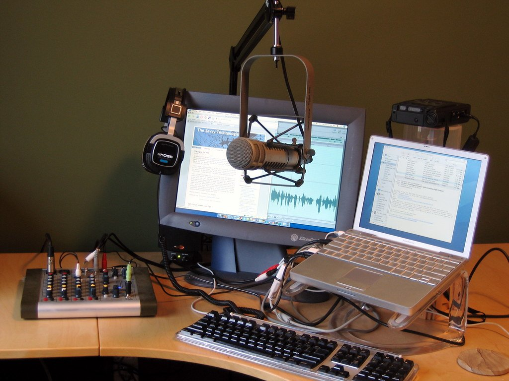
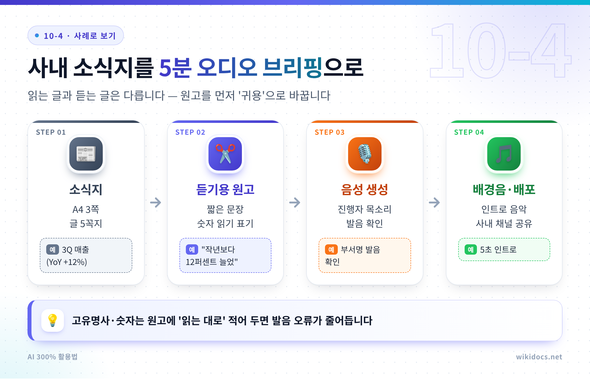

<!--
**상태**: 🔵 검토 중
**분류**: 10. 장르별 AI 도구와 활용 사례
**태그**: #도구 #음성
**작성일**: 2026-11-22
-->
> 📅 **최종 확인**: 2026-11-24

음성 AI는 글을 자연스러운 목소리로 읽어 주고(TTS), 음악 AI는 원하는 분위기의 배경 음악이나 노래를 만들어 줍니다. 영상 내레이션, 오디오 안내, 팟캐스트, 매장 배경 음악처럼 **소리가 필요한 콘텐츠**를 빠르게 만들 수 있습니다.


<small>사진: [The Podcave](https://www.flickr.com/photos/70816538@N00/76894378) · TimWilson · [CC BY 2.0](https://creativecommons.org/licenses/by/2.0/) · Openverse 경유</small>

## 요약

- **음성 생성(TTS)**: 원고를 넣으면 사람 같은 목소리로 읽어 줍니다. (예: ElevenLabs)
- **음악 생성**: 분위기·장르·가사를 주면 곡을 만들어 줍니다. (예: Suno, ElevenLabs Music)
- 음악 AI는 **상업적 이용 권리가 요금제마다 다르고**, 학습 데이터 관련 분쟁도 있었으므로 약관 확인이 특히 중요합니다.

## 도구와 쓰임

| 도구 | 유형 | 잘 맞는 일 |
|---|---|---|
| ElevenLabs | 음성 생성, 음악 생성 | 영상 내레이션, 오디오북, 다국어 음성 안내, 배경 음악 |
| Suno | 음악·노래 생성 | 가사가 있는 노래, 배경 음악, 짧은 징글 |
| 대화형 AI의 음성 대화 | 음성 대화 | 말로 묻고 답 듣기, 회화 연습 (05-5) |

## 상업적 이용 권리 (확인 필수)

2026년 비교 자료를 보면 음악 AI의 권리 조건은 서비스와 요금제에 따라 다르고, 자료끼리도 서술이 엇갈립니다.

| 확인 항목 | 왜 중요한가 |
|---|---|
| 무료 요금제 결과물의 상업 이용 | 많은 서비스가 무료 결과물은 개인·비상업 용도로 제한 |
| 유료 요금제의 권리 범위 | 광고·방송·스트리밍 배포 등 용도별 제한이 있을 수 있음 |
| 소유권 | 생성한 곡의 권리를 누가 갖는지 약관마다 다름 |
| 다운로드·이용 한도 | 무료 계정의 다운로드 횟수 제한 등 정책 변경이 잦음 |

> 업무·상업용으로 쓰기 전에 **사용 시점의 공식 약관**을 확인하고, 확인한 날짜를 기록해 두세요.

## 특성 한눈에 보기

| 항목 | 음성 생성 (TTS) | 음악 생성 |
|---|---|---|
| 넣는 것 | 원고, 목소리·속도·감정 선택 | 분위기·장르·악기·길이 설명, 가사(선택) |
| 얻는 것 | 내레이션·안내 음성 파일 | 배경 음악, 노래, 짧은 징글 |
| 효과가 가장 큰 일 | 교육·안내 내레이션, 다국어 음성 | 영상·매장 배경 음악, 채널 인트로 |
| AI가 약한 부분 | 고유명사·숫자 발음, 긴 글의 억양 | 정확한 길이·구성 맞추기, 원하는 곡 느낌 재현 |
| 사람이 꼭 할 일 | 원고를 '귀용'으로 다듬기, 발음 확인 | 요금제별 상업 이용 권리 확인 |
| 시작 난이도 | ⭐ 쉬움 | ⭐⭐ 보통 — 약관 확인이 필수 |

## 활용 사례

### 사례 1: 교육 영상 내레이션

```text
[1단계: 원고 다듬기 — 대화형 AI]
아래 교육 원고를 귀로 듣기 좋게 고쳐 줘.
문장은 짧게, 숫자는 읽기 쉽게("1,500" → "천오백"), 3분 분량.

[2단계: 음성 생성]
차분한 30대 여성 목소리, 보통 속도로 생성
→ 어색한 부분(고유명사 발음)은 원고에 발음대로 다시 적어 재생성
```

### 사례 2: 매장·영상 배경 음악

```text
카페 매장용 배경 음악. 잔잔한 어쿠스틱 기타, 보컬 없음, 2분,
아침 분위기, 반복 재생해도 거슬리지 않게.
```

### 사례 3: 다국어 안내 음성

```text
1. 한국어 안내 문구 작성 → 2. 번역 AI로 영어·중국어·일본어 번역 (10-6)
3. 원어민 검수 → 4. 언어별 음성 생성
```

[[TIP("주의: 목소리 복제")]]

자기 목소리나 동의를 받은 사람의 목소리만 복제하세요. **다른 사람(특히 유명인)의 목소리를 흉내 내는 것은 금지**입니다. 사기 전화 같은 범죄에 악용될 수 있어 서비스 약관에서도 엄격히 제한합니다.

[[/TIP]]

## 사례로 더 보기: 처음부터 끝까지

> 아래 사례의 내용·결과는 이해를 돕기 위한 **설명용 가상 예시**입니다.

### 사례 4: 사내 소식지 → 5분 오디오 브리핑



**상황**: 홍보팀이 매주 내는 A4 3쪽짜리 사내 소식지를 현장 직원들이 잘 읽지 않습니다. 이동 중에 들을 수 있는 5분 오디오로 바꿉니다.

```text
[1단계 — 대화형 AI로 듣기용 원고]
아래 소식지를 5분 오디오 브리핑 원고로 바꿔 줘.
- 진행자 한 명이 말하는 형식, 인사 → 소식 5꼭지 → 마무리
- 한 문장은 25자 안팎, 괄호·표·영문 약어는 풀어서
- 숫자는 읽는 대로 적기 (예: 3.5% → 삼 점 오 퍼센트)
```

**결과 예시 (읽는 글 → 듣는 글)**

| 소식지 원문 | 듣기용 원고 |
|---|---|
| 3Q 매출 1,250억 원(YoY +12%) 달성 | 3분기 매출은 천이백오십억 원입니다. 작년 같은 때보다 12퍼센트 늘었습니다. |
| ESG TF 신설(~12/15 지원) | 환경과 사회 공헌을 맡을 새 전담팀을 만듭니다. 지원은 12월 15일까지입니다. |

```text
[2단계 — 음성 생성] 밝고 또렷한 진행자 목소리, 보통 속도
[3단계 — 확인] 사람 이름·부서명 발음을 들어 보고, 틀리면 원고에 발음대로 고쳐 다시 생성
[4단계 — 배경음] 음악 AI로 5초 인트로·아웃트로 생성 (상업 이용 가능한 요금제 확인)
[5단계 — 배포] 사내 메신저·인트라넷에 올리고, 원문 링크를 함께 붙임
```

| 비교 | 기존 | AI 활용 |
|---|---|---|
| 형식 | 글만 제공 | 글 + 5분 오디오 |
| 녹음 | 아나운서·녹음실 필요 | 원고만 있으면 생성 |
| 수정 | 다시 녹음 | 해당 문장만 고쳐 재생성 |

### 사례 5: 유튜브 채널 음악 세트 (음악 생성)

**상황**: 업무 팁을 올리는 사내 유튜브 채널이 영상마다 같은 느낌의 음악을 쓰고 싶어 합니다.

| 용도 | 길이 | 요청 예시 |
|---|---|---|
| 인트로 징글 | 5초 | "밝고 경쾌한 신스팝 징글, 마지막에 '딩' 소리로 끝남, 보컬 없음" |
| 본편 배경 | 2분 반복 | "잔잔한 로파이 비트, 말소리를 방해하지 않는 낮은 음량, 보컬 없음" |
| 마무리 | 15초 | "인트로와 같은 멜로디를 느리게, 따뜻하게 마무리" |

**포인트**
- 세 곡에 **같은 장르·악기 단어**를 넣으면 채널 분위기가 통일됩니다.
- 생성한 날짜, 사용한 요금제, 약관 화면을 **기록**해 두면 나중에 권리 문의가 왔을 때 대응하기 쉽습니다.
- 유명 가수나 곡 이름을 넣어 "○○ 스타일로" 요청하지 않습니다.

## 실무 체크포인트

- [ ] 원고를 듣기 좋게 다듬은 뒤 음성을 생성했는가
- [ ] 상업 이용 권리를 사용 시점의 약관으로 확인했는가
- [ ] 목소리 복제는 본인 또는 동의받은 목소리만 썼는가

## 근거·출처

| 구분 | 출처 | 비고 |
|---|---|---|
| 비교 | [AI Music Generation 2026: Suno, Udio, ElevenLabs Compared (Digital Applied)](https://www.digitalapplied.com/blog/ai-music-generation-platforms-suno-udio-elevenlabs-2026) | 권리 조건 |
| 비교 | [Best AI Music Generators in 2026: Ranked by What You Can Legally Use](https://www.web3aiblog.com/blog/best-ai-music-generators-2026) | 상업 이용 |
| 비교 | [Best AI Music Generators (Sept 2026): Price + Rights (Teamday)](https://www.teamday.ai/blog/best-ai-music-models-2026) | 최신 모델·권리 |
| 사진 | [The Podcave](https://www.flickr.com/photos/70816538@N00/76894378) (TimWilson) | CC BY 2.0 |

## 관련 페이지

- 10-3. 영상 생성·편집 AI
- 10-6. 번역 AI
- 📚 08-2. 저작권과 출처 표기
