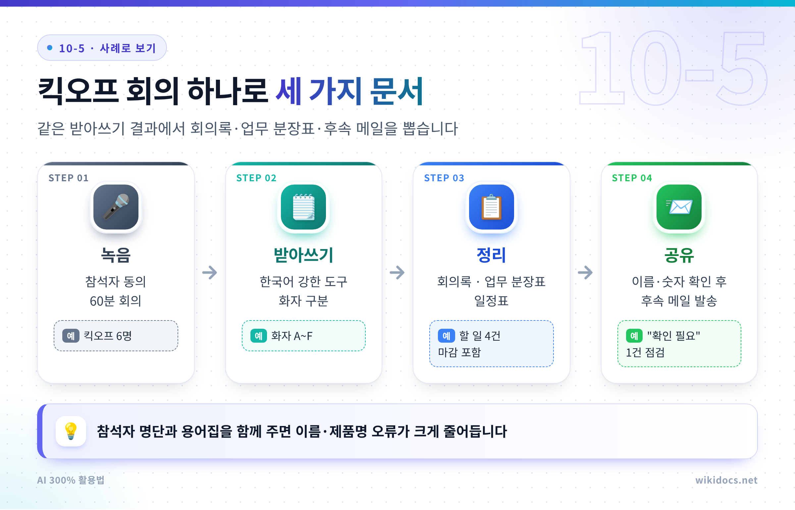

<!--
**상태**: 🔵 검토 중
**분류**: 10. 장르별 AI 도구와 활용 사례
**태그**: #도구 #회의
**작성일**: 2026-11-22
-->
> 📅 **최종 확인**: 2026-11-24

회의·받아쓰기 AI는 회의를 녹음해 **글로 받아 적고, 요약하고, 할 일까지 뽑아 줍니다.** 회의록 작성에 쓰던 시간을 크게 줄일 수 있는 가장 체감이 큰 도구 중 하나입니다.


<small>사진: [Team Meeting](https://stocksnap.io/photo/team-meeting-2R1OMUFVO5) · Startup Stock Photos · [CC0 1.0 (퍼블릭 도메인)](https://creativecommons.org/publicdomain/zero/1.0/) · Openverse 경유</small>

## 요약

- **한국어 회의**가 중심이라면 한국어 인식에 강한 국내 도구(클로바노트, 다글로, 티로 등)가 자주 추천됩니다.
- **영어 회의·화상회의 연동**이 중요하면 Otter, Fireflies 같은 해외 도구도 선택지입니다. (한국어 지원은 도구마다 확인)
- 어떤 도구든 **녹음 동의**와 **이름·숫자 확인**은 필수입니다.

## 도구 비교 (2026 국내 비교 자료 기준)

| 도구 | 자주 언급되는 강점 | 고려할 점 |
|---|---|---|
| 클로바노트 (네이버) | 한국어 받아쓰기 정확도, 무료 사용량 | 무료 사용 한도가 정해져 있음 (정책 변경 확인) |
| 다글로 | 받아쓰기 + AI 챗·번역을 아우르는 구성 | 요금제별 기능 확인 |
| 티로 | 실시간 기록 | 요금제별 기능 확인 |
| Otter.ai | 줌·팀즈·구글 미트 연동 | 한국어 공식 지원이 약하다는 평가 |
| Fireflies | 화상회의 연동, 영어 회의 | 한국어 품질 직접 시험 필요 |

> 무료 한도·지원 언어는 자주 바뀝니다. 비교표는 2026년 비교 자료를 바탕으로 했으며, 사용 전 공식 안내를 확인하세요.

## 특성 한눈에 보기

| 항목 | 회의·받아쓰기 AI |
|---|---|
| 넣는 것 | 회의·인터뷰·강의 녹음 (실시간 또는 파일) |
| 얻는 것 | 받아쓰기 원문, 요약, 결정 사항, 할 일 목록 |
| 효과가 가장 큰 일 | 회의록 작성, 인터뷰 분석, 후속 메일 |
| AI가 약한 부분 | 이름·제품명·숫자, 여러 사람이 동시에 말할 때 화자 구분 |
| 사람이 꼭 할 일 | 녹음 동의 받기, 이름·숫자·결정 사항 확인 |
| 시작 난이도 | ⭐ 쉬움 — 녹음 버튼만 누르면 시작 |

## 활용 사례

### 사례 1: 주간 회의록 자동화

```text
[회의 중] 받아쓰기 도구로 녹음 (참석자 동의)
[회의 후 5분] 받아쓰기 결과를 대화형 AI 또는 도구의 요약 기능에 넣고 아래 양식 요청

참석자: 김팀장, 박대리, 최사원 / 용어: 플랜온 = 우리 제품
1. 결정 사항  2. 할 일 | 담당자 | 마감일 | (없으면 "미정")
3. 남은 쟁점  4. 확인 필요 (받아쓰기가 불분명한 부분)

[확인] 이름·숫자·결정 사항만 원래 녹음과 대조 → 팀 채널에 공유
```

### 사례 2: 고객 인터뷰 분석

```text
고객 인터뷰 5건의 받아쓰기 결과를 넣고
1. 공통으로 나온 불편 사항 Top 5 (인터뷰 번호와 인용 문장 포함)
2. 한 번만 나왔지만 중요해 보이는 의견
3. 다음 인터뷰에서 더 물어볼 질문 5개
```

**포인트:** 인용 문장을 함께 달게 하면 AI 요약이 **실제 발언에 근거했는지** 바로 확인할 수 있습니다.

### 사례 3: 강의·세미나 학습 노트

```text
강의 받아쓰기 → "핵심 개념 10개와 설명, 시험에 나올 만한 질문 5개" 정리 → 복습
```

[[TIP("요령: 참석자 명단과 용어집 함께 주기")]]

받아쓰기는 이름·제품명·전문 용어를 자주 틀립니다. 요약을 요청할 때 **참석자 명단과 용어 목록**을 함께 주면 AI가 문맥으로 바로잡는 경우가 많습니다. (06-3)

[[/TIP]]

## 사례로 더 보기: 처음부터 끝까지

> 아래 사례의 내용·결과는 이해를 돕기 위한 **설명용 가상 예시**입니다.

### 사례 4: 프로젝트 킥오프 회의 하나로 세 가지 문서



**상황**: 신규 앱 개편 프로젝트 킥오프 회의(60분, 6명). 회의가 끝나면 회의록, 업무 분장표, 일정 공유 메일이 모두 필요합니다.

```text
[요청 예시 — 받아쓰기 결과를 넣고]
참석자: 이PM(기획), 김개발, 박디자인, 최QA, 정마케팅, 한팀장
용어: '리뉴얼 2.0' = 이번 프로젝트, '스플래시' = 앱 첫 화면

아래 받아쓰기로 세 가지를 만들어 줘.
1) 회의록: 결정 사항 / 논의 내용 / 남은 쟁점 / 확인 필요(불분명한 발언)
2) 업무 분장표: 할 일 | 담당 | 마감 | 관련 결정 (마감이 언급 안 됐으면 '미정')
3) 후속 메일: 참석자 전원에게 보내는 5줄 요약 + 분장표 첨부 안내
```

**결과 예시 1: 회의록 (일부)**

```text
■ 결정 사항
1. 리뉴얼 2.0 출시일은 2027년 2월 첫째 주로 한다. (한팀장)
2. 스플래시 화면은 3초에서 1초로 줄인다. (박디자인 제안, 전원 동의)
■ 남은 쟁점
- 기존 회원 데이터 이전 방식 (김개발이 다음 회의에 2안 준비)
■ 확인 필요
- 12:40 무렵 "예산은 ○○ 정도"라는 발언이 잘 들리지 않음 → 한팀장 확인
```

**결과 예시 2: 업무 분장표**

| 할 일 | 담당 | 마감 | 관련 결정 |
|---|---|---|---|
| 화면 설계 초안 | 박디자인 | 12/10 | 스플래시 1초 |
| 데이터 이전 방안 2안 | 김개발 | 다음 회의 | 남은 쟁점 |
| 테스트 계획서 | 최QA | 미정 | — |
| 출시 홍보 일정안 | 정마케팅 | 12/20 | 2월 첫째 주 출시 |

**포인트**: '확인 필요' 항목을 따로 달라고 하면 AI가 **잘 못 들은 부분을 지어내지 않고** 표시해 줍니다. 회의록을 공유하기 전에 이 항목만 녹음으로 확인하세요.

### 사례 5: 영업 미팅 → 고객 기록 + 후속 메일

**상황**: 영업 담당자가 고객사 미팅(30분)을 마쳤습니다. 고객 관리 시스템(CRM)에 기록하고 감사 메일을 보내야 합니다. 미팅 녹음은 고객 동의를 받았습니다.

```text
[요청 예시]
아래 미팅 받아쓰기로
1) CRM 기록용 요약: 고객 현황 / 관심 제품 / 우려 사항 / 예산·일정 언급 / 다음 단계
2) 고객 감사 메일: 오늘 논의 요약 3줄, 요청받은 자료 목록, 다음 미팅 제안 2개 일정
고객이 말하지 않은 내용은 추측하지 말고 비워 둬.
```

**결과 예시 (CRM 요약)**

| 항목 | 내용 |
|---|---|
| 고객 현황 | 직원 200명, 현재 엑셀로 근태 관리 |
| 관심 제품 | 근태 관리 앱 (모바일 출퇴근 기능) |
| 우려 사항 | 기존 데이터 이전, 현장직 직원의 앱 사용 교육 |
| 예산·일정 | 예산 언급 없음 / 내년 3월 도입 희망 |
| 다음 단계 | 데이터 이전 사례 자료 송부, 2주 내 시연 |

| 비교 | 기존 방식 | AI 활용 |
|---|---|---|
| 기록 | 기억에 의존해 나중에 작성 | 미팅 직후 받아쓰기로 정리 |
| 누락 | 우려 사항을 빠뜨리기 쉬움 | 항목별 표로 빠짐없이 |
| 메일 | 빈 화면에서 작성 | 초안 수정 후 발송 |

**주의**: 고객 개인정보·계약 금액이 들어간 녹음은 **회사가 승인한 도구**에서만 처리합니다.

## 주의할 점

- 녹음 전 **모든 참석자 동의**를 받습니다.
- 인사·평가·고객 개인정보가 오가는 민감한 회의는 외부 서비스 사용을 피하거나 회사 승인 도구만 씁니다.
- 받아쓰기 결과의 **이름·숫자·결정 사항**은 반드시 확인합니다.

## 실무 체크포인트

- [ ] 한국어 정확도를 우리 회의로 직접 시험해 봤는가
- [ ] 녹음 동의를 받았는가
- [ ] 회의록 양식을 고정해 반복 사용하는가

## 근거·출처

| 구분 | 출처 | 비고 |
|---|---|---|
| 비교 | [AI 회의록 자동 정리: 클로바노트·티로·다글로 비교 (위키독스 오픈위키, 2026)](https://wikidocs.net/blog/@openwiki/23917/) | 국내 도구 |
| 비교 | [AI 회의록 4종 비교 — 한국어로 갈린다 (2026)](https://junai.ai/blog/ai-meeting-notes-tools-comparison-2026/) | 한국어 정확도 |
| 비교 | [2026 AI 회의록 도구 추천 9선 (genape)](https://genape.ai/ko/tutorial-article/ai-generator/ai-meeting) | 기능·가격 |
| 참고 | [AI 노트 테이커 국내외 비교 (다글로 작성)](https://daglo.ai/d/ko/blog/ai-note-taker-hoeuirok-dogu-bigyo-daglo) | 판매사 작성 자료 |
| 사진 | [Team Meeting](https://stocksnap.io/photo/team-meeting-2R1OMUFVO5) (Startup Stock Photos) | CC0 1.0 (퍼블릭 도메인) |

## 관련 페이지

- 10-6. 번역 AI
- 📚 06-3. 회의 녹음 → 요약 → 할 일 정리
- 📚 04-2. 문서·회의 요약 레시피
