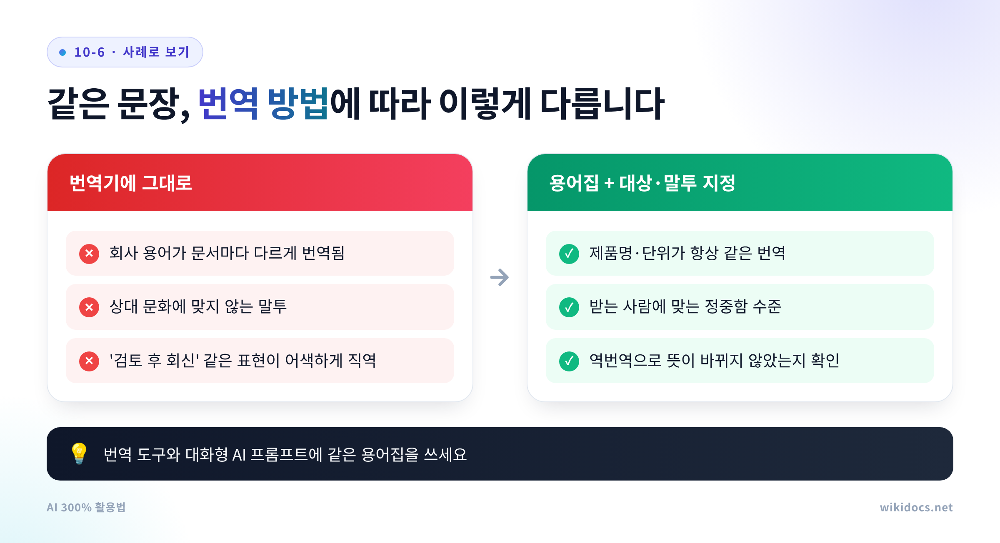

<!--
**상태**: 🔵 검토 중
**분류**: 10. 장르별 AI 도구와 활용 사례
**태그**: #도구 #번역
**작성일**: 2026-11-22
-->
> 📅 **최종 확인**: 2026-11-24

번역은 대화형 AI로도 할 수 있지만, **번역 전용 도구**는 문서 파일 번역, 용어집, 실시간 대화 번역처럼 번역에 특화된 기능을 제공합니다. 해외 메일, 계약 검토 초안, 여행·출장, 다국어 콘텐츠에 두루 쓰입니다.

## 요약

- **DeepL**: 문맥을 살린 비즈니스·기술 문서 번역, 문서 파일 번역, **용어집**(유료 요금제)
- **파파고**: 한국어 중심의 일상·여행·쇼핑 번역, 이미지 번역
- **구글 번역**: 가장 많은 언어 지원, 카메라·대화 번역
- **대화형 AI**: 말투·대상·용어를 지정한 맞춤 번역 (04-5 레시피)

## 도구 비교 (2026 비교 자료 기준)

| 도구 | 자주 언급되는 강점 | 잘 맞는 일 | 참고 |
|---|---|---|---|
| DeepL | 긴 문장 문맥, 비즈니스·기술 문서 | 보고서·메일·계약서 초벌 번역 | 용어집은 유료 요금제, 무료 사용량 한도 |
| 파파고 | 한국어 중심, 일상 표현 | 여행·쇼핑, 이미지 속 글자 번역 | — |
| 구글 번역 | 지원 언어 수가 매우 많음 | 소수 언어, 카메라·대화 번역 | 일부 실시간 기능은 국가별로 제공 시점이 다름 |
| 대화형 AI | 대상·말투·용어 지정, 설명 덧붙이기 | 뉘앙스가 중요한 글, 교정 | 숫자·고유명사 확인 필요 |

> DeepL의 품질 비교 결과는 DeepL이 직접 발표한 자료도 있으므로, 중요한 업무는 우리 문서로 직접 비교해 보세요.

## 특성 한눈에 보기

| 항목 | 번역 전용 도구 (DeepL·파파고·구글 번역) | 대화형 AI 번역 |
|---|---|---|
| 넣는 것 | 문장, 문서 파일, 사진, 음성 | 원문 + 대상·말투·용어 지시 |
| 얻는 것 | 빠른 번역, 서식 유지된 문서 | 맞춤 번역, 설명·대안 표현 |
| 효과가 가장 큰 일 | 많은 양의 초벌 번역, 현장 소통 | 뉘앙스가 중요한 메일·홍보 문구 |
| AI가 약한 부분 | 회사 고유 용어, 문화적 뉘앙스 | 긴 문서의 서식, 숫자·고유명사 |
| 사람이 꼭 할 일 | 용어집 관리, 숫자·날짜 대조 | 역번역 확인, 중요 문서 원어민 검수 |
| 시작 난이도 | ⭐ 쉬움 | ⭐ 쉬움 (지시를 잘 쓰면 품질 ↑) |

## 활용 사례

### 사례 1: 해외 거래처 메일 (번역 도구 + 대화형 AI)

```text
1. 받은 영문 메일을 번역 도구로 읽기 (빠른 이해)
2. 답장은 대화형 AI로 작성:
   "미국 거래처 구매 담당자에게 정중한 답장. 납기 1주 연장 요청, 이유는 원자재 입고 지연.
    용어: 납기=lead time, 단가=unit price"
3. 완성된 영문 답장을 다시 한국어로 번역해 뜻이 바뀌지 않았는지 확인 (역번역)
```

### 사례 2: 제품 매뉴얼 다국어 번역 (용어집 활용)

```text
1. 용어집 만들기: 제품명·기능명·단위의 공식 번역 (예: "스마트 모드" = "Smart Mode")
2. 번역 도구의 문서 번역 + 용어집 적용
3. 원어민 또는 현지 담당자 검수
4. 검수에서 고친 용어를 용어집에 추가 → 다음 번역부터 자동 반영
```

### 사례 3: 출장·현장 소통

```text
메뉴판·안내문은 카메라 번역, 대화는 음성 대화 번역
→ 계약·가격 등 중요한 내용은 번역 결과를 글로 남겨 서로 확인
```

[[TIP("요령: 용어집이 품질을 결정합니다")]]

같은 단어가 문서마다 다르게 번역되면 신뢰가 떨어집니다. 회사·제품 고유 용어는 **용어집으로 관리**하고, 번역 도구와 대화형 AI 프롬프트 양쪽에 같은 용어집을 쓰세요.

[[/TIP]]

## 사례로 더 보기: 처음부터 끝까지

> 아래 사례의 내용·결과는 이해를 돕기 위한 **설명용 가상 예시**입니다.

### 사례 4: 해외 바이어용 제안 메일 현지화



**상황**: 화장품 회사 해외영업팀이 일본 유통사 구매 담당자에게 신제품 입점 제안 메일을 보냅니다.

```text
[요청 예시 — 대화형 AI]
아래 한국어 메일을 일본 유통사 구매 담당자에게 보내는 일본어 비즈니스 메일로 바꿔 줘.
- 처음 연락하는 상대, 매우 정중한 말투(경어)
- 용어집: 수분크림 = 保湿クリーム, 입점 = 取り扱い, 단가 = 卸価格
- 직역하지 말고 일본 비즈니스 메일 관례에 맞는 인사·맺음말 사용
- 마지막에 한국어 역번역을 붙여 줘
```

**결과 예시 (직역 vs 맞춤 번역 비교 — 한국어 역번역 기준)**

| 원문 | 번역기에 그대로 | 용어집 + 대상·말투 지정 |
|---|---|---|
| 검토 후 회신 부탁드립니다 | 검토하고 답장해 주세요 | 바쁘신 중에 송구하오나, 검토해 주시면 감사하겠습니다 |
| 수분크림 입점을 제안드립니다 | 수분 크림의 입장을 제안합니다 | 보습 크림의 취급을 제안드리고자 연락드렸습니다 |
| 단가는 첨부 파일을 참고하세요 | 단가는 첨부를 보세요 | 도매가격은 첨부 자료를 확인해 주시기 바랍니다 |

```text
[확인 순서]
1. 역번역으로 뜻이 바뀌지 않았는지 확인 (특히 숫자·날짜·가격)
2. 용어집 단어가 그대로 쓰였는지 확인
3. 첫 거래 메일은 일본어가 가능한 동료나 현지 담당자에게 한 번 검토 요청
```

### 사례 5: 해외 고객 리뷰 분석 (번역 + 분류)

**상황**: 해외 쇼핑몰에 올라온 일본어·영어 리뷰 300건을 분석해 제품 개선 아이디어를 찾습니다.

```text
[요청 예시 — 대화형 AI 또는 스프레드시트 + AI]
리뷰 시트의 각 행에 다음 열을 추가해 줘.
- 한국어 번역(한 줄 요약), 감성(긍정/부정/중립), 주제(향, 용기, 배송, 가격, 효과, 기타)
그다음 주제별 건수와 부정 리뷰의 대표 의견 3개를 표로 정리해 줘.
```

**결과 예시**

| 주제 | 건수 | 부정 비율 | 대표 의견 (번역) |
|---|---:|---:|---|
| 용기 | 64 | 58% | "펌프가 끝까지 안 나온다", "뚜껑이 잘 깨진다" |
| 향 | 81 | 21% | "향이 생각보다 강하다" |
| 배송 | 47 | 40% | "포장이 찌그러져 왔다" |

**포인트**
- 번역·분류 결과 중 20건 정도를 원문과 비교해 **분류가 맞는지** 확인합니다.
- 리뷰에 작성자 이름·주소가 있으면 지우고 분석합니다.
- 이 결과를 10-1 사례 6처럼 표·차트로 만들어 보고서로 연결할 수 있습니다.

## 주의할 점

- 계약서·법률 문서는 AI 번역을 **참고용 초벌**로만 쓰고 전문가 검토를 받습니다.
- 숫자·날짜·금액·단위는 번역 후 원문과 대조합니다.
- 회사 기밀 문서는 회사에서 허용한 번역 서비스(기업용 요금제 등)만 사용합니다.

## 실무 체크포인트

- [ ] 문서 성격에 맞는 번역 도구를 골랐는가
- [ ] 고유 용어를 용어집으로 관리하는가
- [ ] 중요한 문서는 역번역·원어민 검수를 했는가

## 근거·출처

| 구분 | 출처 | 비고 |
|---|---|---|
| 비교 | [DeepL·파파고·구글 번역 비교 (위키독스 오픈위키)](https://wikidocs.net/blog/@openwiki/24603/) | 2026 비교 |
| 리뷰 | [DeepL Translator Review (Smart Tech Note)](https://smarttechnote.com/deepl-translator-review/) | 지원 언어·무료 한도 |
| 공식 | [DeepL 용어집 (DeepL Academy)](https://www.deepl.com/ko/academy/glossary) | 용어집 기능 |
| 공식 | [DeepL 번역 품질 (DeepL 발표)](https://www.deepl.com/ko/quality) | 자사 발표 자료 |

## 관련 페이지

- 10-5. 회의·받아쓰기 AI
- 📚 04-5. 번역·교정 레시피
