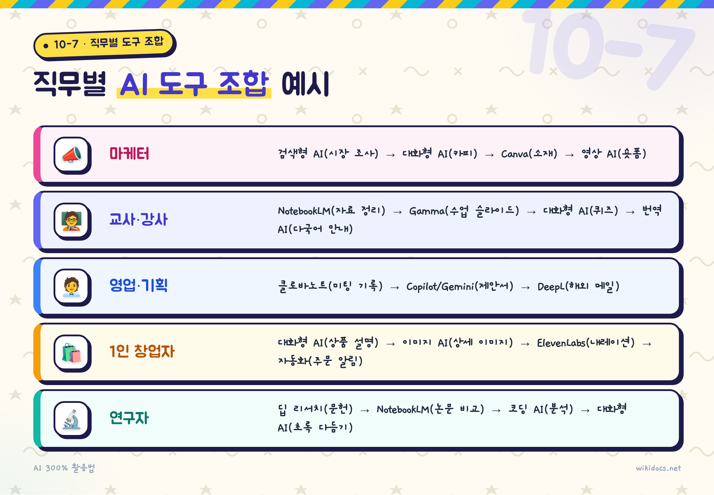
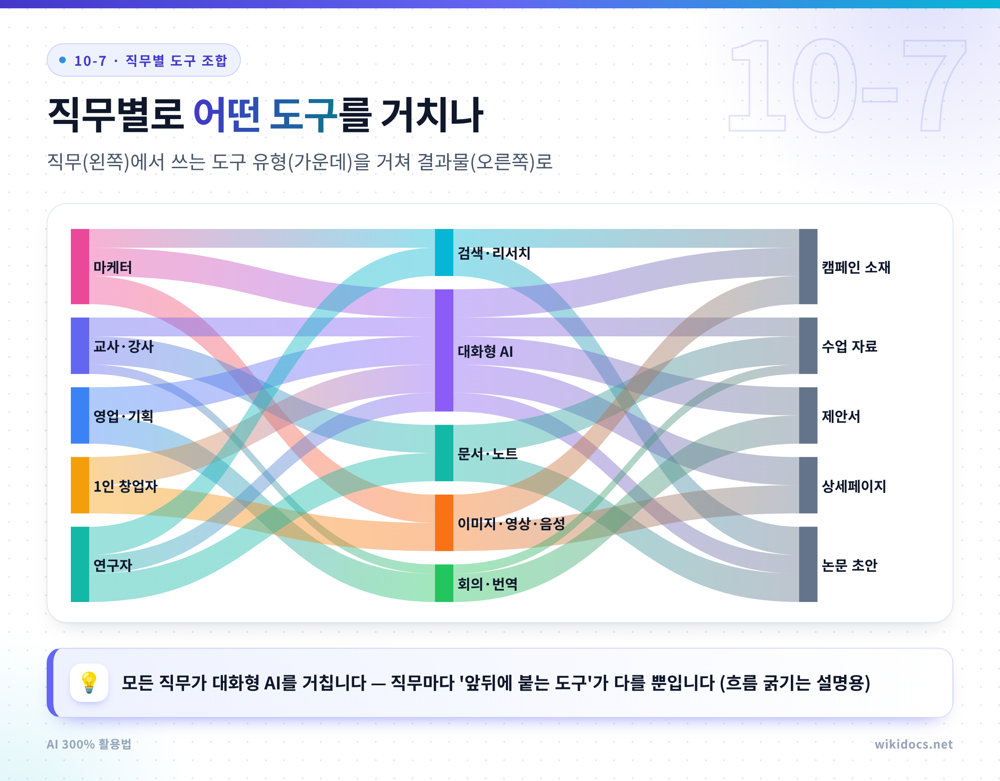

<!--
**상태**: 🔵 검토 중
**분류**: 10. 장르별 AI 도구와 활용 사례
**태그**: #사례 #워크플로
**작성일**: 2026-11-22
-->
> 📅 **최종 확인**: 2026-11-24

장르별 도구는 하나만 쓸 때보다 **여러 개를 이어 붙일 때** 효과가 커집니다. 이 페이지는 다섯 가지 직무의 실제 업무 흐름에 맞춰 도구를 어떻게 조합하는지 사례로 보여 줍니다. 내 직무와 가장 가까운 사례를 골라 따라 해 보세요.

## 요약

- 모든 조합은 **찾기 → 정리 → 만들기 → 확인** 흐름을 따릅니다.
- 각 단계의 결과를 **파일로 저장**해 다음 도구로 넘깁니다. (06-1)
- 마지막 확인(숫자·이름·권리)은 언제나 사람이 합니다.

## 직무별 조합 한눈에 보기





## 사례 1: 마케터 — 신제품 출시 캠페인

| 단계 | 도구 유형 | 할 일 |
|---|---|---|
| 1. 조사 | 검색형 AI | 경쟁 제품·고객 반응 조사 (출처 링크 확인) |
| 2. 메시지 | 대화형 AI | 타깃별 핵심 메시지 3안, 광고 문구 10개 |
| 3. 소재 | Canva·이미지 AI | 카드뉴스 5장, 배너 시안 |
| 4. 영상 | 영상 AI | 15초 숏폼 장면 3개 (10-3) |
| 5. 확인 | 사람 | 과장 표현·상표·이미지 권리 점검 (08-2) |

```text
[2단계 프롬프트 예시]
20~30대 직장인을 위한 친환경 텀블러 출시 캠페인.
핵심 메시지를 "편리함 / 환경 / 디자인" 관점에서 1개씩,
각 메시지에 맞는 SNS 광고 문구 3개(20자 이내)를 써 줘.
```

## 사례 2: 교사·강사 — 수업 준비

| 단계 | 도구 유형 | 할 일 |
|---|---|---|
| 1. 자료 정리 | 문서·노트 AI | 교과서·참고 자료를 올려 핵심 개념 정리 (05-3) |
| 2. 슬라이드 | 프레젠테이션 AI | 수업 슬라이드 초안 (10-2) |
| 3. 활동 | 대화형 AI | 수준별 퀴즈, 토론 질문 |
| 4. 안내 | 번역 AI | 다문화 가정 학부모용 다국어 안내문 (10-6) |
| 5. 확인 | 사람 | 내용 정확성, 학생 개인정보 미포함 확인 |

## 사례 3: 영업·기획 — 고객 미팅에서 제안서까지

| 단계 | 도구 유형 | 할 일 |
|---|---|---|
| 1. 미팅 기록 | 회의·받아쓰기 AI | 고객 미팅 녹음·요약 (동의) (10-5) |
| 2. 요구사항 | 대화형 AI | 고객 요구사항·우려 사항 표로 정리 |
| 3. 제안서 | 오피스 AI | 회사 양식에 맞춘 제안서 초안 (10-1) |
| 4. 해외 고객 | 번역 AI | 영문 제안 메일 (용어집) |
| 5. 확인 | 사람 | 가격·일정·약속 사항 확인 |

## 사례 4: 1인 창업자 — 온라인 쇼핑몰 운영

| 단계 | 도구 유형 | 할 일 |
|---|---|---|
| 1. 상품 설명 | 대화형 AI | 상세페이지 문구, 자주 묻는 질문 |
| 2. 상세 이미지 | 이미지 AI·Canva | 사용 장면 이미지, 배너 |
| 3. 소개 영상 | 영상·음성 AI | 30초 소개 영상 + 내레이션 (10-3, 10-4) |
| 4. 운영 자동화 | 업무 자동화 도구 | 주문 접수 → 알림, 문의 분류 (05-6) |
| 5. 확인 | 사람 | 상품 정보 정확성, 이미지·음악 상업 이용 권리 |

## 사례 5: 연구자 — 문헌 조사에서 논문 초안까지

| 단계 | 도구 유형 | 할 일 |
|---|---|---|
| 1. 문헌 찾기 | 딥 리서치 | 관련 연구 목록과 요약 (링크·인용 직접 확인) |
| 2. 논문 비교 | 문서·노트 AI | 논문 PDF를 올려 방법·결과 비교표 |
| 3. 분석 | 코딩 AI | 데이터 분석 코드 작성·실행 (05-4) |
| 4. 글쓰기 | 대화형 AI | 초록·서론 문장 다듬기, 영어 교정 |
| 5. 확인 | 사람 | 인용 정확성, 연구 윤리·학술지 AI 사용 규정 확인 |

[[TIP("나만의 조합 만들기")]]

1. 이번 주 가장 시간이 많이 든 업무 하나를 고릅니다.
2. 그 업무를 **찾기 → 정리 → 만들기 → 확인** 4단계로 나눕니다.
3. 단계마다 10장의 장르별 도구 중 하나를 붙여 봅니다.
4. 1주일 써 보고, 시간이 줄어든 조합만 남깁니다.

[[/TIP]]

## 실무 체크포인트

- [ ] 내 업무를 4단계로 나눠 봤는가
- [ ] 단계마다 알맞은 도구 유형을 붙였는가
- [ ] 마지막 확인 단계를 사람이 맡았는가
- [ ] 효과가 확인된 조합을 기록해 재사용하는가

## 관련 페이지

- 10-1. 문서·오피스 AI
- 📚 06-1. 리서치 → 정리 → 발행
- 📚 05-7. 목적별 도구 고르기
- 📚 08-3. 결과 검증 체크리스트
