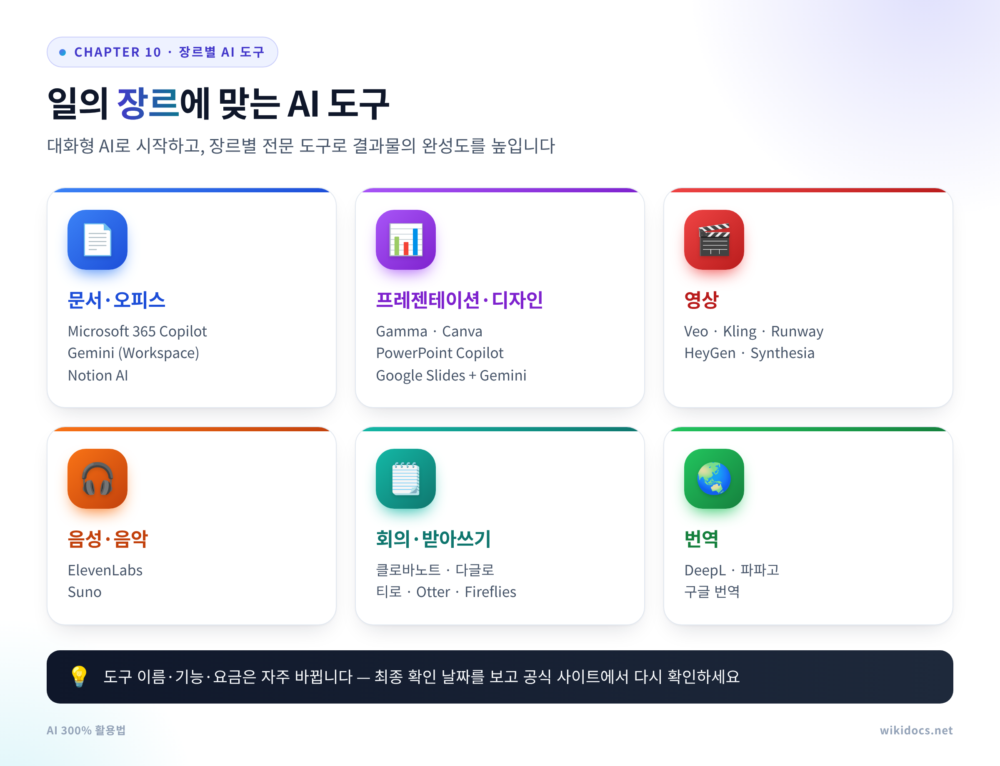

문서·발표·영상·음성·회의·번역 등 장르별 AI 도구의 특징과, 도구를 조합해 일하는 직무별 사례를 다룹니다.

[[TIP("이 장을 읽고 나면")]]

- 장르별(문서·발표·영상·음성·회의·번역) AI 도구의 특징과 고르는 기준을 압니다.
- 장르별로 바로 따라 할 수 있는 활용 사례와 프롬프트를 얻습니다.
- 내 직무에 맞게 여러 도구를 조합하는 방법을 설계할 수 있습니다.

[[/TIP]]

## 이 장의 구성

[[SubPages]]
