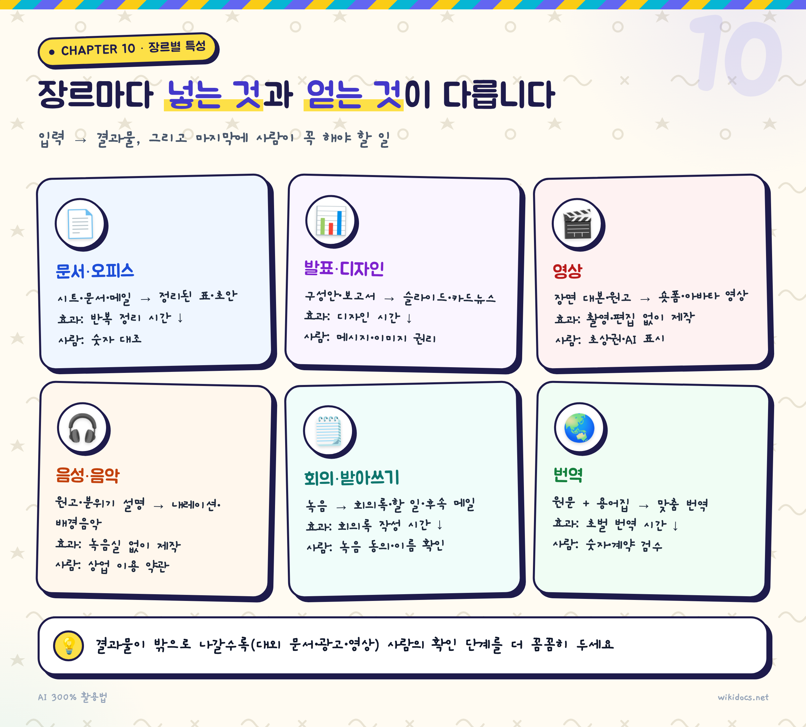
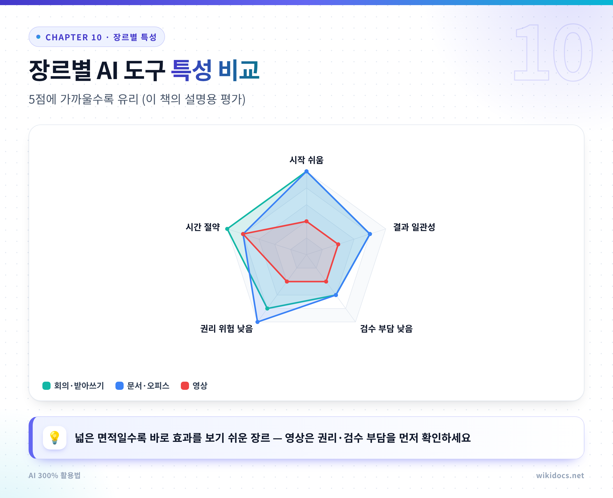

문서·발표·영상·음성·회의·번역 등 장르별 AI 도구의 특징과, 도구를 조합해 일하는 직무별 사례를 다룹니다.

[[TIP("이 장을 읽고 나면")]]

- 장르별(문서·발표·영상·음성·회의·번역) AI 도구의 특징과 고르는 기준을 압니다.
- 장르별로 바로 따라 할 수 있는 활용 사례와 프롬프트를 얻습니다.
- 내 직무에 맞게 여러 도구를 조합하는 방법을 설계할 수 있습니다.

[[/TIP]]

## 장르별 특성 한눈에 보기

| 장르 | 넣는 것 | 얻는 것 | 효과가 큰 일 | 사람이 꼭 확인할 것 | 주요 위험 | 시작 난이도 |
|---|---|---|---|---|---|:---:|
| 📄 문서·오피스 (10-1) | 시트·문서·메일 | 정리된 표, 초안, 요약 | 매달 반복하는 정리·보고 | 숫자 원본 대조 | 계산 실수, 권한 밖 문서 노출 | ⭐ |
| 📊 발표·디자인 (10-2) | 구성안·보고서 | 슬라이드, 카드뉴스 | 디자인·레이아웃 | 메시지, 이미지 권리 | 지어낸 숫자, 소재 저작권 | ⭐⭐ |
| 🎬 영상 (10-3) | 장면 대본·원고 | 숏폼, 아바타 영상 | 촬영이 어려운 장면, 교육 영상 | 초상권, AI 생성 표시 | 딥페이크, 과장 광고 | ⭐⭐~⭐⭐⭐ |
| 🎧 음성·음악 (10-4) | 원고, 분위기 설명 | 내레이션, 배경 음악 | 녹음 없이 오디오 제작 | 발음, 상업 이용 약관 | 목소리 도용, 권리 분쟁 | ⭐~⭐⭐ |
| 🗒️ 회의·받아쓰기 (10-5) | 녹음 | 회의록, 할 일, 후속 메일 | 회의록·인터뷰 정리 | 녹음 동의, 이름·숫자 | 민감 정보 외부 전송 | ⭐ |
| 🌏 번역 (10-6) | 원문 + 용어집 | 맞춤 번역 | 초벌 번역, 해외 메일 | 숫자·계약 내용 검수 | 오역으로 인한 계약 문제 | ⭐ |

## 이 장의 사례 미리 보기

각 페이지에는 기본 활용 사례에 더해, 상황 → 진행 흐름(그림) → 프롬프트 → **결과 예시** → 기존 방식과 비교 순서로 따라가는 **'사례로 더 보기'**가 들어 있습니다.

| 페이지 | 대표 사례 | 결과 예시 |
|---|---|---|
| 10-1 문서·오피스 | 월간 실적 보고(엑셀 → 메일), 규정 두 버전 비교, 설문 정리 | 증감률 표, 조항 비교표, 주제별 의견 표 |
| 10-2 발표·디자인 | 신입사원 온보딩 발표, 성과 인포그래픽, 대상별 3가지 버전 | 결론형 구성안, 숫자 카드, 대상별 첫 장 제목 |
| 10-3 영상 | 앱 사용법 안내 영상, 매장 숏폼 3가지 버전 | 장면 대본표, 버전별 프롬프트 |
| 10-4 음성·음악 | 소식지 → 5분 오디오 브리핑, 채널 음악 세트 | 읽는 글 → 듣는 글 비교, 용도별 음악 요청 |
| 10-5 회의·받아쓰기 | 킥오프 회의 → 문서 3종, 영업 미팅 → CRM 기록 | 회의록, 업무 분장표, 고객 기록 표 |
| 10-6 번역 | 일본 바이어 제안 메일, 해외 리뷰 분석 | 직역 vs 맞춤 번역 비교, 주제별 리뷰 표 |
| 10-7 직무별 조합 | 마케터·교사·영업·창업자·연구자 | 직무별 도구 조합표 |

[[TIP("어디서부터 시작할까")]]

시작 난이도 ⭐인 **회의·받아쓰기 → 문서·오피스 → 번역** 순서로 먼저 써 보세요. 매주 하는 일이라 효과를 빨리 느낄 수 있습니다. 영상·음악은 권리 확인이 필요하므로 회사 규정을 확인한 뒤 시작합니다.

[[/TIP]]

## 이 장의 구성

[[SubPages]]
