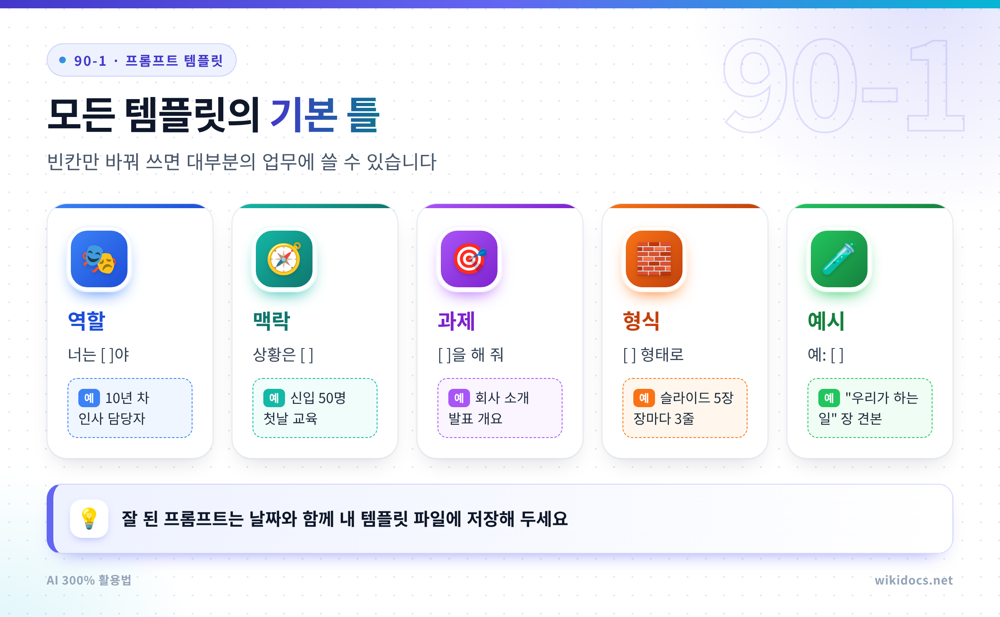

<!--
**상태**: 🔵 검토 중
**분류**: 90. 부록
**태그**: #부록
**작성일**: 2026-11-22
-->
> 📅 **최종 확인**: 2026-11-24

이 책에서 다룬 프롬프트 중 가장 자주 쓰는 것을 모았습니다. **빈칸(______)만 채워서** 바로 쓰세요. 자세한 설명은 각 템플릿 옆의 페이지에 있습니다.

[TOC]

## 요약

- 템플릿 10개: 기본 5요소, 이메일, 요약, 회의록, 아이디어, 분석, 번역, 검토, 사실 확인, 학습
- 자주 쓰는 템플릿은 대화형 AI의 **프로젝트 지침**이나 메모장에 저장해 두세요.



## 1. 기본 5요소 (02-1)

```text
[역할] 너는 ______(직무·경력)야.
[맥락] ______(상황, 대상 독자, 목적, 제약)
[과제] ______(해 줄 일, 여러 개면 번호)
[형식] ______(표/목록/분량/문체)
[예시] ______(원하는 결과의 견본, 선택)
```

## 2. 까다로운 이메일 (04-1)

```text
받는 사람: ______ / 관계: ______ / 상황: ______
______ 내용의 이메일을 써 줘. 제목 1줄 + 본문 5~7문장.
첫 문장에 용건, 마지막에 다음 행동 제안. 꼭 넣을 것: ______
버전 2개: (1) 부드럽게 (2) 간결하게
```

## 3. 독자 맞춤 요약 (04-2)

```text
아래 문서를 ______(읽을 사람)를 위해 ______(분량)로 요약해 줘.
결론 먼저, 숫자 중심. 문서에 없는 내용은 쓰지 마.
<문서>
______
</문서>
```

## 4. 회의록 (04-2, 06-3)

```text
아래 회의 메모를 정리해 줘. 참석자: ______ / 용어: ______
1. 목적 2. 결정 사항 3. 할 일 | 할 일 | 담당자 | 마감일 | (없으면 "미정")
4. 남은 쟁점 5. 확인 필요 (불분명한 부분)
<메모>
______
</메모>
```

## 5. 아이디어 발산 → 수렴 (04-3)

```text
[맥락] 우리는 ______, 목표는 ______. 대상: ______ / 예산: ______
목표를 이룰 아이디어 20개 (평범한 것 10, 과감한 것 10)를 한 줄 설명과 함께.
이어서 효과·비용·난이도·차별성 1~5점 평가표와 상위 3개 실행 계획.
```

## 6. 데이터 분석 (04-4)

```text
첨부 파일은 ______ 데이터, 열의 뜻: ______, 분석 목적: ______
1. 데이터 점검 결과를 먼저 보여 주고 나에게 확인받기
2. 목적에 맞는 분석 3가지 제안 → 내가 고른 것 실행 (계산은 코드로)
3. 핵심 발견 3가지(숫자 포함) + 차트 1개. 해석은 "추정" 표시
```

## 7. 번역 (04-5)

```text
아래 글을 ______(언어)로 번역해 줘. 읽는 사람: ______ / 말투: ______
용어집: ______ = ______
직역이 어색한 곳은 자연스럽게 바꾸고, 바꾼 곳은 따로 설명해 줘.
```

## 8. 검토 (03-4)

```text
아래 글을 ______ 입장에서 검토해 줘.
기준: ① ______ ② ______ ③ ______
기준별 ○/△/× 평가 → △·×만 고친 수정본.
```

## 9. 사실 확인 대상 뽑기 (01-3, 08-3)

```text
아래 글에서 사실 확인이 필요한 문장을 모두 골라 표로 정리해 줘.
| 문장 | 확인할 내용 | 확신 정도(높음/중간/낮음) | 확인 방법 |
```

## 10. 학습 지도 (04-7)

```text
나는 ______(수준)이고 ______을 배워야 해. 목표: ______ / 하루 ______분
1. 핵심 개념 10개 (배우는 순서, 한 줄 설명)
2. 날짜별 학습 계획 표
3. 처음 배우는 사람이 가장 헷갈리는 3가지
```

[[TIP("요령: 나만의 템플릿으로 고쳐 쓰기")]]

이 템플릿은 출발점입니다. 몇 번 써 보면서 **내 업무에 맞게 고친 버전**을 저장해 두세요. 잘 된 결과가 나온 프롬프트는 날짜와 함께 기록하면 나만의 레시피북이 됩니다.

[[/TIP]]

## 관련 페이지

- 90-2. AI 도구 비교표
- 90-3. 용어집
- 📚 04장 업무별 프롬프트 레시피
