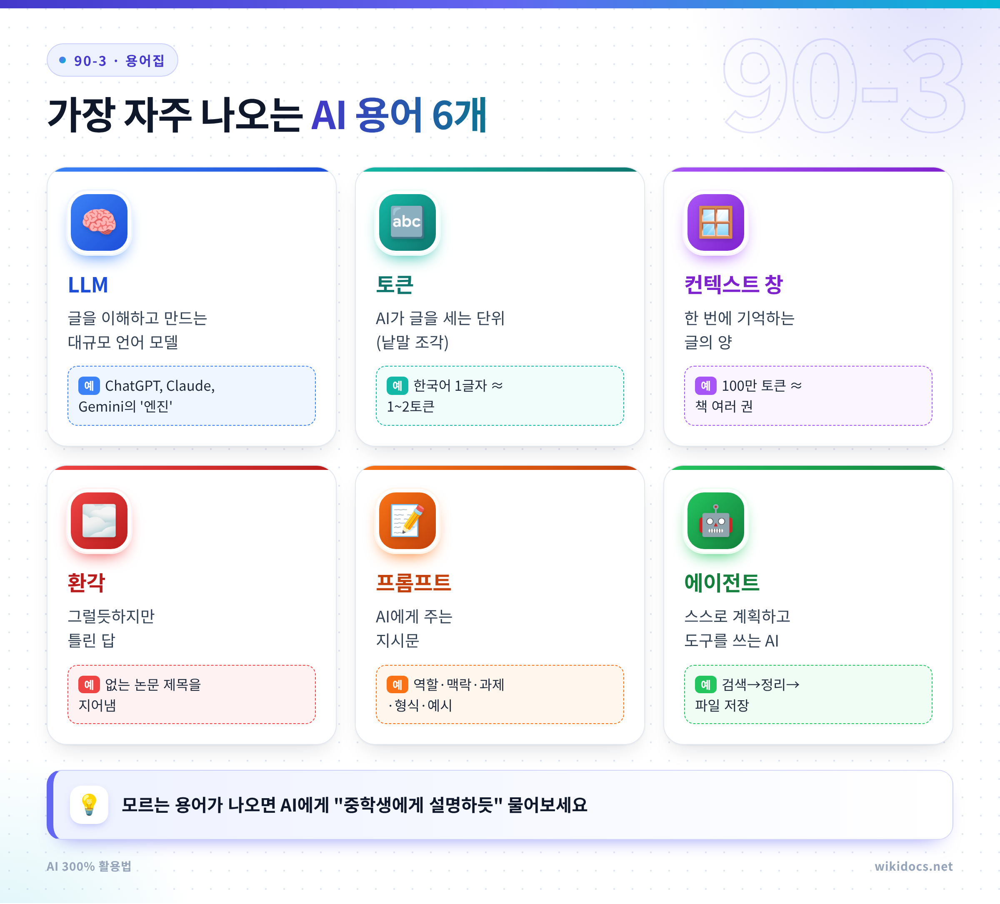

<!--
**상태**: 🔵 검토 중
**분류**: 90. 부록
**태그**: #부록
**작성일**: 2026-11-22
-->
> 📅 **최종 확인**: 2026-11-24

이 책에 나오는 용어를 가나다순으로 정리했습니다. 옆의 페이지 번호에서 자세한 설명을 볼 수 있습니다.

## 용어

| 용어 | 뜻 | 페이지 |
|---|---|---|
| 검색 증강 생성 (RAG) | 답하기 전에 관련 자료를 찾아 AI에게 주는 방법 | 05-2 |
| 구조화된 출력 | 표·JSON처럼 정해진 형식으로 받는 답 | 03-6 |
| 대화형 AI | 질문하고 지시하면 답하는 AI 서비스 | 05-1 |
| 딥 리서치 | 여러 자료를 찾아 읽고 보고서로 정리하는 기능 | 05-2 |
| 메모리 | 사용자의 정보·선호를 기억하는 기능 | 05-1 |
| 멀티모달 | 글·이미지·음성 등 여러 형태를 함께 다루는 것 | 09-2 |
| 모델 (LLM) | AI 서비스 안에서 실제로 답을 만드는 언어 모델 | 01-1 |
| 사전 학습 | 방대한 글로 언어 패턴을 익히는 첫 학습 단계 | 01-1 |
| 에이전트 | 목표를 받아 스스로 계획하고 도구를 쓰며 일하는 AI | 07-1 |
| 오픈 모델 | 직접 내려받아 설치할 수 있는 모델 | 09-2 |
| 워크플로 | 여러 단계·도구를 이어 붙인 작업 흐름 | 06-1 |
| 자동화 (트리거·액션) | 정해진 사건(트리거)이 생기면 일(액션)을 자동 실행 | 05-6 |
| 추론 모델 | 답하기 전에 오래 생각하는 모델 | 09-2 |
| 컨텍스트 창 | AI가 한 번에 읽을 수 있는 글의 최대 분량 | 01-1 |
| 토큰 | AI가 글을 다루는 작은 조각 단위 | 01-1 |
| 퓨샷 (Few-shot) | 예시 몇 개를 보여 주고 따라 하게 하는 방법 | 03-2 |
| 프로젝트 | 자료와 지시를 모아 둔 대화형 AI의 작업 공간 | 05-1 |
| 프롬프트 | AI에게 주는 요청문 | 02-1 |
| 프롬프트 체이닝 | 큰 일을 단계로 나눠 결과를 이어 붙이는 방법 | 03-5 |
| 학습 기준 시점 | 학습 자료가 수집된 마지막 시점 | 01-1 |
| 환각 | AI가 사실이 아닌 내용을 사실처럼 말하는 현상 | 01-3 |
| JSON | 프로그램이 읽기 쉬운 데이터 형식 | 03-6 |
| MCP | AI 앱과 외부 도구·데이터를 잇는 개방형 표준 | 07-2 |

## 관련 페이지

- 90-1. 프롬프트 템플릿 모음
- 90-2. AI 도구 비교표
